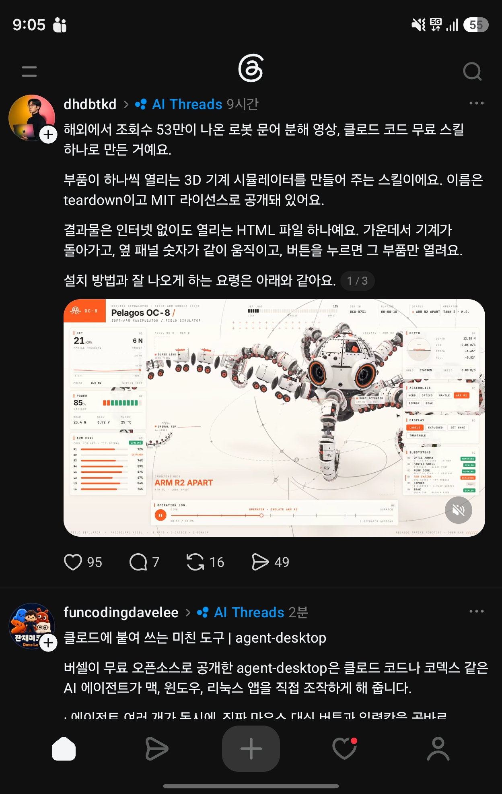
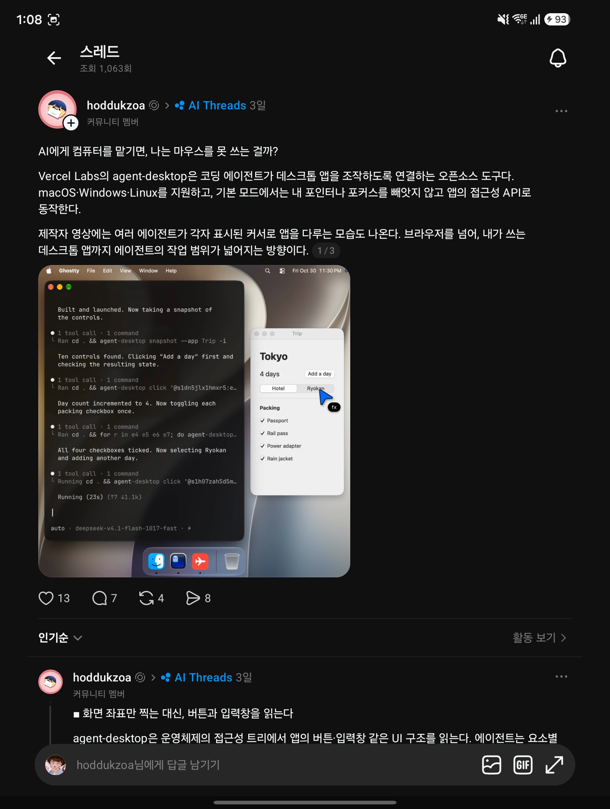
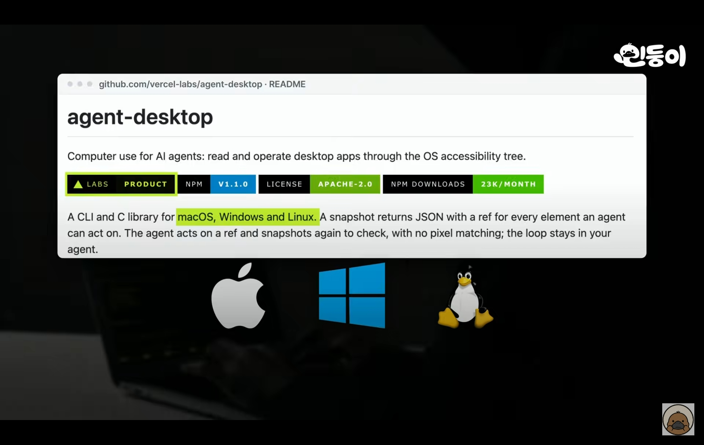

## 한눈에 보기

- Claude Code나 Codex 같은 에이전트가 **데스크톱 앱을 보고 조작**하게 해 주는 명령줄 도구입니다. Vercel Labs가 만들었습니다.
- 화면 캡처나 픽셀 맞추기를 쓰지 않습니다. 앱의 접근성 트리를 JSON으로 돌려주고, 조작할 수 있는 요소마다 참조 번호(ref)를 붙입니다. 에이전트는 ref를 누르거나 입력하고, 다시 읽어 결과를 확인합니다. 도구 안에 모델은 없고, 반복 판단은 에이전트 쪽에서 합니다.
- 공개 시기는 저장소 생성일인 2026-02-19를 기준으로 적었습니다. 첫 릴리스 v0.1.2와 npm 패키지 첫 게시는 2026-02-23입니다. 2026-11-11 조회 기준 별 21,713개, 포크 1,613개, 최신 릴리스 v1.2.0(2026-11-05)입니다.


## 핵심 내용

### 동작 방식

```bash
agent-desktop snapshot --app Finder -i      # 조작할 수 있는 요소와 ref 목록
agent-desktop click @s8f3k2p9:e8            # 그 스냅샷의 ref를 누름
agent-desktop snapshot --app Finder -i      # 다시 읽어 확인
```

- 명령마다 JSON 한 덩어리를 돌려줍니다.
- **ref는 그 스냅샷에만 속합니다.** 화면이 바뀌면 `STALE_REF`나 `AMBIGUOUS_TARGET` 오류가 나고, 새로 스냅샷을 찍어야 합니다.
- **기본은 화면을 건드리지 않습니다(headless).** 접근성 API로 동작해서 마우스 포인터를 움직이거나 포커스를 가져가지 않습니다. 실제 입력이 필요하면 `--headed`를 붙입니다.
- 요소가 많은 앱은 `--skeleton`으로 뼈대만 먼저 보고 한 영역을 골라 자세히 봅니다.
- 실패한 명령은 `error.disposition.retry`가 `safe`일 때만 다시 시도하라고 안내합니다.

### 지원 환경

| 운영체제 | 조건 | 쓰는 접근성 API |
|---|---|---|
| macOS | 13 이상, Intel·Apple Silicon | AX API |
| Windows | 10 1809 이상, x64·ARM64 | UI Automation |
| Linux | Ubuntu 24.04 이상, X11·Wayland | AT-SPI |

### 명령

README 기준 명령 이름은 61개이고 그중 57개가 동작합니다(키·마우스 버튼을 누른 채 두는 4개는 아직 실행을 거부). 묶음은 다음과 같습니다.

- 보기: `snapshot`, `find`, `get`, `screenshot` 등
- ref 조작: `click`, `type`, `set-value`, `select`, `toggle`, `scroll` 등
- 키보드·마우스: `press`, `hover`, `drag`, `mouse-move` 등
- 앱·창: `launch`, `close-app`, `list-windows`, `focus-window`, `resize-window` 등
- 그 밖: 알림, 클립보드, `wait`, 세션·기록(`trace`), 샌드박스, `batch`

### 에이전트에 붙이는 법

- **스킬**: `npx skills add https://github.com/vercel-labs/agent-desktop --skill agent-desktop`
- **AGENTS.md에 한 줄**: 처음 쓰기 전에 `agent-desktop skills get desktop`과 `skills get platform`을 실행해 따르라고 적어 둡니다. 안내서가 실행 파일 안에 버전에 맞게 들어 있습니다.
- **MCP**: `agent-desktop mcp`가 모든 명령을 MCP 도구로 내놓습니다(`desktop_snapshot`, `desktop_click` 등).

```json
{ "mcpServers": { "agent-desktop": { "command": "agent-desktop", "args": ["mcp"] } } }
```

- **C 라이브러리**: 릴리스마다 `libagent_desktop_ffi`가 함께 나와 프로그램 안에서 직접 부를 수 있습니다.

## 써 보려면

```bash
npm install -g agent-desktop
agent-desktop status                # 플랫폼, 권한, 지원 범위 확인
agent-desktop permissions --guide   # macOS: 접근성 권한 안내
```

- Bun, Yarn, pnpm으로도 설치됩니다. macOS와 Linux는 `brew install agent-desktop`도 됩니다. Windows용 공식 Scoop 패키지는 아직 없습니다.
- PowerShell에서는 ref를 반드시 따옴표로 감쌉니다(`'@s8f3k2p9:e8'`). 따옴표 없는 `@`는 PowerShell 문법으로 해석됩니다.
- 라이선스는 Apache-2.0입니다.

## 눈여겨볼 점

- README의 경고: 스냅샷, 클립보드, 화면 캡처, 명령 출력에는 **개인적인 화면 내용이 들어갈 수 있으니** 공개 로그나 업로드에 넣지 말라고 합니다. 비밀번호 같은 입력은 `--stdin`으로 넘겨 명령 인자에 남지 않게 하라고 안내합니다.
- 접근성 트리에 기대므로, 접근성 정보를 제대로 내놓지 않는 앱에서는 얼마나 되는지 README만으로는 알 수 없습니다. 확인 못 함.
- 캡처 속 글은 "에이전트 여러 개가 동시에, 진짜 마우스 대신 버튼과 입력칸을 곧바로…"까지만 보이고 뒤가 잘렸습니다. 포인터를 움직이지 않는다는 점은 README와 맞지만, 여러 에이전트 동시 사용에 대한 설명은 README에서 세션·샌드박스 명령이 있다는 것까지만 확인했습니다.
- 공식 문서 주소가 `agent-browser.dev/desktop`인 것으로 보아 같은 곳의 브라우저용 도구와 문서 사이트를 함께 씁니다. 두 도구의 관계는 자세히 확인하지 않았습니다.
- 실제 설치와 동작은 직접 확인하지 않았습니다.

## 받은 캡처



캡처 2026-11-01. 아래쪽 글(funcodingdavelee)이 이 문서의 출발점입니다. 위쪽 글은 [teardown](teardown.md) 문서로 따로 정리했습니다.



캡처 2026-11-03. 글쓴이(hoddukzoa)는 제작자 영상에 여러 에이전트가 각자 표시된 커서로 앱을 다루는 모습이 나온다고 적었습니다. README 명령 표에 `cursor-overlay`가 있다는 것까지만 확인했고, 그 영상은 확인하지 못했습니다.



캡처 2026-11-04. 화면 속 README 배지는 npm v1.1.0인데, 다음 날(11-05) v1.2.0이 나왔습니다.

## 출처

- [vercel-labs/agent-desktop README](https://github.com/vercel-labs/agent-desktop) — 동작 방식, 설치, 명령, 지원 환경, MCP, 라이선스
- [GitHub 저장소 API 정보](https://api.github.com/repos/vercel-labs/agent-desktop) — 생성일, 별·포크 수, 최신 릴리스 (2026-11-11 조회)
- [agent-browser.dev/desktop](https://agent-browser.dev/desktop), [skills.sh 페이지](https://skills.sh/vercel-labs/agent-desktop/agent-desktop) — 주소가 열리는 것만 확인
- [GitHub 릴리스 목록](https://github.com/vercel-labs/agent-desktop/releases), [npm 패키지 정보](https://www.npmjs.com/package/agent-desktop) — 첫 릴리스·첫 게시 날짜 (2026-11-11 조회)
- YouTube 영상 화면(캡처 2026-11-04) — 영상 주소는 캡처에 보이지 않음
- Threads 글(funcodingdavelee, 캡처 2026-11-01) — 처음 알게 된 곳. 원문 주소는 캡처에 보이지 않음
