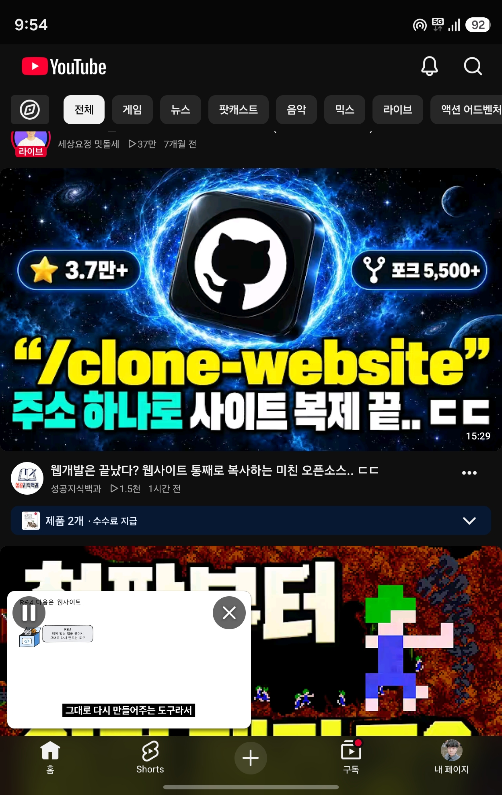

## 한눈에 보기

- 저장소를 내 프로젝트로 복사한 뒤 에이전트에서 `/clone-website https://example.com`을 실행하면, 에이전트가 그 사이트를 깔끔한 **Next.js 앱**으로 다시 만듭니다. 만든 사람은 GitHub 사용자 JCodesMore입니다.
- 캡처에는 저장소 이름이 보이지 않고 `/clone-website`와 "별 3.7만+, 포크 5,500+"만 보입니다. 같은 명령 이름을 쓰고 수치가 비슷한 이 저장소로 특정했습니다(2026-11-11 조회: 별 38,993개, 포크 5,797개). 영상이 실제로 이 저장소를 다뤘는지는 영상을 보지 않아 확인 못 함.
- 공개 시기는 저장소 생성일인 2026-03-13을 기준으로 적었습니다. 최신 릴리스는 v0.6.1(2026-10-05), 마지막 커밋은 2026-11-10입니다.

## 핵심 내용

### `/clone-website` 스킬의 네 단계 (README)

1. **Map** — 원본 주소들을 로컬 경로에 대응시킵니다. 이미 해 둔 작업은 보존합니다.
2. **Observe** — 데스크톱·모바일 화면을 살펴보고, 실제 그림과 글꼴을 뽑고, 다른 상태(펼침, 호버 등)도 눌러 봅니다.
3. **Build** — 고칠 수 있는 컴포넌트와 동작하는 상호작용을 구현합니다. 서로 독립된 구역은 다른 에이전트에 나눠 맡기기도 합니다.
4. **Compare** — 같은 크기·같은 상태에서 원본과 로컬 화면을 비교해 눈에 보이는 차이를 고치고, 빌드 검사를 돌립니다.

끝나면 경로 대응표, 실행 방법, 비교 화면, 남은 차이 목록을 남깁니다. Framer로 만든 페이지와 애니메이션이 많은 사이트를 위한 살펴보기 지침이 따로 있습니다.

### 기술 구성

- Next.js 16(App Router, React 19, TypeScript strict)
- shadcn/ui, Tailwind CSS v4
- Lucide React(기본 아이콘. 복제 중에 원본에서 뽑은 SVG로 바뀜)

### 지원 에이전트

| 에이전트 | 상태 |
|---|---|
| Claude Code | 권장 (README는 Opus 5.5에서 결과가 가장 좋다고 함) |
| Codex CLI, OpenCode, Cursor | 지원 |

스킬 원본은 `.agents/skills/clone-website/` 한 곳에 있고 Codex·Cursor·OpenCode가 직접 읽습니다. Claude Code는 `.claude/commands/clone-website.md`라는 얇은 연결 파일로 같은 스킬을 부릅니다.

### README가 말하는 쓸 곳

- 내 사이트를 WordPress·Webflow·Squarespace에서 Next.js로 옮길 때
- 사이트는 살아 있는데 소스가 없어졌거나 담당 개발자가 떠났을 때
- 실제 사이트의 레이아웃·애니메이션·반응형 구현을 뜯어보며 배울 때

## 써 보려면

- 필요한 것: Node.js 24 이상, 브라우저를 쓸 수 있는 코딩 에이전트
- 가장 쉬운 방법은 에이전트에게 저장소 주소를 주고 "새 폴더에 독립 프로젝트로 설치하고 `npm run check`까지 돌려 달라"고 하는 것입니다. GitHub의 "Use this template" 버튼으로 내 저장소를 만들어도 됩니다.
- 그다음 프로젝트를 에이전트로 열고 `/clone-website 주소`를 실행합니다.
- 명령: `npm run dev`(개발 서버), `npm run check`(lint + 타입 검사 + 빌드). Docker Compose 설정도 있습니다.
- 라이선스는 MIT입니다.

## 눈여겨볼 점

- **쓰면 안 되는 곳을 README가 명시합니다.** 피싱이나 사칭, 남의 디자인을 내 것처럼 내놓는 일(로고·브랜드 자산·원문은 원 주인 것), 수집이나 복제를 금지한 사이트의 약관을 어기는 일입니다. 캡처 속 영상 제목은 "웹사이트 통째로 복사"라고 하지만, 도구 자체는 내 사이트 이전·소스 복구·학습용이라고 선을 긋고 있습니다.
- 영상 제목의 "웹개발은 끝났다?"는 영상의 표현이고 README에는 그런 주장이 없습니다.
- README에 프록시 업체 후원 배너가 있습니다.
- Node.js 24 이상이 필요합니다. 실제 설치와 복제 품질은 직접 확인하지 않았습니다.

## 받은 캡처

캡처 2026-10-31. 영상은 "성공지식백과" 채널의 15분 29초짜리이고, 캡처 시점에 올라온 지 1시간 된 것으로 보입니다.

## 출처

- [JCodesMore/ai-website-cloner-template README](https://github.com/JCodesMore/ai-website-cloner-template) — 동작 단계, 기술 구성, 지원 에이전트, 쓸 곳과 쓰면 안 되는 곳, 라이선스
- [GitHub 저장소 API 정보](https://api.github.com/repos/JCodesMore/ai-website-cloner-template) — 생성일, 별·포크 수, 최신 릴리스, 마지막 커밋 (2026-11-11 조회)
- YouTube 영상(성공지식백과, 캡처 2026-10-31) — 처음 알게 된 곳. 영상 주소는 캡처에 보이지 않고 영상 내용은 확인 못 함
