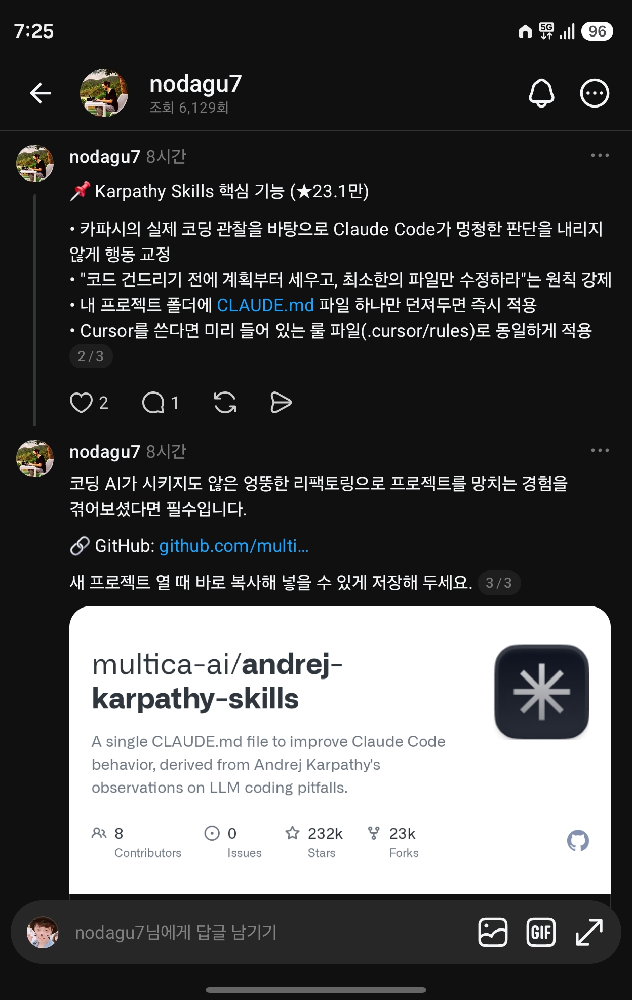

## 한눈에 보기

- Claude Code가 코딩할 때 따를 행동 지침을 `CLAUDE.md` 파일 하나(약 2.4KB)에 담은 저장소입니다. Andrej Karpathy가 X에 올린 "LLM 코딩의 함정" 관찰을 바탕으로 했다고 README가 밝힙니다. Karpathy 본인이 만든 것은 아닙니다.
- 만든 곳은 `multica-ai`이고, README 첫머리에서 같은 사람이 만드는 코딩 에이전트 플랫폼 Multica를 소개합니다.
- 공개 시기는 저장소 생성일이자 첫 커밋 날짜인 2026-01-27을 기준으로 적었습니다. GitHub 릴리스는 없습니다. 별 약 232,000개, 포크 약 23,000개, 마지막 커밋 2026-04-20 (2026-11-11 조회).

## 핵심 내용

### 풀려는 문제

README가 Karpathy의 글에서 옮긴 문제는 세 가지입니다.

- 모델이 사용자 대신 잘못된 가정을 하고 확인 없이 그대로 진행합니다. 헷갈려도 묻지 않고, 맞지 않는 점이나 장단점을 드러내지 않습니다.
- 코드와 API를 지나치게 복잡하게 만듭니다. 100줄이면 될 것을 1,000줄로 짭니다.
- 과제와 상관없는데도, 충분히 이해하지 못한 주석과 코드를 바꾸거나 지웁니다.

### 네 가지 원칙

| 원칙 | 내용 | 막으려는 것 |
|---|---|---|
| Think Before Coding (짜기 전에 생각) | 가정을 밝히고, 해석이 여럿이면 조용히 고르지 말고 내놓고, 더 단순한 길이 있으면 말하고, 헷갈리면 멈추고 묻습니다. | 잘못된 가정, 숨긴 혼란 |
| Simplicity First (단순함 먼저) | 요청받지 않은 기능, 한 번 쓰는 코드의 추상화, 요청 없는 설정 가능성, 일어날 수 없는 경우의 오류 처리를 넣지 않습니다. 200줄이 50줄로 되면 다시 씁니다. | 과한 설계 |
| Surgical Changes (필요한 곳만 수정) | 옆 코드·주석·서식을 "개선"하지 않고, 멀쩡한 것을 리팩터링하지 않고, 기존 스타일을 따릅니다. 상관없는 죽은 코드는 지우지 말고 알려 주기만 합니다. 자기 변경 때문에 안 쓰게 된 import·변수·함수만 치웁니다. | 상관없는 수정 |
| Goal-Driven Execution (목표 중심 실행) | "검증 추가"를 "잘못된 입력에 대한 테스트를 쓰고 통과시키기"처럼 확인할 수 있는 목표로 바꿉니다. 여러 단계 작업은 단계마다 확인 방법을 붙인 짧은 계획을 먼저 적습니다. | 모호한 성공 기준 |

README는 판단 기준도 한 줄씩 줍니다. 단순함은 "선임 엔지니어가 보면 과하다고 할까?", 수정 범위는 "바뀐 모든 줄이 사용자의 요청으로 설명되는가?"입니다.

### 잘 듣고 있는지 보는 법 (README)

- diff에 요청한 변경만 보입니다.
- 과하게 짜서 다시 쓰는 일이 줄어듭니다.
- 확인 질문이 실수 뒤가 아니라 구현 전에 나옵니다.

### 저장소에 든 것 (2026-11-11 조회)

`CLAUDE.md`, `CURSOR.md`, `EXAMPLES.md`, `README.md`, `README.zh.md`, `.claude-plugin/`, `.cursor/rules/karpathy-guidelines.mdc`, `skills/karpathy-guidelines/`

## 써 보려면

README의 안내 그대로입니다. 명령에 적힌 소유자 이름이 `forrestchang`인데, 지금은 같은 저장소가 `multica-ai` 아래로 옮겨져 있습니다(아래 "눈여겨볼 점").

Claude Code 플러그인(README 권장, 모든 프로젝트에 적용):

```text
/plugin marketplace add forrestchang/andrej-karpathy-skills
/plugin install andrej-karpathy-skills@karpathy-skills
```

프로젝트마다 `CLAUDE.md`로 넣기:

```bash
# 새 프로젝트
curl -o CLAUDE.md https://raw.githubusercontent.com/forrestchang/andrej-karpathy-skills/main/CLAUDE.md

# 이미 CLAUDE.md가 있으면 뒤에 붙이기
echo "" >> CLAUDE.md
curl https://raw.githubusercontent.com/forrestchang/andrej-karpathy-skills/main/CLAUDE.md >> CLAUDE.md
```

- Cursor에서는 저장소에 들어 있는 `.cursor/rules/karpathy-guidelines.mdc` 규칙 파일을 씁니다. 다른 프로젝트에 옮겨 쓰는 방법은 `CURSOR.md`에 있습니다.
- 프로젝트 고유 규칙과 합쳐 쓰도록 만든 것이라, 기존 `CLAUDE.md`에 덧붙이고 그 아래에 프로젝트 규칙 절을 따로 두라고 안내합니다.

## 눈여겨볼 점

- **저장소 주소가 바뀌었습니다.** README의 설치 명령은 `forrestchang/andrej-karpathy-skills`를 가리키는데, GitHub API로 그 이름을 조회하면 `multica-ai/andrej-karpathy-skills`(같은 저장소 ID)가 돌아옵니다. 소유자가 옮겨진 것으로 보이며, 옛 주소의 `curl` 명령이 계속 동작하는지는 직접 실행해 보지 않았습니다.
- **라이선스 표기가 엇갈립니다.** README 끝에는 MIT라고 적혀 있지만 GitHub API의 라이선스 항목은 비어 있습니다(2026-11-11 조회). 저장소 최상위 목록에 LICENSE 파일이 보이지 않았습니다.
- README 스스로 밝힌 절충: 이 지침은 속도보다 신중함 쪽으로 기울어 있습니다. 오타 수정 같은 사소한 일에는 판단껏 가볍게 적용하라고 합니다.
- "필요한 곳만 수정" 원칙은 Anthropic이 [Claude Fable 5.2 안내에서 소개한 "이 코드는 네 것" 문장](fable-5-2-code-ownership-prompt.md)과 방향이 반대입니다. 저장소의 주인이 사용자이고 적게 고치기를 바라면 이 지침이, 에이전트가 맡아 키우는 저장소면 그쪽이 맞습니다.
- 캡처 속 Threads 글은 이 지침이 원칙을 "강제"한다고 썼지만, 실제로는 모델이 읽는 지침 글입니다. 따르지 않을 때 막는 장치는 저장소에 없습니다. 효과를 잰 수치도 README에 없습니다.
- 캡처의 별 수(글 23.1만, 카드 232k)는 오늘 조회한 값(232,039개)과 맞습니다.
- Karpathy의 X 글은 주소가 열리는 것만 확인했고 글 내용을 직접 읽지는 못했습니다. 위 문제 설명은 README가 옮겨 적은 대목을 따른 것입니다.

## 받은 캡처



캡처 2026-11-11

## 출처

- [multica-ai/andrej-karpathy-skills README](https://github.com/multica-ai/andrej-karpathy-skills) — 네 가지 원칙, 설치 방법, Cursor 안내, 절충 설명
- [GitHub 저장소 API 정보](https://api.github.com/repos/multica-ai/andrej-karpathy-skills) — 별·포크 수, 생성일, 첫 커밋과 마지막 커밋 날짜, 라이선스 항목, 파일 목록, 옛 주소가 같은 저장소로 이어지는 것 (2026-11-11 조회)
- [Karpathy의 X 글](https://x.com/karpathy/status/2015883857489522876) — README가 출처로 든 글. 주소가 열리는 것만 확인
- Threads 글(nodagu7, 캡처) — 처음 받은 자료. 원문 주소는 캡처에 보이지 않음
