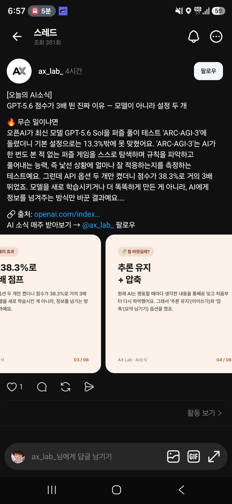
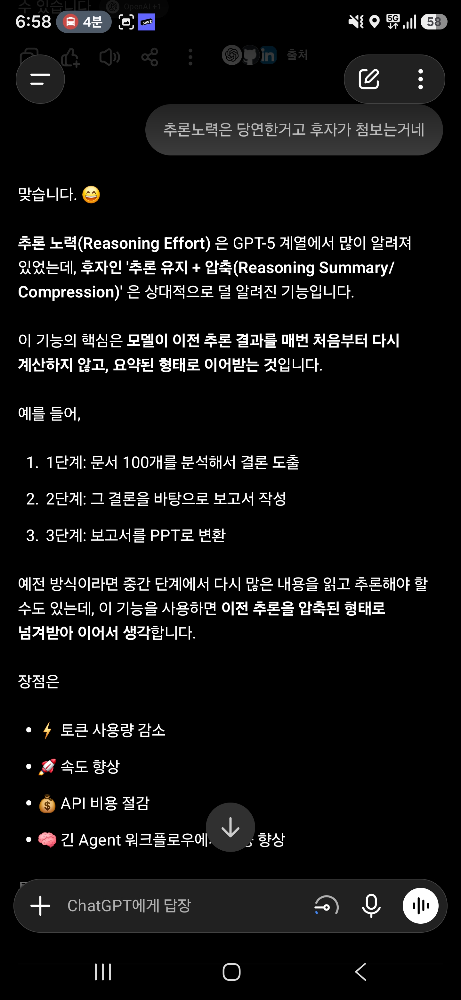

## 한눈에 보기

- OpenAI가 2026-07-29에 낸 글 "How enabling two settings tripled our scores on the ARC-AGI-3 benchmark"(글쓴이 Ilan Bigio, Ted Sanders)의 내용입니다. 공개 시기는 이 글의 날짜로 적었습니다.
- GPT-5.6 Sol을 ARC-AGI-3 **공개 세트**에 돌렸을 때 공식 하네스로는 13.3%, **추론 유지(retained reasoning)** 와 **압축(compaction)** 을 켠 자체 하네스로는 38.3%였다고 합니다. 출력 토큰은 6분의 1로 줄었다고 합니다.
- 모델을 바꾼 것이 아니라 모델에게 지난 기록을 넘겨주는 방식만 바꾼 결과입니다. 긴 에이전트 작업을 API로 만드는 사람에게 직접 쓸모 있는 이야기입니다.

## 핵심 내용

### ARC-AGI-3가 무엇인가

AI가 처음 보는 2D 퍼즐 게임을 설명 없이 스스로 탐색해 규칙을 알아내고 푸는 능력을 재는 벤치마크입니다. 점수는 사람 기준과 비교한 행동 효율(RHAE)로 매깁니다. OpenAI는 공식 플레이 기록을 바탕으로 평균적인 사람 참가자의 점수를 48%로 추정했습니다. 공식 하네스는 도구나 특수 기능 없이 일부러 단순하게 만들어져 있습니다.

### 공식 하네스에서 모델이 헤맨 이유 두 가지

| 문제 | 무슨 일이 생기나 |
|---|---|
| 추론을 버림 | 게임에서 한 번 행동할 때마다 모델의 비공개 추론이 모두 지워집니다. 지난 행동과 짧은 메모는 보이지만, 그 행동을 낳은 계획과 깨달음은 보이지 않아 매번 게임을 처음부터 다시 파악합니다. |
| 굴러가는 잘라내기(rolling truncation) | 대화가 175,000자를 넘으면 가장 오래된 메시지부터 버립니다. 초반에 관찰한 것과 한 행동을 잊고, 늘 꽉 찬 컨텍스트로 일하게 됩니다. |

### 바꾼 설정 두 가지

1. **추론 유지**: 하네스를 Responses API로 다시 만들었습니다. 발표 글에 따르면 GPT-5.6에서는 이전 응답의 ID를 넘기면(`previous_response_id`) 도구 호출과 턴을 넘어 추론이 자동으로 유지됩니다. 켜고 나니 모델이 행동마다 생각하는 시간이 줄었고, 일관된 전략을 쓰며 점점 나아졌다고 합니다.
2. **압축**: 오래된 기록을 잘라 버리는 대신 요약해서 이어 갑니다. 게임마다 알아낸 것을 긴 실행 내내 보존해 더 적은 출력 토큰으로 더 높은 점수를 냈다고 합니다.

### 발표된 수치

| 조건 (GPT-5.6 Sol, 공개 세트) | 점수 |
|---|---|
| 공식 하네스 | 13.3% |
| 추론 유지 + 압축 (Responses API 하네스) | 38.3% |
| 사람 평균 (OpenAI 추정) | 48% |

- 글 앞부분에는 GPT-5.6 Sol이 "7.8%"를 받았다는 숫자도 나옵니다. 이것은 ARC Prize 쪽이 측정한 점수이고, 13.3%는 OpenAI가 공개 세트에서 공식 하네스로 다시 돌린 점수입니다. 두 숫자가 어느 문제 세트 기준인지의 차이는 OpenAI 글만으로는 분명하지 않습니다.
- 같은 글에서 GPT-5.5는 0.4%였다고 합니다.

### API에서 압축을 켜는 법 (OpenAI 압축 문서, 2026-11-11 조회)

- **서버 쪽 압축**: `/responses` 요청에 `context_management=[{"type": "compaction", "compact_threshold": 200000}]`처럼 넣으면, 토큰 수가 기준을 넘을 때 서버가 알아서 압축합니다.
- **직접 호출**: `/responses/compact`에 전체 컨텍스트를 보내면 압축된 컨텍스트를 돌려줍니다. 돌려받은 것은 손대지 말고 그대로 다음 요청에 넣으라고 합니다.
- 압축 결과물(compaction item)은 암호화되어 있어 사람이 읽을 수 없습니다.
- `previous_response_id`로 이어 가는 방식에서는 직접 기록을 잘라내지 말라고 합니다.

### OpenAI의 권고

API 개발자에게 세 가지를 권합니다. Chat Completions가 아니라 Responses API를 쓸 것, 추론을 유지할 것, 압축을 쓸 것. ChatGPT와 Codex가 실제로 이렇게 돌아간다고 합니다.

## 눈여겨볼 점

- **공식 순위표 점수가 아닙니다.** 38.3%는 OpenAI가 공개 세트에서 자체 하네스로 잰 값입니다. The Decoder(2026-07-30)에 따르면 ARC Prize는 공식 점수에 제공자별 설정을 쓰지 않는 표준 방식을 쓴다고 했고, 만든 사람 François Chollet는 누구나 쓸 수 있는 일반 API 설정이라면 설정과 비용을 밝히는 조건으로 허용할 수 있다는 입장을 냈다고 합니다. 이 X 게시물들은 직접 열어 보지 않았습니다.
- The Decoder는 같은 벤치마크에서 Claude Opus 5가 30.2%라고 전했는데, 하네스 조건이 달라 38.3%와 그대로 견줄 수 없습니다.
- 캡처의 Threads 글은 "API 옵션 두 개만 켰더니 13.3% → 38.3%"라고 요약했고, 이는 OpenAI 글과 맞습니다. 공개 세트·자체 하네스라는 조건은 캡처에 보이는 부분에는 없습니다.
- 함께 받은 ChatGPT 답변 캡처는 이 기능을 "Reasoning Summary/Compression"이라고 불렀는데, OpenAI 글과 문서의 이름은 "retained reasoning"과 "compaction"입니다. 또 그 답변은 장점으로 속도 향상과 API 비용 절감을 들었으나, OpenAI 글이 수치로 밝힌 것은 점수와 출력 토큰(6분의 1)뿐입니다. 비용 수치는 확인 못 함.
- GPT-5.6 Sol 자체의 출시일은 1차 자료로 확인 못 함(GIGAZINE 기사는 2026년 6월 말 발표라고 적음).
- 다른 회사 모델에서도 같은 효과가 나는지는 이 글에서 다루지 않습니다.

## 받은 캡처

캡처 2026-08-04

캡처 2026-08-04

## 출처

- [How enabling two settings tripled our scores on the ARC-AGI-3 benchmark (OpenAI, 2026-07-29)](https://openai.com/index/how-two-settings-tripled-our-arc-agi-3-scores/) — 점수, 두 설정의 내용, 공식 하네스의 동작, 권고. 자동 조회 도구로는 403이 나와 브라우저 방식으로 내려받아 읽음
- [Compaction 문서 (OpenAI)](https://developers.openai.com/api/docs/guides/compaction) — 압축을 켜는 매개변수와 호출 방법 (2026-11-11 조회)
- [The Decoder 기사 (2026-07-30)](https://the-decoder.com/openai-claims-gpt-5-6-sol-beats-opus-5-on-arc-agi-3-with-its-latest-api-and-two-additional-settings/) — ARC Prize와 Chollet의 반응, Opus 5 점수
- [GIGAZINE 기사 (2026-07-31)](https://gigazine.net/gsc_news/en/20260731-how-enabling-two-settings-tripled-arc-agi-3-benchmark/) — GPT-5.6 시리즈 발표 시기 언급
- Threads 글(ax_lab_), ChatGPT 대화 — 받은 캡처. 원문 주소는 캡처에서 `openai.com/index…`까지만 보임
