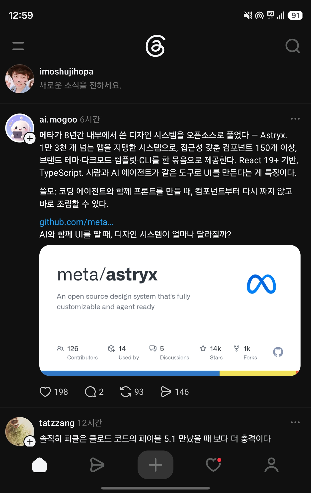

## 한눈에 보기

- Meta가 공개한 오픈소스 디자인 시스템입니다. README에 따르면 지난 8년간 Meta 안에서 자라 사내에서 가장 많이 쓰이는 디자인 시스템이 됐고, 13,000개가 넘는 앱을 받치고 있습니다.
- 코딩 에이전트와 함께 프런트엔드를 만들 때, 컴포넌트를 처음부터 짜게 하지 않고 이미 있는 것을 조립하게 하는 데 씁니다.
- 공개 시기는 2026-06으로 적었습니다. 근거는 npm 패키지 `@astryxdesign/core`의 첫 게시일(2026-06-24)과 GitHub 첫 릴리스 v0.1.1(2026-06-26)입니다. 저장소 생성일은 2026-01-09로 더 이릅니다. Meta의 공식 발표 글과 그 날짜는 확인 못 함.


## 핵심 내용

### 들어 있는 것

- 접근성을 갖춘 컴포넌트 150개 이상, 브랜드 단위 테마, 다크 모드, 바로 쓸 수 있는 템플릿, CLI.
- React 19 이상이 필요하고 TypeScript 타입이 붙어 있습니다. 스타일은 Meta의 StyleX로 작성됐습니다.
- 미리 빌드된 CSS를 import하고 타입이 있는 React 컴포넌트를 쓰면 됩니다. 빌드 플러그인이나 PostCSS·Babel 설정이 필요 없다고 합니다.

| 패키지 | 내용 |
|---|---|
| `@astryxdesign/core` | 컴포넌트, 테마 시스템, 유틸리티 |
| `@astryxdesign/cli` | 컴포넌트 문서, 템플릿, 뼈대 만들기, 테마, 코드모드 |
| `@astryxdesign/build` | StyleX 소스 빌드용 플러그인 |
| `@astryxdesign/theme-*` | 바로 쓰는 테마 일곱 가지 (neutral, butter, chocolate, matcha, stone, gothic, y2k) |

차트 패키지(`@astryxdesign/charts`, `@astryxdesign/vega`)는 npm에 `@canary` 태그로만 올라와 있고 안정 버전은 아직 없습니다.

### README가 내세우는 다른 점

- **속이 열려 있습니다.** 조립에 쓰는 부품을 그대로 내보내고, 더 깊이 고치려면 `swizzle`로 컴포넌트 소스 전체를 내 프로젝트로 꺼내 직접 관리합니다.
- **스타일 도구에 묶이지 않습니다.** 쓰는 쪽에서는 StyleX가 보이지 않습니다. `className`으로 Tailwind, CSS 모듈, 일반 CSS 어느 것이든 덮어쓸 수 있습니다.
- **감싸지 않고 바꿉니다.** 테마는 CSS 사용자 정의 속성을 덮어쓰는 묶음이어서, 컴포넌트를 포크하거나 감싸지 않고 브랜드에 맞춥니다.
- **사람과 에이전트가 같은 방식으로 만듭니다.** API, 문서, CLI를 함께 설계해서 사람과 AI가 같은 참고 자료로 작업합니다.

### 에이전트가 쓰는 길: CLI

CLI 문서는 이 CLI를 "사람과 기계 모두의 기본 창구"라고 소개합니다. 터미널 명령, 타입이 있는 JSON API, 프로그램에서 import하는 세 가지 방식으로 같은 내용을 줍니다.

- `astryx search button` — 컴포넌트, 훅, 문서, 템플릿을 한 번에 검색하고, 결과마다 다음에 실행할 명령을 알려 줍니다.
- `astryx component Button` — 컴포넌트 문서.
- `astryx docs tokens` — 디자인 토큰 등 안내 문서.
- `astryx template --list` — 페이지 템플릿 목록.
- `astryx manifest --json` — 모든 명령과 옵션, 응답 형식을 JSON으로.

### 원칙 (README)

강제보다 안내(값을 넘기면 그대로 그립니다), 모든 컴포넌트에 같은 이름·속성·조립 규칙, 사람과 AI를 위한 하나의 시스템, 규칙은 주장하지 않고 측정해서 정한다는 네 가지입니다.

## 써 보려면

```bash
npm install @astryxdesign/core @astryxdesign/theme-neutral @stylexjs/stylex
npm install -D @astryxdesign/cli
```

컴퓨터에 한 번 설치해 두면 어느 폴더에서나, 어느 코딩 에이전트에서나 `astryx` 명령을 쓸 수 있습니다.

```bash
npm i -g @astryxdesign/cli
```

- 설치 전에 한 번만 실행해 볼 때는 `npx @astryxdesign/cli --help`처럼 범위가 붙은 이름을 씁니다. CLI 문서는 설치 전에 `npx astryx`를 실행하지 말라고 경고합니다. `astryx`라는 이름만으로는 관계없는 다른 npm 패키지가 잡힙니다.
- Next.js, Tailwind, Vite, CDN별 설정은 `packages/core/README.md`에 있습니다.
- 최신 버전 0.7.13 (GitHub 릴리스 2026-11-10, 2026-11-11 조회). 라이선스 MIT.

## 눈여겨볼 점

- README가 "현재 베타"라고 밝힙니다. 버전도 0.x입니다.
- React 19 미만 프로젝트에서는 쓸 수 없습니다.
- 캡처 속 Threads 글의 주요 내용(8년간 내부 사용, 13,000개 넘는 앱, 컴포넌트 150개 이상, 테마·다크 모드·템플릿·CLI, React 19 이상, TypeScript)은 README와 일치합니다.
- 별·포크 수는 차이가 있습니다. 캡처(2026-11-08)의 저장소 카드는 별 14k, 포크 1k이고, 오늘 조회한 값은 별 24,070개, 포크 1,880개입니다(2026-11-11 조회). 카드 그림이 언제 만들어진 것인지는 확인 못 함.
- 검색으로 나온 외부 글들은 공개일을 6월 18일, 6월 28일 등으로 다르게 적고, 저장소 주소를 `github.com/facebook/astryx`로 쓴 곳도 있습니다. 오늘 확인한 저장소는 `meta/astryx`입니다. Meta의 공식 발표 글은 열어 보지 못했으므로 이 문서의 날짜는 npm과 GitHub 기록만 근거로 했습니다.
- 사내 13,000개 앱이라는 수치는 Meta 자신의 설명이며 따로 검증할 방법은 없습니다. 직접 설치해 쓰지는 않았습니다.

## 받은 캡처



캡처 2026-11-08

## 출처

- [meta/astryx 저장소 README](https://github.com/meta/astryx) — 개요, 다른 점, 패키지, 원칙, 설치 방법, 베타 표시
- [packages/cli/README.md](https://github.com/meta/astryx/blob/main/packages/cli/README.md) — CLI 명령, `npx astryx` 경고
- [GitHub 저장소 API 정보](https://api.github.com/repos/meta/astryx) — 별·포크 수, 생성일, 라이선스, 첫 릴리스와 최신 릴리스 (2026-11-11 조회)
- [npm 레지스트리 @astryxdesign/core](https://registry.npmjs.org/@astryxdesign%2fcore) — 첫 게시일, 최신 버전 (2026-11-11 조회)
- [astryx.atmeta.com](https://astryx.atmeta.com), [Storybook](https://astryx.atmeta.com/storybook/) — 주소가 열리는 것만 확인
- Threads 글(ai.mogoo, 캡처) — 처음 받은 자료. 원문 주소는 캡처에 잘려 보임
