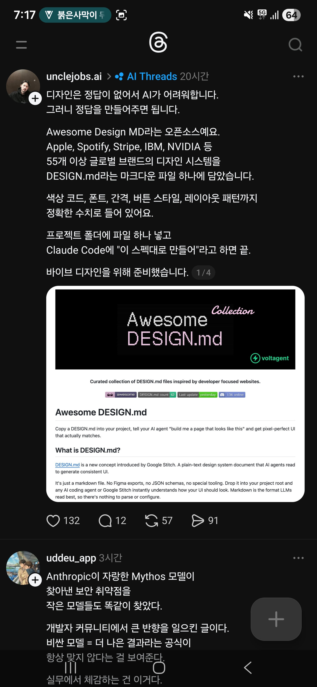

## 한눈에 보기

- **DESIGN.md**는 AI 에이전트가 읽고 일관된 화면을 만들도록 디자인 시스템을 글로 적은 마크다운 파일입니다. README는 이 개념을 Google Stitch가 처음 내놓았다고 설명합니다.
- 이 저장소는 AI 에이전트 프레임워크를 만드는 VoltAgent가 운영하는 모음으로, 실제 웹사이트에서 뽑은 DESIGN.md를 바로 쓸 수 있게 제공합니다.
- 공개 시기는 저장소 생성일인 2026-03-31을 기준으로 적었습니다. 릴리스는 따로 없습니다. 별 126,678개, 포크 14,016개 (2026-11-11 조회).

## 핵심 내용

### 왜 파일 하나인가

README의 설명입니다. Figma 내보내기도, JSON 스키마도, 전용 도구도 필요 없이 프로젝트 루트에 마크다운 파일 하나를 두면 코딩 에이전트나 Google Stitch가 화면이 어떻게 보여야 하는지 이해합니다.

| 파일 | 읽는 쪽 | 정하는 것 |
|---|---|---|
| `AGENTS.md` | 코딩 에이전트 | 프로젝트를 어떻게 만드는가 |
| `DESIGN.md` | 디자인 에이전트 | 프로젝트가 어떻게 보이고 느껴져야 하는가 |

### 파일 하나에 들어 있는 것

Stitch의 DESIGN.md 형식을 따르고 몇 절을 더했습니다.

1. 시각 테마와 분위기
2. 색 팔레트와 역할(이름, hex, 쓰임)
3. 글자 규칙(글꼴, 전체 위계 표)
4. 컴포넌트 모양(버튼, 카드, 입력, 내비게이션과 상태)
5. 배치 원칙(간격 체계, 그리드, 여백)
6. 깊이와 높낮이(그림자, 표면 위계)
7. 해야 할 것과 하지 말 것
8. 반응형 동작(분기점, 터치 영역)
9. 에이전트 프롬프트 안내(색 빠른 참조, 바로 쓰는 프롬프트)

사이트마다 `DESIGN.md`와 함께 색 견본·글자 체계·버튼·카드를 보여 주는 `preview.html`, 어두운 배경용 `preview-dark.html`이 있습니다.

### 들어 있는 사이트

README의 배지에 적힌 수는 84개입니다 (2026-11-11 조회). 묶음은 다음과 같습니다.

| 묶음 | 예 |
|---|---|
| AI·LLM | Claude, Cohere, ElevenLabs, Mistral AI, Ollama, Replicate, xAI |
| 개발 도구 | Cursor, Expo, Lovable, Raycast, Vercel, Warp |
| 백엔드·DB·DevOps | ClickHouse, MongoDB, PostHog, Sentry, Supabase |
| 생산성·SaaS | Cal.com, Intercom, Linear, Notion, Resend, Zapier |
| 디자인 도구 | Airtable, Figma, Framer, Miro, Webflow |
| 핀테크 | Binance, Coinbase, Mastercard, Revolut, Stripe, Wise |
| 커머스 | Airbnb, Nike, Shopify, Starbucks |
| 미디어·소비자 기술 | Apple, IBM, NVIDIA, Pinterest, SpaceX, Spotify, Uber, WIRED |
| 자동차 | BMW, Bugatti, Ferrari, Lamborghini, Renault, Tesla |
| 옛날 웹 | Dell(1996), Nintendo.com(2001) |

목록의 각 항목은 `getdesign.md/사이트/design-md` 주소로 연결됩니다.

## 써 보려면

1. 원하는 사이트의 `DESIGN.md`를 내 프로젝트 루트에 복사합니다.
2. AI 에이전트에게 그 파일을 쓰라고 말합니다. (README의 예: "build me a page that looks like this")

- 목록에 없는 사이트는 getdesign.md에서 요청할 수 있다고 합니다.
- 라이선스는 MIT입니다.

## 눈여겨볼 점

- **캡처와 지금의 수치가 다릅니다.** 캡처(2026-04-12)의 글은 "55개 이상 글로벌 브랜드"라고 했고, 같은 캡처에 찍힌 README 배지는 62개였습니다. 지금 배지는 84개입니다.
- 캡처의 글은 "프로젝트 폴더에 파일 하나 넣고 Claude Code에 '이 스펙대로 만들어'라고 하면 끝"이라고 소개합니다. 캡처 당시 README는 "pixel-perfect UI"라는 표현을 썼고, 지금 README는 "디자인 언어와 일관된 고품질 UI"라고 적습니다. 실제로 얼마나 비슷하게 나오는지는 직접 확인하지 않았습니다.
- README는 이 문서들이 공개된 CSS 값에서 뽑은 것이고 각 사이트의 시각 정체성에 대한 소유권을 주장하지 않으며, 보증 없이 "있는 그대로" 제공한다고 밝힙니다. 남의 브랜드를 그대로 흉내 낸 화면을 외부에 내놓는 것은 따로 판단해야 합니다.
- 내가 원하는 사이트를 직접 분석해 design.md를 만들고 싶다면 [insane-design](insane-design.md)이 그 용도입니다.

## 받은 캡처

캡처 2026-04-12

## 출처

- [VoltAgent/awesome-design-md 저장소 README](https://github.com/VoltAgent/awesome-design-md) — DESIGN.md 설명, 수록 사이트, 파일 구성, 사용법, 면책 문구
- [GitHub 저장소 API 정보](https://api.github.com/repos/VoltAgent/awesome-design-md) — 생성일, 별·포크 수, 라이선스, 릴리스 없음 (2026-11-11 조회)
- [getdesign.md](https://getdesign.md/), [Stitch DESIGN.md 문서](https://stitch.withgoogle.com/docs/design-md/overview/) — 주소가 열리는 것만 확인
- Threads unclejobs.ai 글(캡처) — 소개 문구, 당시 배지 수치. 원문 주소는 캡처에 보이지 않음
