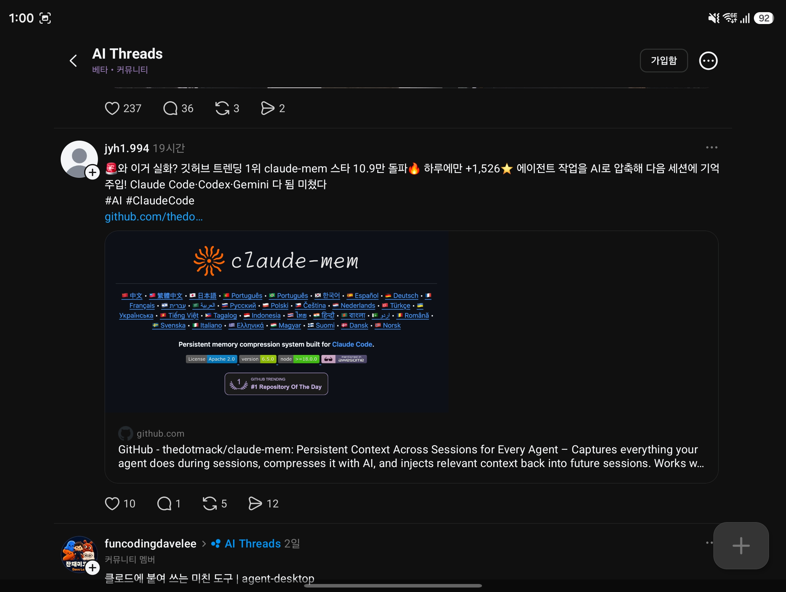

## 한눈에 보기

- 코딩 에이전트는 세션이 바뀌면 앞에서 한 일을 잊습니다. claude-mem은 세션 중 활동을 기록·압축해 두고 **다음 세션이 시작될 때 필요한 기억을 넣어 주는** 플러그인입니다.
- 만든 사람은 GitHub 사용자 thedotmack입니다. 처음에는 Claude Code용이었고 지금은 "모든 에이전트용"을 내세웁니다.
- 공개 시기는 저장소 생성일 2025-08-31을 기준으로 적었습니다. 최신 릴리스는 v15.17.0(2026-11-11). 별 116,025개, 포크 10,062개(2026-11-11 조회). 캡처한 글(11-03 기준 약 19시간 전 작성)은 "스타 10.9만 돌파, 하루 +1,526, 깃허브 트렌딩 1위"라고 적었습니다. 하루 증가분과 트렌딩 순위는 따로 확인하지 못했습니다.


## 핵심 내용

### 동작 방식 (README 기준)

1. **에이전트가 일한다.** 에이전트의 훅(hook)이 도구 호출 하나하나(읽기, 고치기, 실행)를 PC에서 도는 작은 워커(worker)에 넘깁니다.
2. **관찰자가 적는다.** 두 번째 에이전트(observer)가 그 활동을 짧은 관찰 기록으로 바꾸고, 세션이 끝나면 요약을 씁니다.
3. **다음 세션이 그것으로 시작한다.** 세션 시작 때 이 프로젝트에 중요한 관찰의 **간단한 색인**만 받고, 자세한 내용은 필요할 때만 가져옵니다.

기억 주입은 한 프로젝트의 두 번째 세션부터 시작됩니다. 저장소 전체를 미리 읽혀 두려면 `/learn-codebase`를 씁니다(보통 약 5분이라고 안내).

### 구성 요소

| 부분 | 역할 |
|---|---|
| 훅 | 에이전트별 어댑터. Claude Code에서는 SessionStart, UserPromptSubmit, PreToolUse, PostToolUse, Stop, SessionEnd 등에 연결 |
| 워커 | Bun이 관리하는 로컬 HTTP 서비스. 훅에서 활동을 받아 관찰자를 돌리고 뷰어와 검색을 제공 |
| 관찰자 | 활동을 관찰·요약으로 바꾸는 모델. Claude, OpenRouter, Gemini 등 공급자를 고를 수 있음 |
| 저장소 | `~/.claude-mem/claude-mem.db`(SQLite)에 세션·관찰·요약 저장. Chroma로 의미 검색을 더함 |
| 검색 | MCP 도구 3개와 `mem-search` 스킬 |
| 뷰어 | 워커 주소의 `/viewer`(기억·세션·설정)와 `/`(My Work: 진행 상황, 검토 대기 목록) |

### 토큰을 아끼는 3단계 검색

1. `search` — ID가 붙은 간단한 색인(결과당 약 50~100토큰)
2. `timeline` — 관심 있는 결과 앞뒤의 시간순 맥락
3. `get_observations` — 고른 ID만 전체 내용(결과당 약 500~1,000토큰)

### 지원 에이전트

README는 Claude Code, Codex, Cursor, OpenCode와 그 밖의 11개 에이전트에서 동작한다고 합니다(T3 Code, Antigravity CLI, OMP, Pi, DeepSeek Harness, Grok Bot, OpenClaw 등이 설치 안내에 나옵니다). Copilot CLI, Goose, Roo Code, Warp는 **기억 검색만** 되고 세션이 기록되지는 않습니다. 저장소 설명에는 Gemini, Hermes도 적혀 있습니다.

### 그 밖의 기능

- `<private>` 태그로 감싼 내용은 저장하지 않는다고 합니다.
- 새 세션에 무엇을 넣을지 세밀하게 설정할 수 있습니다.
- TeamBrain(팀 공유 작업 공간), Claude Desktop에서 검색, 도구 스크린샷 보관 기능이 있습니다.

## 써 보려면

```bash
npx claude-mem install
```

설치 프로그램이 PC의 에이전트를 찾아 어느 것에 설정할지 묻습니다. Claude Code 안에서는 플러그인 마켓플레이스로도 설치합니다.

```bash
/plugin marketplace add thedotmack/claude-mem
/plugin install claude-mem
```

- 필요한 것: Node.js 20.19 이상(20.x) 또는 22.12 이상. Bun과 uv는 없으면 자동 설치, SQLite는 포함.
- `npm install -g claude-mem`은 SDK만 설치하고 훅과 워커를 등록하지 않으므로 쓰지 말라고 안내합니다.
- 한 에이전트만 설정하려면 `--ide`를 줍니다(예: `npx claude-mem install --ide opencode`).
- 라이선스는 Apache-2.0입니다. 오픈소스와 상용 부분의 경계는 `docs/license.md`, `docs/ip-boundary.md`에 있다고 합니다.

## 눈여겨볼 점

- **계정 가입과 유료 흐름이 설치에 끼어 있습니다.** 설치 끝에 브라우저에서 claude-mem 로그인을 요청하고, "claude-mem observer"를 고르면 결제 수단을 받는 30일 무료 체험이 시작됩니다. 체험이 끝나면 구독하지 않는 한 사용자의 Anthropic 요금제로 되돌아간다고 합니다. 로그인을 건너뛰려면 `--provider`를 명시하거나 `CLAUDE_MEM_ONLINE_OPTIN=false`를 설정합니다.
- **익명 사용 통계가 기본으로 켜져 있습니다.** `npx claude-mem telemetry disable`로 끕니다. 클라우드 동기화는 선택 사항이고 기억은 기본적으로 `~/.claude-mem`에 있습니다.
- 관찰자가 별도 모델 호출을 하므로 토큰이 추가로 듭니다. 사내에서 쓸 때는 작업 내용이 어느 공급자로 나가는지 먼저 확인해야 합니다.
- 캡처 속 README 이미지에는 버전 6.5.0 배지가 보이지만 현재 최신은 v15.17.0입니다. 미리 보기 이미지가 오래된 것으로 보입니다.
- 직접 설치해 보지는 않았습니다. README 뒷부분(설정, Windows 안내, 문제 해결)은 자세히 읽지 않았습니다.

## 받은 캡처



캡처 2026-11-03 (같은 화면 아래쪽에 agent-desktop 글의 첫 줄이 보입니다: [agent-desktop](agent-desktop.md))

## 출처

- [thedotmack/claude-mem 저장소 README](https://github.com/thedotmack/claude-mem) — 동작 방식, 구성 요소, 설치, 지원 에이전트, 로그인·체험·통계 안내, 요구 사항, 라이선스
- [GitHub 저장소 API 정보](https://api.github.com/repos/thedotmack/claude-mem) — 별·포크 수, 생성일, 설명, 최신 릴리스 (2026-11-11 조회)
- [claude-mem.ai](https://claude-mem.ai), [docs.claude-mem.ai](https://docs.claude-mem.ai/) — 주소가 열리는 것만 확인
- Threads 글(jyh1.994, AI Threads 커뮤니티) 캡처 — 출발점. 글 속 링크는 `github.com/thedo…`까지만 보임
