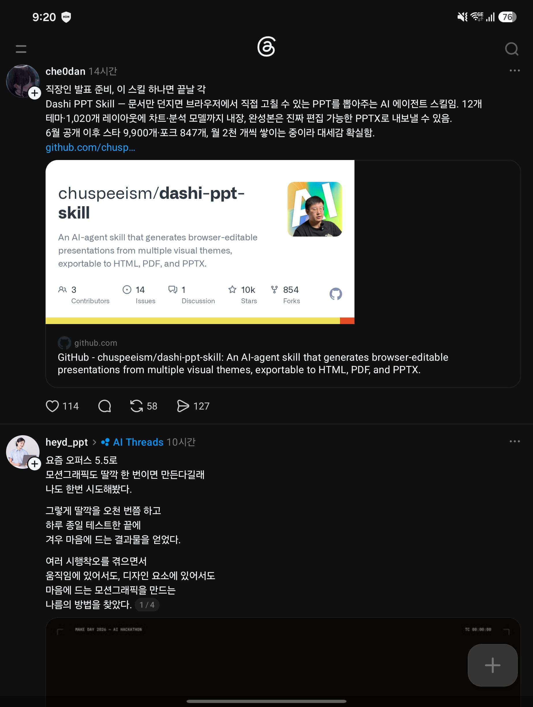

## 한눈에 보기

- 코딩 에이전트에 설치하는 **발표 자료 제작 스킬**입니다. 문서를 넘기고 "PPT 만들어 줘"라고 하면 몇 분 뒤 웹 화면으로 된 발표 자료가 나오고, 그 화면에서 글자·그림·레이아웃을 직접 고친 뒤 PPTX로 내보냅니다.
- 만든 사람은 GitHub 사용자 chuspeeism입니다. README 기본 언어는 중국어이고 영문판이 따로 있습니다.
- 공개 시기는 저장소 생성일인 2026-06-10을 기준으로 적었습니다(캡처 속 글도 "6월 공개"라고 합니다). 2026-11-11 조회 기준 GitHub 별 10,599개, 포크 901개, 마지막 커밋 2026-11-06입니다.


## 핵심 내용

### 규모 (README가 밝힌 수치)

| 항목 | 수 |
|---|---|
| 시각 테마 | 12종 |
| 레이아웃 페이지 | 1,020개 |
| 조절할 수 있는 컨트롤 | 8,576개 |
| 페이지 역할 | 20가지 (표지, 목차, 지표, 추세, 비교, 흐름, 위험, 마무리 등) |
| 페이지 전환 애니메이션 | 9종 |

### 만들어진 뒤에 고치는 방식

README는 "만든 뒤에 어떻게 고치느냐가 만드는 것보다 중요하다"고 강조합니다.

- **페이지마다 조절판이 붙습니다.** 슬라이더, 스위치, 드롭다운으로 레이아웃, 모듈 수, 색 조합, 페이지에서 강조할 부분을 바꿉니다.
- **글자는 눌러서 그 자리에서 고칩니다.**
- **그림·영상 자리는 눌러서 또는 끌어다 놓아 바꿉니다.** 글만 있는 자료에도 그림 자리를 미리 잡아 둡니다.
- 왼쪽 축소판 목록에서 페이지 순서를 끌어 바꾸고, 건너뛰기·삭제·복제를 합니다. 위쪽 막대에서 발표 모드, 밝은·어두운 화면 전환, 전체 되돌리기를 합니다.
- 고친 내용은 자동으로 저장됩니다.

### 차트와 분석 모델

- 차트: 레이더, 폭포, 트리맵, 깔때기, 히트맵, 생키, 간트
- 분석 모델 레이아웃: SWOT, 포터의 5가지 힘, PEST, 비즈니스 모델 캔버스, 더블 다이아몬드 등

### 내보내기

- HTML 오프라인 묶음, PDF, **편집 가능한 PPTX** 세 가지입니다.
- PPTX는 화면 요소를 하나씩 옮기고 글자는 편집 가능한 상태로 둔다고 합니다. 다만 "PPT는 HTML의 기능을 전부 가질 수 없지만 편집 가능성은 최대한 살렸다"고 스스로 밝힙니다.
- HTML을 거치지 않고 에이전트에게 "이 스킬로 PPT 파일을 만들어 줘"라고 해서 바로 PPTX를 받을 수도 있습니다.

### 쓰는 순서

1. 주제, 듣는 사람, 쪽수, 강조할 결론을 말합니다.
2. 스킬이 테마 12종의 미리보기를 보여 주면 고릅니다. 그림·영상이 필요한지도 이때 정합니다.
3. 스킬이 내용을 구조화하고 발표 구성을 짭니다.
4. 화면에서 글자·그림·모듈 수·색을 고칩니다.
5. 에이전트에게 테마를 통째로 바꾸게 하거나 세부를 다듬은 뒤 원하는 형식으로 내보냅니다.

### 맞는 곳과 안 맞는 곳 (README)

- 맞는 곳: 산업 조사, 투자 유치 회고, 경쟁사 분석, 동향 보고, 프로젝트 보고, 제안 발표, 사내 교육처럼 구조가 갖춰지고 모양이 통일된 자료를 빨리 만들어야 할 때
- 안 맞는 곳: 픽셀 단위로 손수 디자인해야 하는 자료

## 써 보려면

설치와 업데이트는 같은 명령입니다.

```bash
npx dashi-ppt-skill@latest
```

- 필요한 것: Node.js 20 이상과 npm. PPTX·PDF로 내보내려면 PC에 Chrome, Chromium, Edge 중 하나가 있어야 합니다(`CHROME_PATH` 환경 변수로 지정 가능).
- 확인된 플랫폼: Claude Code, Codex(그림 생성 기능으로 삽화 보충 가능), 豆包(오피스 모드 필요), Marvis·Workbuddy·Dumate·Qclaw. Cursor 등 파일을 읽고 쓰고 셸 명령을 실행할 수 있는 로컬 에이전트는 "사용 가능"으로 적혀 있습니다. 일반 웹 챗봇은 권하지 않습니다(로컬 Node.js가 필요).
- 토큰: 10쪽짜리 한 벌에 실측 약 10만 토큰이라고 합니다(문서 길이와 수정 횟수에 따라 달라짐).
- 네트워크: 문서와 발표 내용은 어떤 서버로도 보내지 않고 PC 안에서 만들고 고치고 내보낸다고 합니다. 인터넷을 쓰는 것은 처음 실행할 때 npm 의존성 설치와, 작업이 끝난 뒤 최신 버전 번호만 가져오는 확인 두 가지입니다. 미리보기 서버는 기본으로 같은 내부망에서 접속할 수 있습니다(보기 전용, 내보내기는 그 PC에서만).

## 눈여겨볼 점

- **라이선스가 AGPL-3.0입니다.** 자유롭게 쓰고 고치고 배포할 수 있지만, 고친 판을 배포하거나 네트워크 서비스로 제공하면 소스를 같은 라이선스로 공개해야 합니다. 회사에서 서비스에 넣으려면 먼저 확인이 필요합니다.
- **내보내기 엔진은 예외입니다.** 하위 패키지 `project/packages/html-deck-to-pptx`는 전용(비공개 라이선스) 구성품이라 이 스킬의 일부로만 쓸 수 있고 따로 떼어 쓰거나 재배포할 수 없습니다. v0.2.7 이전 판은 MIT로 나왔고 그 허가는 옛 판에만 유효하다고 적혀 있습니다.
- 꾸미기 범위는 일부러 좁게 두었다고 합니다("자유로운 색 선택보다 안정된 결과가 중요하다").
- 캡처 속 글의 수치와 지금 수치가 다릅니다. 캡처(2026-10-26)의 글은 별 9,900개·포크 847개, 같은 캡처의 GitHub 카드는 10k·854로 보이고, 2026-11-11 조회로는 10,599·901입니다. "월 2천 개씩 쌓인다"는 주장은 확인하지 않았습니다.
- 캡처의 "차트·분석 모델 내장"은 README와 맞습니다.
- 사내망에서는 첫 실행의 npm 설치와 Chrome 계열 브라우저가 걸림돌이 될 수 있습니다. 실제 설치와 결과 품질은 직접 확인하지 않았습니다.
- 저장소의 "릴리스"에는 README용 그림 묶음(`readme-assets-v1`, 2026-07-07)만 있어, 스킬 자체의 최신 버전 번호는 확인 못 함.

## 받은 캡처



캡처 2026-10-26

## 출처

- [chuspeeism/dashi-ppt-skill README](https://github.com/chuspeeism/dashi-ppt-skill) — 기능, 수치, 설치, 플랫폼, 라이선스와 예외, 자주 묻는 질문
- [GitHub 저장소 API 정보](https://api.github.com/repos/chuspeeism/dashi-ppt-skill) — 생성일, 별·포크 수, 마지막 커밋, 라이선스 (2026-11-11 조회)
- Threads 글(che0dan, 캡처 2026-10-26) — 처음 알게 된 곳. 원문 주소는 캡처에 보이지 않음
