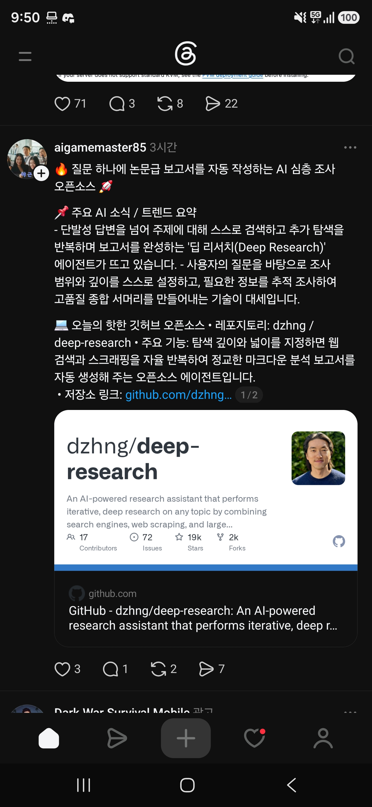

## 한눈에 보기

- 주제를 주면 **검색 → 결과 읽기 → 알게 된 것과 다음 방향 정리 → 다시 검색**을 되풀이하고, 마지막에 출처가 달린 마크다운 보고서를 만드는 에이전트입니다. README의 제목은 "Open Deep Research"입니다.
- 만든 사람은 dzhng이고, README에 Duet(duet.so)이 만든 프로젝트라고 적혀 있습니다.
- 목표가 "가장 단순한 딥 리서치 구현"입니다. 이해하고 고쳐 쓰기 쉽도록 저장소 크기를 500줄 미만으로 유지하겠다고 밝힙니다.
- 공개 시기는 저장소 생성일인 2025-02-04를 기준으로 적었습니다. 릴리스는 따로 없습니다.
- GitHub 별 19,892개, 포크 2,008개, 주 언어 TypeScript, 마지막 푸시 2026-04-11 (2026-11-11 조회). 캡처(2026-08-10)에는 별 19k, 포크 2k, 기여자 17명으로 보입니다.

## 핵심 내용

### 동작 방식

README의 흐름도를 말로 풀면 다음과 같습니다.

1. 질문, 넓이(breadth), 깊이(depth)를 받습니다. 조사 방향을 잡기 위해 사용자에게 되묻는 질문을 먼저 만듭니다.
2. 조사 목표에 맞는 검색어를 여러 개 만들어 검색합니다.
3. 검색 결과를 읽고 **알게 된 것(learnings)**과 **더 파 볼 방향(directions)**을 뽑습니다.
4. 깊이가 남아 있으면 이전 목표, 새 질문, 알게 된 것을 묶어 새 맥락으로 2번부터 다시 합니다.
5. 깊이가 0이 되면 모은 내용을 마크다운 보고서로 정리합니다.

| 값 | 뜻 | README 권장 |
|---|---|---|
| 넓이(breadth) | 한 번에 만드는 검색어 수 | 3~10, 기본 4 |
| 깊이(depth) | 되풀이해 파고드는 횟수 | 1~5, 기본 2 |

### 주요 기능 (README)

- 이전에 알게 된 것을 바탕으로 다음 검색어를 LLM이 만듭니다.
- 여러 검색과 결과 처리를 동시에 돌립니다. 동시 실행 수는 `CONCURRENCY_LIMIT`으로 조절합니다.
- 결과는 작업 폴더에 `report.md`(보고서) 또는 `answer.md`(짧은 답)로 저장됩니다.

### 쓰는 외부 서비스

- 웹 검색과 본문 추출: **Firecrawl** API (직접 띄운 Firecrawl도 `FIRECRAWL_BASE_URL`로 지정 가능)
- 모델: 기본은 OpenAI **o3-mini**. Fireworks 키를 넣으면 DeepSeek R1으로 자동 전환됩니다.
- `OPENAI_ENDPOINT`와 `CUSTOM_MODEL`(또는 `OPENAI_MODEL`)로 OpenAI 호환 주소와 모델을 바꿀 수 있습니다. 로컬 모델 서버나 OpenRouter, Gemini를 예로 듭니다.

## 써 보려면

```bash
git clone https://github.com/dzhng/deep-research
cd deep-research
npm install
```

`.env.local` 파일에 키를 넣습니다.

```bash
FIRECRAWL_KEY="your_firecrawl_key"
OPENAI_KEY="your_openai_key"
```

```bash
npm start
```

실행하면 질문, 넓이, 깊이를 차례로 묻고, 되묻는 질문에 답하면 조사가 시작됩니다.

- Docker로 돌리는 방법도 README에 있습니다(`docker compose up -d` 뒤 `docker exec -it deep-research npm run docker`).
- 필요한 것: Node.js, Firecrawl API 키, OpenAI API 키(또는 호환 주소).
- 라이선스는 MIT입니다.

## 눈여겨볼 점

- 받은 글은 "오늘의 핫한 깃허브 오픈소스"로 소개했지만, 저장소는 2025년 2월에 만들어졌고 마지막 푸시는 2026-04-11입니다. README의 기본 모델도 o3-mini, DeepSeek R1 그대로입니다. 최신 모델로 쓰려면 `CUSTOM_MODEL`을 직접 지정해야 합니다.
- Firecrawl 무료 요금제에서는 호출 제한 오류가 날 수 있어 동시 실행 수를 1로 낮추라고 README가 안내합니다. 그만큼 느려집니다.
- 터미널에서 묻고 답하는 방식이고, 화면(UI)은 README에 없습니다.
- "논문급 보고서"라는 받은 글의 표현은 README에 없는 말입니다. 보고서 품질은 직접 돌려 확인하지 않았습니다.
- 사내망에서 쓰려면 검색(Firecrawl)과 모델 주소를 모두 내부에서 닿는 곳으로 바꿔야 합니다. OpenAI 호환 주소를 받으므로 구조상 가능해 보이지만 직접 시험하지 않았습니다.

## 받은 캡처



캡처 2026-08-10

## 출처

- [dzhng/deep-research 저장소 README](https://github.com/dzhng/deep-research) — 동작 방식, 기능, 설치·실행 방법, 필요한 키, 라이선스
- [GitHub 저장소 API 정보](https://api.github.com/repos/dzhng/deep-research) — 생성일, 별·포크 수, 마지막 푸시, 언어 (2026-11-11 조회)
- Threads aigamemaster85 글 (캡처) — 처음 받은 정보
