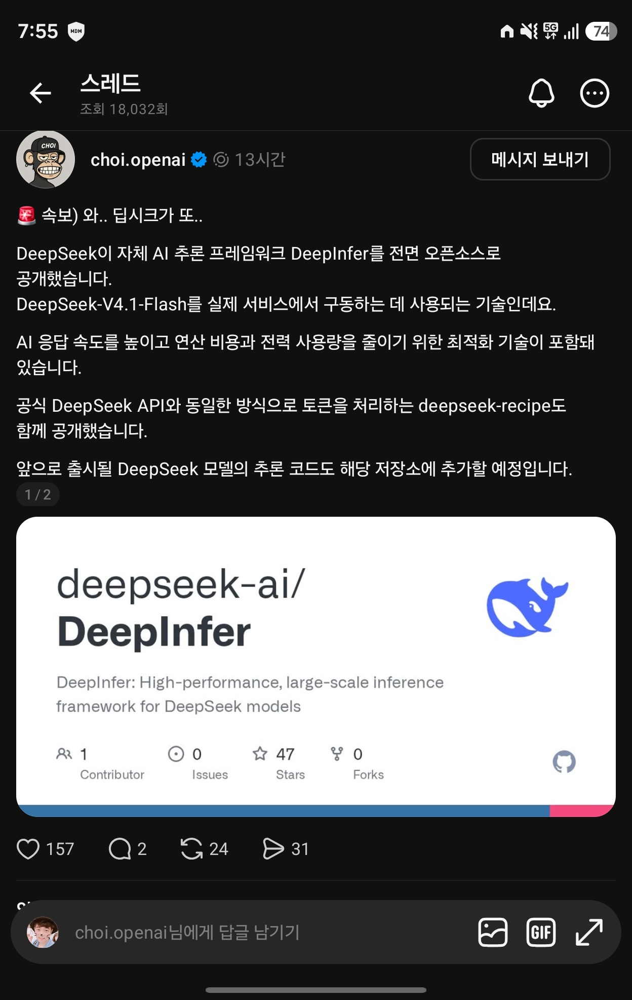

## 한눈에 보기

- DeepSeek이 자사 대규모 서비스를 돌리는 데 쓰는 **추론 프레임워크**(학습된 모델을 실제로 실행해 답을 만들어 내는 프로그램)입니다. README는 "DeepSeek의 대규모 운영 서비스를 움직이는 고성능 추론 프레임워크"라고 소개합니다.
- 이번 공개본은 **오프라인 추론**(서버로 띄우지 않고 스크립트로 직접 돌리는 방식)과 대규모 서빙에 필요한 핵심 기능을 담았습니다. 지원 모델은 지금 DeepSeek-V4.1-Flash 하나입니다.
- 공개 시기는 첫 커밋 날짜인 2026-10-20을 기준으로 적었습니다(저장소 생성은 2026-10-16). 릴리스 태그는 없습니다.
- GitHub 별 25,846개, 포크 3,169개, 마지막 푸시 2026-11-03 (2026-11-11 조회). 캡처(2026-10-21)에는 별 47개, 포크 0개로 보여 공개 직후에 찍힌 화면입니다.


## 핵심 내용

### 지원 기능 (README)

| 기능 | 쉬운 설명 |
|---|---|
| 최적화된 커널, 모델·샘플러 실행부 | DeepSeek이 따로 공개한 FlashMLA, DeepGEMM, DeepEP, TileKernels, DeepSelect와 자체 TileLang 커널을 씁니다 |
| 병렬 처리 | Attention DP / balanced CP, MoE EP + EPLB (README 표기 그대로. 풀이는 README에 없음) |
| DSpark와 신뢰도 기반 검증 | 초안 토큰을 미리 뽑아 디코딩을 빠르게 하고, 신뢰도 추정으로 검증 시점을 정합니다. 초안 최대 길이 기본값 5 |
| SWA bounded replay | 디코더가 앞부분을 다시 읽는 양을 제한된 끝부분만으로 줄입니다 |
| 비동기 스케줄링 | CPU의 묶음(배치) 편성과 장치 실행을 겹쳐서 돌립니다. 기본으로 켜져 있음 |
| 배치 불변 추론 | 함께 묶인 요청이 달라져도 결과가 같게 합니다 (NVIDIA만) |
| 결정적 샘플링 | 같은 입력 토큰과 같은 설정이면 같은 출력이 나옵니다. 고정 `seq_seed` 필요 (NVIDIA만) |
| 구조화 출력 | 정규식, JSON 스키마, EBNF 문법에 맞춰 출력을 제한합니다 |

### 이 공개본에 없는 것

완전한 추론 서비스를 만들려면 아래가 더 필요하다고 README가 밝힙니다.

- KV 캐시 시스템
- VE/Prefill/Decode 분리 구성 (엔진 쪽 기능은 대부분 들어 있다고 함)
- 데이터 병렬 복제본 사이의 부하 분산

### 지원 하드웨어

- NVIDIA SM100 GPU
- Huawei Ascend 950 NPU

### 성능 자료

README에 프리필(입력 처리)과 디코드(출력 생성) 성능 그래프가 있습니다. 프리필은 SM100 GPU 4장, 디코드는 64장에서 쟀다고 하며, 재현용 스크립트(`examples/sweep/run_sweep.sh`)를 함께 줍니다. 그래프의 수치는 이 문서에 옮기지 않았습니다.

### 함께 언급된 deepseek-recipe

- 여러 형식의 API 요청(Messages, Chat Completions, Responses)을 하나의 대화 형식으로 바꾸고, DeepSeek 모델용 프롬프트로 만들고, 토큰 ID로 바꾸고, 모델 출력을 다시 응답 형식으로 돌려주는 Rust 라이브러리와 Python 바인딩 모음입니다. 추론 자체, 도구 실행, HTTP 전송은 쓰는 쪽이 맡습니다.
- 저장소 생성일은 2026-09-10, 라이선스는 MIT, 별 2,818개입니다(2026-11-11 조회).

### 받은 글의 주장과 확인한 내용

| 받은 글(Threads, choi.openai) | 1차 자료에서 확인한 것 |
|---|---|
| 자체 추론 프레임워크 DeepInfer를 전면 오픈소스로 공개 | 저장소는 Apache 2.0으로 공개. 다만 README는 "오프라인 추론"을 제공하는 공개본이고 서비스에 필요한 일부(KV 캐시 등)는 빠져 있다고 밝힘 |
| DeepSeek-V4.1-Flash를 실제 서비스에서 구동하는 기술 | README의 소개와 지원 모델 목록과 일치 |
| 응답 속도를 높이고 연산 비용과 전력 사용량을 줄이는 최적화 | 속도 관련 기능은 README에 있음. **전력 사용량에 대한 언급은 README에서 확인 못 함** |
| deepseek-recipe도 함께 공개 | 저장소는 있으나 생성일이 2026-09-10으로 DeepInfer보다 앞섬. 같은 날 공개됐는지는 확인 못 함 |
| 앞으로 나올 모델의 추론 코드도 이 저장소에 추가 예정 | README에서 확인 못 함. 원 발표 글은 찾지 못함 |

## 써 보려면

필요한 것: Linux, GCC 13 이상, Python 3.12, CUDA 13(NVIDIA) 또는 CANN 9.2(Ascend).

```bash
# Ascend에서는 nvidia 대신 ascend
export DEEPINFER_ACCELERATOR=nvidia
./build.sh
python examples/offline_inference.py
```

- 기본 모델 파일(`deepseek-ai/DeepSeek-V4.1-Flash-1017`)은 처음 실행할 때 Hugging Face에서 내려받습니다. 미리 받아 둔 폴더는 `DEEPINFER_HF_MODEL_DIR`로 지정합니다.
- 라이선스는 Apache 2.0입니다.

## 눈여겨볼 점

- 개인 PC에서 돌려 보는 도구가 아닙니다. 지원 하드웨어가 데이터센터용 가속기 두 종류뿐이고, 성능 측정도 GPU 4~64장 규모입니다.
- README는 DeepInfer가 원래 vLLM을 주된 바탕으로 만들어졌고 SGLang, TensorRT-LLM에서도 착안했다고 감사의 말에 적었습니다.
- 지원 모델이 하나뿐입니다. 다른 모델에 쓸 수 있는지는 README에 없습니다.
- 커밋이 6개뿐입니다(2026-10-20 ~ 2026-11-03, 2026-11-11 조회). 내부 코드를 정리해 올리는 방식으로 보이며, 바깥 기여를 어떻게 받는지는 확인하지 못했습니다.
- DeepSeek의 공식 발표 글(블로그·X)은 찾아보지 않았습니다. 위 내용은 저장소 README와 메타데이터를 읽은 것입니다.

## 받은 캡처



캡처 2026-10-21

## 출처

- [deepseek-ai/DeepInfer 저장소 README](https://github.com/deepseek-ai/DeepInfer) — 소개, 지원 모델·기능·하드웨어, 빠진 구성 요소, 빌드·실행 방법, 라이선스
- [GitHub 저장소 API 정보](https://api.github.com/repos/deepseek-ai/DeepInfer) — 생성일, 첫 커밋일, 별·포크 수, 마지막 푸시 (2026-11-11 조회)
- [deepseek-ai/deepseek-recipe 저장소 README](https://github.com/deepseek-ai/deepseek-recipe) — 하는 일, 생성일, 라이선스 (2026-11-11 조회)
- [DeepSeek-V4.1-Flash-1017 모델 페이지](https://huggingface.co/deepseek-ai/DeepSeek-V4.1-Flash-1017) — 주소가 열리는 것만 확인
- Threads choi.openai 글 (캡처) — 처음 받은 정보
