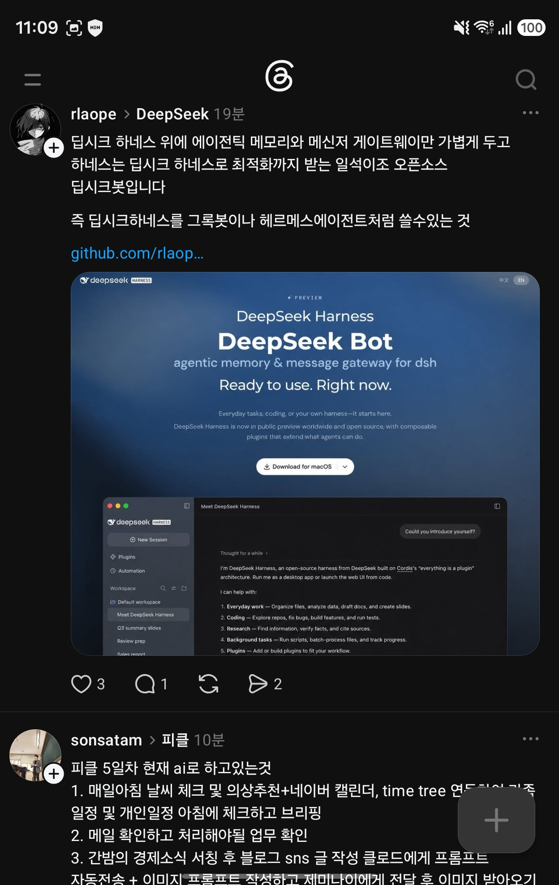

## 한눈에 보기

- **DeepSeek Harness**(명령 이름 `dsh`)용 플러그인입니다. 하네스 자체는 DeepSeek 것을 그대로 쓰고, 그 위에 "대화가 끝나도 남는 기억"과 "메신저에서 부르는 창구"만 더합니다. 캡처한 글의 표현으로는 하네스 최적화는 DeepSeek에게 맡기고 얹을 것만 얹는 방식입니다.
- 만든 사람은 GitHub 사용자 rlaope(oh-my-hermes 제작자)입니다. DeepSeek와 무관한 개인 프로젝트라고 README에 밝혔습니다.
- 공개 시기는 저장소 생성일 2026-10-06을 기준으로 적었습니다. GitHub 릴리스는 등록된 것이 없었습니다. 별 229개, 포크 25개, 마지막 푸시 2026-11-08(2026-11-11 조회).


## 핵심 내용

### 바탕이 되는 DeepSeek Harness

- `deepseek-ai/deepseek-harness`는 2026-08-13에 만들어진 MIT 라이선스 저장소이고, 설명은 "Everything is a Plugin"입니다. 별 약 278,600개(2026-11-11 조회). 최근 릴리스는 `dsh-v0.2.2-rc.1`(2026-11-04)로 아직 릴리스 후보 단계입니다.
- 모델, 도구, 스킬, 세션, 샌드박스 등이 모두 플러그인 경계 뒤에 있어 설정으로 바꿔 끼울 수 있다는 설명은 2차 자료(검색 결과 요약)로만 확인했고, 하네스 저장소의 README는 이번에 직접 읽지 않았습니다.

### deepseek-bot이 더하는 것 (README 기준)

| 항목 | 내용 |
|---|---|
| 터미널 에이전트 | `dsh`가 전체 화면 터미널로 뜨고, 답이 흘러나오며 도구 호출과 변경 내용(diff)이 보입니다. docx·xlsx·pptx 작성, 헤드리스 브라우저로 링크 읽기, 이미지 보기, MCP 도구 사용 |
| 기억 | 모든 대화가 재시작해도 남는 세션입니다. 페르소나, 사용자와 작업에 대한 기록(`USER.md`, `MEMORY.md`, `memory/`), 지난 대화 검색 색인이 매 턴에 들어옵니다. 회상은 자기 채널 안에서만 하고 "못 찾음"도 답으로 칩니다 |
| 메신저 | Slack, Discord, Telegram에서 멘션하면 스레드에 답합니다. `stop`(중단), `usage`(토큰 사용량), `be quiet`(조용히) 명령 |
| 승인 | 지우거나 덮어쓰는 명령은 요청한 사람이 대화 안에서 허용/거부를 누를 때까지 기다립니다 |
| 격리 | 명령은 macOS Seatbelt 샌드박스에서 실행되어 자기 작업 폴더에만 쓰고 토큰·자격 증명을 읽지 못합니다. 지시를 심으려는 글은 모델이 보기 전에 표시합니다 |
| 모델 | 기본은 DeepSeek 자체 API. OpenGateway나 다른 OpenAI 호환 주소도 선택할 수 있습니다 |

캡처한 글은 "딥시크 하네스를 그록봇이나 헤르메스 에이전트처럼 쓸 수 있는 것"이라고 설명합니다. 곧 코딩용 하네스를 메신저에 상주하는 개인 비서형 에이전트로 쓰게 해 주는 층입니다.

## 써 보려면

```sh
curl -fsSL https://raw.githubusercontent.com/rlaope/deepseek-bot/master/install.sh | bash
dsh
```

- 필요한 것: **macOS**, Node.js 22 이상, DeepSeek Harness 앱, DeepSeek API 키(하네스에 이미 있으면 다시 묻지 않음). 앱이 없으면 설치 스크립트가 DeepSeek 서버에서 내려받겠다고 제안합니다.
- 메신저 연결: `dsh gateway setup`, 상태 확인: `dsh gateway status`, 업데이트: `dsh update`.
- 라이선스는 MIT입니다.

## 눈여겨볼 점

- **macOS 전용**입니다. README에 따르면 Windows에서는 터미널을 손으로 띄울 수는 있지만 설치 스크립트, 서비스, 샌드박스가 이식되지 않았습니다.
- 메신저 중 실제로 써 본 것은 Slack뿐이고, Discord·Telegram은 모의 API로만 검증했다고 적혀 있습니다. Telegram·Discord는 봇을 찾은 누구나 말을 걸 수 있으니 허용 사용자를 지정하라고 안내합니다.
- 샌드박스는 별도 OS 사용자가 아니라 정책 경계이고, MCP 서버는 샌드박스 밖에서 돕니다. 믿는 것만 추가하라고 합니다.
- DeepSeek Harness가 릴리스 후보 단계이고 이 프로젝트가 그 내부 구조에 기대고 있어, 하네스 버전을 고정하라고 권합니다.
- README의 데모는 후원사 OpenGateway 경로로 녹화했다고 밝혀 두었습니다.
- 직접 설치해 보지는 않았습니다. `docs/how-it-works.md`, `SPEC.md`도 열어 보지 않았습니다.

## 받은 캡처



캡처 2026-11-03 (같은 화면 아래쪽의 다른 사람 글은 이 문서와 관계없습니다)

## 출처

- [rlaope/deepseek-bot 저장소 README](https://github.com/rlaope/deepseek-bot) — 기능, 설치, 검증 범위, 한계, 라이선스
- [GitHub 저장소 API 정보: rlaope/deepseek-bot](https://api.github.com/repos/rlaope/deepseek-bot) — 별·포크 수, 생성일, 마지막 푸시 (2026-11-11 조회)
- [GitHub 저장소 API 정보: deepseek-ai/deepseek-harness](https://api.github.com/repos/deepseek-ai/deepseek-harness) — 생성일, 별 수, 라이선스, 최근 릴리스 (2026-11-11 조회)
- Threads 글(rlaope) 캡처 — 출발점. 글 속 링크는 `github.com/rlaop…`까지만 보임
