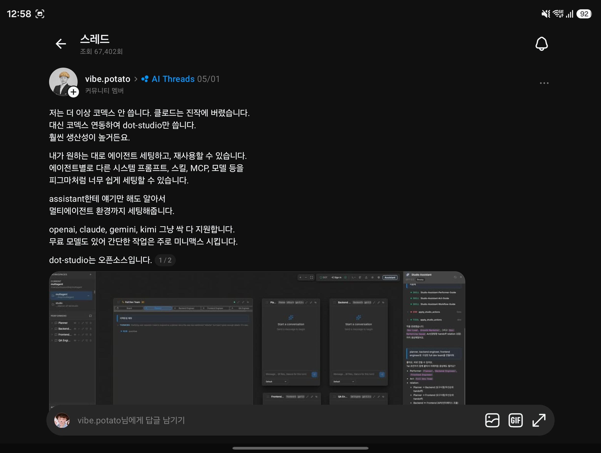

## 한눈에 보기

- 캡처한 글(vibe.potato, 05/01 작성)이 소개한 **dot-studio**는 에이전트를 화면에서 구성하고 재사용하는 오픈소스 도구입니다. 에이전트마다 다른 시스템 프롬프트, 스킬, MCP, 모델을 붙이고, 도우미(Studio Assistant)에게 말로 시키면 멀티에이전트 구성까지 만들어 준다고 합니다.
- **지금은 이름이 바뀌었습니다.** `github.com/dance-of-tal/dot-studio` 주소는 `apm-studio/apm-studio`로 넘어가고, README 제목도 "APM Studio"입니다. 설명은 "Agent Package Manager(APM) 패키지용 로컬 GUI"로 바뀌었습니다. 이름을 바꾼 이유나 시점을 밝힌 글은 찾지 못했습니다.
- 공개 시기는 저장소 생성일 2026-03-12를 기준으로 적었습니다(npm `dot-studio` 패키지의 첫 등록일도 같은 날). 별 437개, 포크 70개, **마지막 푸시 2026-06-03**, 최신 릴리스 v0.3.5(2026-06-03)입니다(2026-11-11 조회). 다섯 달 넘게 변경이 없습니다.

## 핵심 내용

### 캡처 시점의 DOT Studio (문서 사이트 기준)

"Dance of Tal(DOT)" 체계를 눈으로 조립·점검·실행하는 로컬 작업 공간입니다. 프로젝트 폴더를 열고, 뒤에서 관리되는 **OpenCode**를 통해 에이전트를 돌립니다.

| 개념 | 뜻 |
|---|---|
| Tal | 정체성과 지침을 적은 마크다운(페르소나, 규칙) |
| Dance | `SKILL.md`를 중심으로 한 스킬 묶음 |
| Performer | 실행 가능한 에이전트. Tal + Dance + 모델 + MCP 연결 + 실행 방식 |
| Act | 여러 Performer가 참여하는 작업 흐름. 참여자, 넘겨주기 관계, 깨우는 신호, 공통 규칙 |

- 화면 구성: 캔버스, 자산 목록, 속성 창, Performer 대화, Act 스레드, 초안 편집기.
- 실행 방식: **direct**는 실제 프로젝트 폴더에서, **safe**는 그림자 작업 공간에서 일하고 검토한 뒤 반영합니다.
- 캡처 화면에는 Planner·Backend·Frontend·QA Engineer로 된 "Full Dev Team"과, 오른쪽 Studio Assistant가 Performer와 Act를 만들어 주는 모습이 보입니다.

### 지금의 APM Studio (저장소 README 기준)

같은 저장소가 Microsoft의 APM(Agent Package Manager) 패키지 형식을 다루는 화면 도구로 바뀌었습니다.

| 단계 | 하는 일 |
|---|---|
| Import | GitHub 저장소를 찾아 에이전트·스킬·프롬프트·훅·MCP 설정을 미리 보고 골라 설치 |
| Manage | 로컬 패키지(`packages/*`)의 정보와 Studio Agent 구성을 편집 |
| Run | Studio 전용 모델 설정으로 에이전트를 로컬에서 시험 |
| Export | 고른 항목을 Codex, Claude, Cursor, Gemini, OpenCode 등의 설정 파일로 내보내 동기화 |

### 캡처의 주장과 확인한 것

| 캡처의 주장 | 확인 결과 |
|---|---|
| 오픈소스다 | MIT 라이선스 확인 |
| 에이전트별 시스템 프롬프트·스킬·MCP·모델 설정 | DOT 문서의 Performer 설명과 일치 |
| assistant에게 말하면 멀티에이전트까지 세팅 | 캡처 화면에 Studio Assistant가 보임. 문서 사이트의 해당 쪽에서는 설명을 찾지 못함 |
| openai, claude, gemini, kimi 모두 지원, 무료 모델(미니맥스)도 있음 | 1차 자료에서 지원 모델 목록을 찾지 못함. OpenCode 위에서 돈다는 점만 확인 |
| 코덱스와 연동해 쓴다 | 현재 README는 Codex를 내보내기 대상으로 적음. 캡처 당시의 연동 방식은 확인 못 함 |

## 써 보려면

현재 저장소(APM Studio) 기준입니다.

```bash
npm install -g apm-studio
apm-studio
```

- 필요한 것: Node.js 20.19.0 이상, macOS·Linux·Windows·WSL, 로컬 실행용 OpenCode, 전체 동기화에는 Microsoft APM CLI.
- Windows 설치 스크립트: `irm https://raw.githubusercontent.com/apm-studio/apm-studio/main/public/install.ps1 | iex`
- 기본 포트는 43100(앱과 API), 43102(OpenCode)입니다.
- 예전 이름의 npm 패키지 `dot-studio`는 0.2.13(마지막 수정 2026-05-21)에서 멈춰 있고, DOT 문서 사이트는 여전히 `npm install -g dot-studio@latest` 뒤 `dot-studio .`로 실행하라고 안내합니다.
- 라이선스는 MIT입니다.

## 눈여겨볼 점

- 캡처한 글은 05/01에 쓰인 것이고, 그 뒤 6월 초에 이름과 방향이 바뀐 뒤 갱신이 멈췄습니다. 지금 새로 쓰기 시작하기에는 유지 여부가 불확실합니다.
- 글쓴이는 "코덱스도 클로드도 안 쓰고 dot-studio만 쓴다"고 했지만 개인의 사용 후기이고, 생산성 비교 자료는 없습니다.
- 캡처 화면 속 작업 공간 경로에 `dance-of-tal/studio`가 보여, 글쓴이가 이 프로젝트의 개발자일 가능성이 있습니다. 확인 못 함.
- 예전 이름의 `dot-studio`와 새 이름의 `apm-studio` 사이에 설정이 호환되는지 확인하지 못했습니다.
- 직접 설치해 보지는 않았습니다.

## 받은 캡처



캡처 2026-11-03 (글 자체는 05/01 작성)

## 출처

- [apm-studio/apm-studio 저장소 README](https://github.com/apm-studio/apm-studio) — 현재 이름과 설명, 설치, 흐름, 포트, 라이선스. `dance-of-tal/dot-studio`로 조회하면 이 저장소가 나옴
- [GitHub 저장소 API 정보](https://api.github.com/repos/apm-studio/apm-studio) — 생성일, 별·포크 수, 마지막 푸시, 릴리스 (2026-11-11 조회)
- [DOT Studio 문서](https://dance-of-tal-web.vercel.app/docs/studio) — Tal·Dance·Performer·Act 개념, 실행 방식, 화면 구성, 예전 설치 명령
- [npm 레지스트리: dot-studio](https://registry.npmjs.org/dot-studio), [apm-studio](https://registry.npmjs.org/apm-studio) — 첫 등록일, 최신 버전 (2026-11-11 조회)
- Threads 글(vibe.potato, AI Threads 커뮤니티, 05/01) 캡처 — 출발점. 원문 주소는 캡처에 보이지 않음
