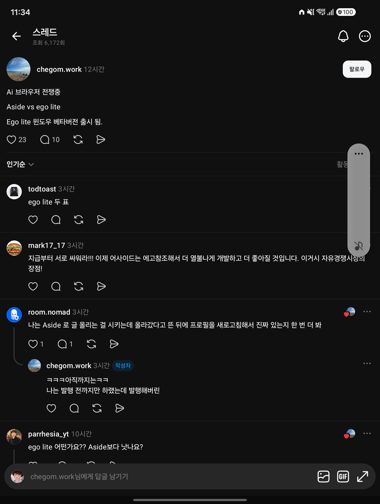

## 한눈에 보기

- **ego lite**는 사람과 AI 에이전트가 한 브라우저를 나눠 쓰도록 만든 브라우저입니다. 에이전트는 **Space**라는 분리된 작업 공간에서 일하고, 사람은 자기 탭에서 하던 일을 계속합니다. 만든 곳은 citrolabs입니다.
- 브라우저 안에 AI가 들어 있는 것이 아니라, **내가 이미 쓰는 에이전트**(Claude Code, Codex, Cursor 등)가 `ego-browser` 스킬로 이 브라우저를 조종하는 구조입니다.
- 공개 시기는 저장소 생성일인 2026-04-16을 기준으로 적었습니다. 최신 릴리스는 v2.2.0(2026-11-05)입니다.
- GitHub 별 22,512개, 포크 1,275개 (2026-11-11 조회).
- 받은 글은 "AI 브라우저 전쟁 중, Aside vs ego lite, ego lite Windows 베타 출시"라는 짧은 소식이었습니다.


## 핵심 내용

### ego lite의 특징 (README)

| 특징 | 설명 |
|---|---|
| 명령이 아니라 코드로 조종 | 브라우저 기능이 JavaScript 함수(snapshot, fill, click, wait, navigate, capture)로 제공됩니다. 에이전트가 여러 단계를 코드 한 덩어리로 써서 한 번에 실행하므로, 명령을 하나씩 주고받는 방식보다 도구 호출 수와 토큰이 줄어든다고 합니다 |
| 에이전트마다 전용 Space | 에이전트는 뒤에서, 사람은 앞에서 일합니다. 어느 Space에서 에이전트가 도는지 보이고, 넘겨받거나 멈출 수 있습니다 |
| 여러 Space 동시 실행 | Space마다 다른 에이전트나 작업을 동시에 돌립니다 |
| 페이지 스냅샷 | 페이지를 구조화된 글로 바꿔 글만 읽는 모델이 화면을 "보게" 합니다. 브라우저 엔진을 고쳐서 겹겹이 들어간 iframe도 다룬다고 합니다 |
| 내 로그인 그대로 | 처음 실행할 때 Chrome 데이터를 옮길지 묻고, 옮기면 로그인·쿠키·확장 프로그램·북마크를 에이전트가 이어받습니다 |
| 경험 쌓기 (준비 중) | 성공한 동작을 다시 쓸 수 있는 도구로 정리해 비슷한 작업을 빠르게 한다는 기능. 아직 나오지 않았습니다 |

README는 기존 도구(browser-use, agent-browser 등)를 "브라우저로 가는 다리일 뿐 브라우저가 아니다"라고 하고, 그 때문에 따로 브라우저가 필요하고 로그인 데이터가 온전히 넘어오지 않으며 사람과 에이전트가 조종권을 두고 다툰다고 설명합니다.

### 성능 자료 (README의 자체 측정)

실제 웹사이트에서 하는 복잡한 자동화 작업 31개(Real-World Bench)를 다른 도구 네 가지(Browser Harness, playwright-cli, chrome-devtools-cli, agent-browser)와 같은 에이전트, 같은 모델로 돌렸더니 ego-browser가 47~63% 더 빨리 끝냈다고 합니다. 만든 쪽이 잰 수치입니다.


### Windows 지원

- 받은 글(2026-10-21 캡처)은 "ego lite 윈도우 베타 버전 출시"라고 전했습니다.
- README는 지금 "macOS와 Windows에서 동작하고 Linux는 계획에 있다"고 적고 Windows 설치 파일 링크를 둡니다(2026-11-11 조회).
- 릴리스 기록에서 v2.1.0(2026-10-16)에 Windows 관련 수정(클립보드 붙여넣기, PowerShell·cmd 실행 형식)이, v2.2.0(2026-11-05)에 "README에 Windows 내려받기 추가"가 보입니다.
- 지금도 "베타" 표시가 붙어 있는지는 README에서 확인하지 못했습니다(README에는 베타 표시가 없음).

### Aside와 무엇이 다른가

| | ego lite | Aside |
|---|---|---|
| 한마디 | 내가 쓰는 에이전트가 조종하는 브라우저 | 에이전트가 들어 있는 AI 브라우저 |
| 만든 곳 | citrolabs | Aside (Y Combinator 2025년 가을 배치, 샌프란시스코) |
| 누가 일하나 | 바깥의 에이전트(Claude Code, Codex, Cursor 등)가 `ego-browser`로 접속 | 브라우저에 든 에이전트가 로그인된 사이트에서 작업. CLI와 MCP도 제공 |
| 모델 | 쓰는 에이전트의 것 | ChatGPT 또는 Claude 구독, 또는 내 API 키 |
| 지원 환경 | macOS, Windows (Linux 예정) | macOS 15 이상, Windows 10 22H2 이상·Windows 11 |
| 값 | 무료, 저장소는 MIT | 요금 페이지가 따로 있음. 금액은 확인 못 함 |
| 안전장치 | 데이터는 내 기기에 보관, 수집은 기본 제품 신호로 한정한다고 밝힘 | 비밀번호는 사이트에 자동 입력되고 에이전트에게 노출되지 않음. 결제·게시·메시지 같은 민감한 동작은 사용자 확인 필요 |

Aside 쪽 내용은 aside.com과 Y Combinator 회사 소개를 2026-11-11에 조회한 것입니다. Aside의 공개 시기는 2026년 6월 하순이라는 2차 보도만 있고 1차 자료로는 확인하지 못했습니다. Aside의 공개 저장소는 찾지 못했습니다.

## 써 보려면

ego lite 설치는 세 가지 중 고릅니다.

1. 공식 사이트나 README에서 앱을 내려받아 설치합니다. 설치하면 내 PC의 모든 에이전트 스킬 폴더에 `ego-browser` 스킬이 들어갑니다.
2. 스킬만 먼저 넣습니다. 에이전트가 처음 브라우저 작업을 할 때 앱 설치를 안내합니다.

```bash
npx skills add citrolabs/ego-lite
```

3. 에이전트에게 저장소 주소를 주고 설치를 맡깁니다(README에 붙여 넣을 문구가 있음).

쓸 때는 에이전트 CLI에서 `/ego-browser` 뒤에 할 일을 말로 적습니다.

- 저장소 내용은 MIT 라이선스입니다. 브라우저 앱은 "별도의 무료 다운로드"라고 적혀 있고, 앱 자체의 라이선스는 확인하지 못했습니다.

## 눈여겨볼 점

- 내 로그인과 쿠키를 에이전트가 그대로 씁니다. 편리한 만큼, 에이전트가 내 계정으로 글을 올리거나 결제하는 일이 실제로 일어날 수 있습니다. 받은 글의 댓글에도 "발행 전까지만 하랬는데 발행해 버린" 경험, "올라갔다고 뜬 뒤 새로 고침으로 진짜 있는지 다시 본다"는 말이 있습니다(Aside 사용 경험으로 읽힘).
- 성능 수치와 "가장 빠르다", "시장에서 가장 강한 스냅샷"은 만든 쪽의 주장입니다.
- 저장소가 MIT라고 해서 브라우저 전체가 오픈소스인지는 확인하지 못했습니다. 저장소 설명은 스킬과 연결 부분 중심입니다.
- 사내 PC에 설치하려면 Chrome 데이터 이전과 외부 접속 여부를 보안 부서와 먼저 확인해야 합니다.
- 두 제품 모두 직접 설치해 써 보지 않았습니다.

## 받은 캡처



캡처 2026-10-21

## 출처

- [citrolabs/ego-lite 저장소 README](https://github.com/citrolabs/ego-lite) — 소개, 특징, 비교표, 자체 성능 자료, 설치 방법, 지원 환경, 라이선스
- [GitHub 저장소·릴리스 API 정보](https://api.github.com/repos/citrolabs/ego-lite) — 생성일, 별·포크 수, 릴리스 날짜와 변경 내용 (2026-11-11 조회)
- [lite.ego.app](https://lite.ego.app), [문서](https://lite.ego.app/document/) — 주소가 열리는 것만 확인
- [aside.com](https://aside.com) — Aside 소개, 지원 환경, 구독 연결, 안전장치 (2026-11-11 조회)
- [Y Combinator: Aside](https://www.ycombinator.com/companies/aside) — 배치, 창업자, 위치
- Threads chegom.work 글 (캡처) — 처음 받은 정보
