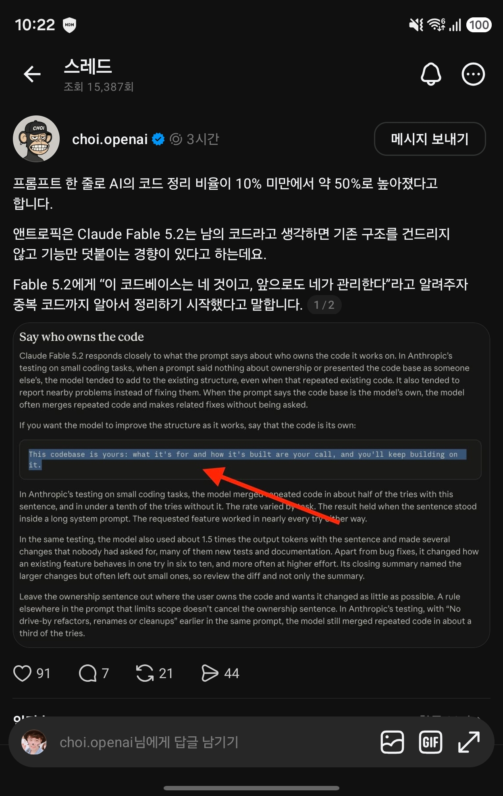

## 한눈에 보기

- Anthropic 공식 문서 "Prompting Claude Fable 5.2"에 있는 "Say who owns the code"라는 절입니다. 코딩 에이전트가 기존 코드를 합치지 않고 비슷한 코드를 또 덧붙이거나, 옆에 있는 문제를 고치지 않고 보고만 할 때 보라고 안내하는 대목입니다.
- 요지는 간단합니다. 프롬프트에 "이 코드베이스는 네 것이고, 무엇을 위한 것인지와 어떻게 만들지는 네가 정하며, 앞으로도 네가 계속 만들어 간다"는 뜻의 한 문장을 넣으면 모델이 구조까지 손봅니다.
- 공개 시기는 Claude Fable 5.2 출시일(2026-11-09, 모델 소개 문서의 "Released")을 기준으로 적었습니다. 이 안내 문서 자체가 올라온 날짜는 문서에 적혀 있지 않아 확인하지 못했습니다.

## 핵심 내용

### 모델이 보이는 차이

Anthropic이 작은 코딩 과제로 시험한 결과라고 문서가 밝힌 내용입니다.

| 프롬프트가 말하는 코드의 주인 | 모델의 행동 |
|---|---|
| 아무 말 없음, 또는 남의 코드라고 함 | 기존 구조에 덧붙입니다. 이미 있는 코드와 겹쳐도 그대로 더합니다. 근처의 문제는 고치지 않고 보고합니다. |
| 모델 자신의 코드라고 함 | 겹치는 코드를 합치고, 관련된 수정을 시키지 않아도 하는 경우가 많습니다. |

### 넣는 문장

문서가 제시한 문장은 "This codebase is yours"로 시작하는 한 줄입니다. 전체 문장은 위 링크의 해당 대목과 아래 캡처에 그대로 있습니다. 뜻은 "이 코드베이스는 네 것이다. 무엇을 위한 것이고 어떻게 만들지는 네가 정하고, 앞으로도 네가 이어서 만든다"입니다.

### Anthropic이 밝힌 수치

| 항목 | 문장 없음 | 문장 있음 |
|---|---|---|
| 중복 코드를 합친 비율 | 시도의 10분의 1 미만 | 시도의 절반쯤 |
| 요청한 기능이 동작한 비율 | 거의 모든 시도 | 거의 모든 시도 |
| 출력 토큰 | 기준 | 약 1.5배 |

- 비율은 과제에 따라 달랐다고 합니다.
- 이 문장이 긴 시스템 프롬프트 안에 들어 있어도 결과가 유지됐다고 합니다.

### 함께 따라오는 부작용

- 아무도 시키지 않은 변경이 여러 건 생겼고, 그중 많은 수가 새 테스트와 문서였습니다.
- 버그 수정을 빼고도, 기존 기능의 동작을 바꾼 경우가 6~10번에 한 번꼴이었고, effort를 높일수록 더 잦았습니다.
- 마무리 요약은 큰 변경은 적지만 작은 변경은 자주 빠뜨렸습니다. 그래서 문서는 요약만 보지 말고 diff를 직접 검토하라고 합니다.

### 쓰지 말아야 할 때

- 코드의 주인이 사용자이고, 되도록 적게 고치기를 바랄 때는 이 문장을 빼라고 합니다.
- 범위를 제한하는 규칙을 프롬프트 다른 곳에 적어도 이 문장의 효과가 사라지지 않습니다. 같은 프롬프트 앞쪽에 지나가는 길의 리팩터링·이름 변경·정리를 금지하는 규칙을 두었는데도, 모델은 시도의 3분의 1쯤에서 중복 코드를 합쳤다고 합니다.

## 써 보려면

- 시스템 프롬프트나 에이전트 지침 파일에 위 한 문장을 넣습니다. 에이전트가 맡아서 계속 키워 가는 저장소에 맞습니다.
- 문서 머리의 주의 사항: 시스템 프롬프트를 바꾸는 일은 새 대화에서만 하라고 합니다. Claude Fable 5.2에서는 thinking 블록을 되돌려 보낼 때 앞부분이 바뀌었는지 검사하므로, 저장해 둔 대화에 새 문구를 넣어 이어 가면 400 오류가 날 수 있습니다.
- 반대로 "꼭 필요한 곳만 고쳐라"가 목표인 저장소(예: [Karpathy 지침의 Surgical Changes 원칙](andrej-karpathy-skills.md))에는 이 문장을 넣지 않는 편이 문서의 권고와 맞습니다.

## 눈여겨볼 점

- 수치는 모두 Anthropic의 자체 시험 결과이고 "작은 코딩 과제" 기준입니다. 과제 수나 시험 방법의 자세한 내용은 문서에 없습니다. 큰 저장소에서 같은 비율이 나오는지는 확인 못 함.
- 문서는 이 안내가 Claude Fable 5.2(와 Claude Mythos 5.2)에서 잰 것이라고 합니다. 다른 모델에서 같은 효과가 나는지는 문서에 없습니다.
- 캡처 속 Threads 글의 "10% 미만에서 약 50%"라는 요약은 공식 문서의 표현("10분의 1 미만", "절반쯤")과 일치합니다. 다만 Threads 글은 토큰 1.5배, 시키지 않은 변경, 기존 동작 변경 같은 부작용은 본문에서 따로 풀어 쓰지 않았습니다(붙인 원문 그림에는 들어 있습니다).
- 직접 시험해 보지는 않았습니다. 위 내용은 공식 문서를 읽은 것입니다.

## 받은 캡처

캡처 2026-11-11

## 출처

- [Prompting Claude Fable 5.2 — Say who owns the code](https://platform.claude.com/docs/en/build-with-claude/prompt-engineering/prompting-claude-fable-5-2#say-who-owns-the-code) — 모델의 행동 차이, 넣는 문장, 시험 수치, 부작용, 쓰지 말아야 할 때 (2026-11-11 조회)
- [Claude Fable 5.2 모델 소개](https://platform.claude.com/docs/en/models/fable-5-2/overview) — 출시일 2026-11-09 (2026-11-11 조회)
- [Prompting best practices](https://platform.claude.com/docs/en/build-with-claude/prompt-engineering/claude-prompting-best-practices) — 모델별 안내 목록에서 Fable 5.2 안내가 "code ownership"을 다룬다는 것 확인
- Threads 글(choi.openai, 캡처) — 처음 받은 자료. 원문 주소는 캡처에 보이지 않음
