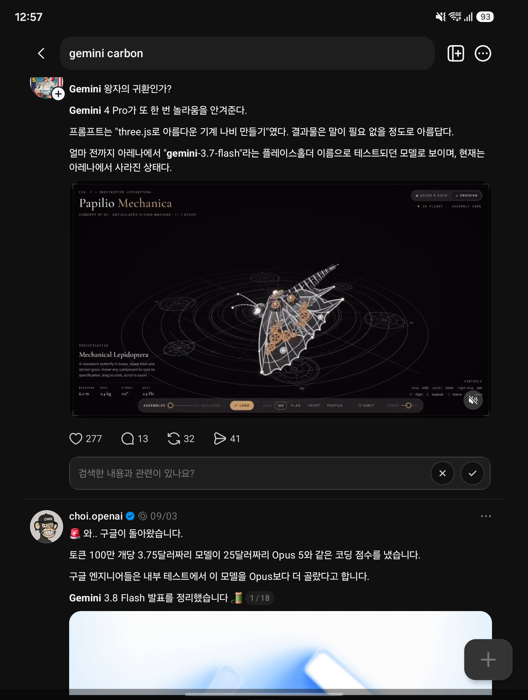

## 한눈에 보기

- 받은 캡처는 Threads에서 "gemini carbon"을 검색한 결과 화면입니다. 글 두 개가 보입니다. 하나는 "Gemini 4 Pro"가 아레나에서 가명으로 시험되고 있었다는 소문 글(작성자·날짜가 화면에 안 보임)이고, 다른 하나는 Gemini 3.8 Flash 발표를 정리한 글(choi.openai, 09/03)입니다.
- 구글 공식 글에서 "Gemini 4 Pro"라는 이름은 찾지 못했습니다. 실제로 나온 4세대 모델의 이름은 **Gemini 4 Argon**과 **Gemini 4 Carbon**입니다.
- `released`는 4세대 첫 모델인 Argon의 발표 글 날짜 2026-10-13을 기준으로 적었습니다. 모델별 날짜는 아래 표에 있습니다.

## 핵심 내용

### 공식 발표로 확인한 것

| 모델 | 날짜 | 무엇 | 가격 (100만 토큰당, 입력/출력) | 쓸 수 있는 곳 |
|---|---|---|---|---|
| Gemini 3.8 Flash | 2026-09-02 발표 | 가성비형 주력 모델. 보안용 3.8 Flash Cyber와 함께 발표 | 도입가 $0.75 / $3.75 (2026-12-31까지), 2027-01-01부터 $1.50 / $7.50 | AI Studio, Gemini API, Antigravity, Android Studio, Gemini 앱(AI Pro·Ultra) 등 |
| Gemini 4 Argon | 2026-10-13 발표 | 최신 프런티어 모델. 코딩·금융·법률·보안·과학의 복잡하고 긴 작업용 | 도입가 $2 / $10 (2026-11-30까지), 이후 $4 / $20. 캐시된 입력 95% 할인 | Gemini API·AI Studio(전 세계), Antigravity(AI Ultra), Gemini 앱·검색 AI 모드(AI Ultra·Pro) |
| Gemini 4 Carbon | 2026-10-28 발표, 2026-11-10 일반 공개 | "가장 강한 모델". 긴 호흡의 엔지니어링과 사이버 보안 방어 | Argon과 같음 | 10-28에는 일부 보안 방어자에게만(Fairwind Program). 11-10부터 유료 API·AI Studio·기업용, AI Ultra 구독자에게 순차 제공 |

- Argon: Gemini API에서 입력과 출력을 합쳐 100만 토큰 한도. 발표 글은 Vals Index 1위, ERQA 87%, Gray Swan 간접 프롬프트 주입 벤치마크 공격 성공률 0.7%를 내세웁니다.
- Carbon: 발표 글은 Artificial Analysis Intelligence Index v5.0 1위(59점), SEC-bench Pro 88.2%, ExploitGym 54.8%, CWE-bench 71.0%, WebDev Arena 4위(1768 Elo)를 내세웁니다. 외부 벤치마크는 안전장치 없이 평가했다고 적었습니다. 토큰 한도는 글에서 찾지 못했습니다.
- 위 수치는 모두 구글이 발표한 것입니다.

**캡처한 날(11-03)에는 Carbon이 아직 일반에 풀리지 않았습니다.** 일반 공개는 그 일주일 뒤인 11-10입니다.

### 캡처 속 글 ①: "Gemini 4 Pro" 소문

캡처의 주장: 프롬프트 "three.js로 아름다운 기계 나비 만들기"의 결과물(Papilio Mechanica라는 3D 화면)이 매우 뛰어났고, 얼마 전까지 아레나에서 "gemini-3.7-flash"라는 임시 이름으로 시험되던 모델로 보이며 지금은 아레나에서 사라졌다.

확인한 것:

- 2차 자료(Pasquale Pillitteri의 2026-09-27 기사)는 9월 중순부터 LMArena에서 Gemini 4 Pro로 추정되는 시험판이 목격됐다고 정리합니다. 한 제보자는 `gemini-3.7-flash`, 다른 제보자는 `gemini-3.8-flash`라는 표시로 보았다고 해서 **자료끼리 이름이 엇갈립니다.** 내부 코드명이 Argon이라는 보도도 같은 기사에 있습니다.
- 그 기사에 나오는 Three.js 예시는 F1 자동차와 비행선이고 **기계 나비는 없습니다.** 캡처 속 나비 결과물의 출처는 확인하지 못했습니다.
- 구글의 Argon 발표 글에는 아레나 사전 시험이나 "Pro"라는 이름에 대한 언급이 없습니다. 소문 속 "Gemini 4 Pro"가 Argon으로 나온 것인지는 공식적으로 확인된 바 없습니다.

### 캡처 속 글 ②: Gemini 3.8 Flash 정리 (choi.openai, 09/03)

| 캡처의 주장 | 확인 결과 |
|---|---|
| 토큰 100만 개당 3.75달러짜리 모델 | $3.75는 **출력** 가격입니다. 입력은 $0.75이고, 둘 다 2026-12-31까지의 도입가입니다 |
| 25달러짜리 Opus 5와 같은 코딩 점수 | 구글 발표 글은 경쟁사 모델 이름을 하나도 들지 않습니다. "더 큰 프런티어 모델 대부분을 앞선다"(DeepSWE v1.1)고만 하고 본문에 점수 숫자가 없습니다. 확인 못 함 |
| 구글 엔지니어들이 내부 테스트에서 Opus보다 더 골랐다 | 발표 글에서 찾지 못함. Chrome 보안팀 등의 내부 사용 사례만 나옵니다 |

글은 18장짜리 묶음의 첫 장만 캡처되어 나머지 내용은 알 수 없습니다.

## 눈여겨볼 점

- 가격표의 도입가는 기한이 있습니다. Argon·Carbon은 2026-11-30, 3.8 Flash는 2026-12-31에 끝나고 그 뒤 두 배가 됩니다.
- 3.8 Flash의 컨텍스트 100만 토큰, 최대 출력 6.4만 토큰, Terminal-bench·SWE-Bench Pro 점수는 구글 개발자 문서를 인용한 검색 요약으로만 보았고 문서를 직접 열지는 못했습니다(주소가 다른 곳으로 넘어감).
- 벤치마크 집계 사이트 llm-stats는 Carbon의 출시일을 2026-10-28로 적습니다. 이는 제한 공개일이고, 일반 공개는 11-10입니다.
- 모델 ID는 공식 글 본문에 명시되어 있지 않았습니다. AI Studio 링크에 `model=gemini-4-carbon`이 쓰인 것만 보았습니다.

## 받은 캡처

캡처 2026-11-03

## 출처

- [Introducing Gemini 4 Argon (blog.google)](https://blog.google/innovation-and-ai/models-and-research/gemini-models/introducing-gemini-4-argon/) — 발표일, 가격, 토큰 한도, 제공 범위, 벤치마크 주장
- [Introducing Gemini 4 Carbon (blog.google)](https://blog.google/innovation-and-ai/models-and-research/gemini-models/introducing-gemini-4-carbon/) — 발표일, 제한 공개 대상, 가격, 벤치마크 주장
- [Gemini 4 Carbon is now available (blog.google)](https://blog.google/innovation-and-ai/models-and-research/gemini-models/gemini-4-carbon-now-available/) — 일반 공개일(2026-11-10), 제공 범위
- [Introducing Gemini 3.8 Flash and 3.8 Flash Cyber (blog.google)](https://blog.google/innovation-and-ai/models-and-research/gemini-models/3-8-flash-and-3-8-flash-cyber/) — 발표일, 가격, 벤치마크 주장, 경쟁 모델 언급이 없다는 점
- [The latest AI news we announced in October 2026 (blog.google)](https://blog.google/innovation-and-ai/technology/ai/google-ai-updates-october-2026/) — Argon과 Carbon의 순서와 성격
- [Gemini 4 Pro leaks on Arena disguised as Gemini 3.8 Flash (Pasquale Pillitteri)](https://pasqualepillitteri.it/en/news/18784/gemini-4-pro-checkpoint-arena) — 아레나 목격 제보 정리(2차 자료), 이름이 엇갈린다는 점
- Threads 검색 화면 캡처 — 출발점. 원문 주소는 캡처에 보이지 않음
