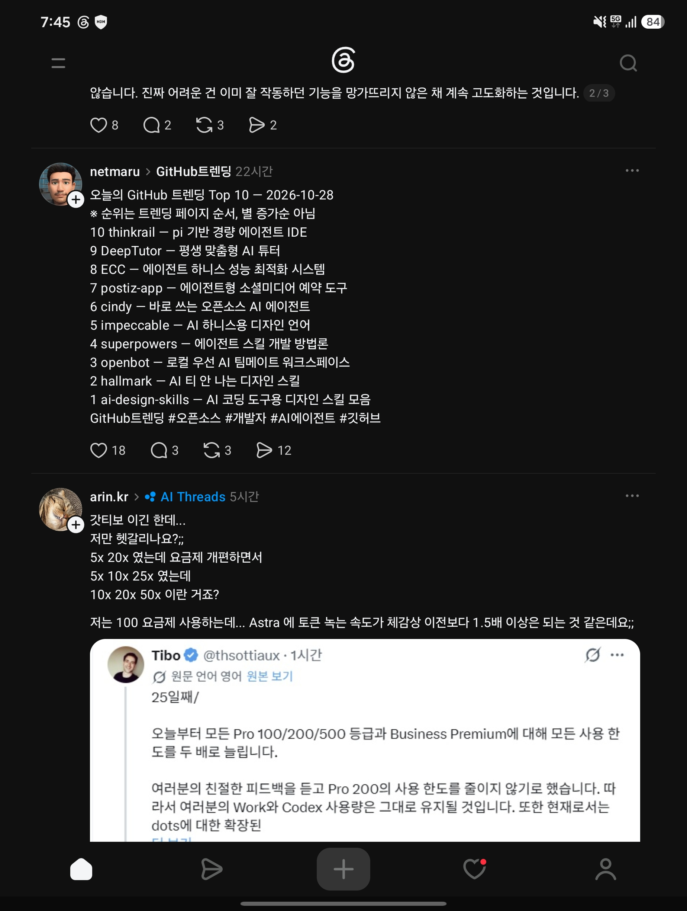

## 한눈에 보기

- Threads의 netmaru 계정이 올린 "오늘의 GitHub 트렌딩 Top 10 — 2026-10-28" 글을 캡처로 받았습니다. 글에 따르면 순위는 트렌딩 페이지에 나온 순서이고 별 증가순이 아닙니다.
- 글에는 이름과 한 줄 설명만 있어서, 각 이름을 GitHub에서 찾아 저장소를 특정하고 설명·별 수·라이선스를 확인했습니다. **그날의 트렌딩 페이지 자체는 지금 볼 수 없어 순위는 확인 못 함**(GitHub는 지난 날짜의 트렌딩을 보여 주지 않습니다).
- 어느 하루의 목록이라 "처음 나온 때"가 없으므로 공개 시기는 적지 않았습니다. 저장소별 생성일은 아래 표에 있습니다.

## 핵심 내용

별 수는 모두 2026-11-11 조회입니다. "글의 설명"은 캡처에 적힌 그대로이고, "저장소 설명"은 GitHub에 적힌 것을 옮긴 것입니다.

| 순위 | 글의 이름·설명 | 찾은 저장소 | 저장소 설명 | 별 | 생성일 | 라이선스 |
|---|---|---|---|---|---|---|
| 1 | ai-design-skills — AI 코딩 도구용 디자인 스킬 모음 | [elayadesign/ai-design-skills](https://github.com/elayadesign/ai-design-skills) | (설명 없음) | 15,244 | 2026-07-29 | MIT |
| 2 | hallmark — AI 티 안 나는 디자인 스킬 | [Nutlope/hallmark](https://github.com/Nutlope/hallmark) | Claude Code, Cursor, Codex용 "AI 티" 방지 디자인 스킬 | 52,985 | 2026-04-27 | MIT |
| 3 | openbot — 로컬 우선 AI 팀메이트 워크스페이스 | [nightly-labs/openbot](https://github.com/nightly-labs/openbot) | 계속 유지되는 AI 팀원을 위한 로컬 우선 데스크톱 작업 공간. Codex, Claude, Grok을 전용 작업 공간·작업 대기열·파일 공유·브라우저 제어와 함께 실행 | 6,958 | 2026-08-12 | 확인 못 함 (GitHub가 인식하지 못함) |
| 4 | superpowers — 에이전트 스킬 개발 방법론 | [obra/superpowers](https://github.com/obra/superpowers) | 에이전트 스킬 프레임워크이자 소프트웨어 개발 방법론 | 315,986 | 2025-10-09 | MIT |
| 5 | impeccable — AI 하니스용 디자인 언어 | [pbakaus/impeccable](https://github.com/pbakaus/impeccable) | 코딩 에이전트를 위한 디자인 어휘. polish·bolder로 방향을 잡고 critique·audit로 검토 | 107,904 | 2025-11-16 | Apache-2.0 |
| 6 | cindy — 바로 쓰는 오픈소스 AI 에이전트 | [makecindy/cindy](https://github.com/makecindy/cindy) | 설치하면 바로 쓰는 오픈소스 AI 에이전트 | 9,802 | 2026-07-22 | Apache-2.0 |
| 7 | postiz-app — 에이전트형 소셜미디어 예약 도구 | [gitroomhq/postiz-app](https://github.com/gitroomhq/postiz-app) | 에이전트형 소셜 미디어 예약 도구 | 41,336 | 2023-07-08 | AGPL-3.0 |
| 8 | ECC — 에이전트 하니스 성능 최적화 시스템 | [affaan-m/ECC](https://github.com/affaan-m/ECC) | 에이전트 하네스 성능 최적화 시스템. Claude Code, Codex, Opencode, Cursor용 스킬·본능·메모리·보안·조사 우선 개발 | 301,014 | 2026-01-18 | MIT |
| 9 | DeepTutor — 평생 맞춤형 AI 튜터 | [HKUDS/DeepTutor](https://github.com/HKUDS/DeepTutor) | 평생 맞춤형 튜터링 | 58,152 | 2025-12-28 | Apache-2.0 |
| 10 | thinkrail — pi 기반 경량 에이전트 IDE | [JetBrains/thinkrail](https://github.com/JetBrains/thinkrail) | 쓸수록 나아지는 에이전트 IDE | 8,150 | 2026-07-08 | Apache-2.0 |

### 읽을 만한 흐름

- **디자인 스킬이 셋**입니다(ai-design-skills, hallmark, impeccable). 에이전트가 만든 화면이 "AI가 만든 티"가 난다는 문제를 스킬로 고치려는 저장소가 한꺼번에 올라와 있습니다. 보관함의 [Diagram Design](diagram-design.md)도 같은 흐름입니다.
- 나머지도 에이전트 하네스·작업 공간·IDE가 대부분이고, 에이전트와 직접 관련이 덜한 것은 교육용 DeepTutor 정도입니다.
- 별 수로는 superpowers(약 31.6만)와 ECC(약 30.1만)가 압도적으로 큽니다.

## 눈여겨볼 점

- **저장소 특정은 이름 검색에 기댄 것입니다.** 특히 다음 둘은 같은 이름의 후보가 여럿입니다.
  - openbot: 글의 설명 "로컬 우선 AI 팀메이트 워크스페이스"가 nightly-labs/openbot의 설명과 맞아 그쪽으로 적었습니다. 별이 더 많은 [CopilotKit/OpenBot](https://github.com/CopilotKit/OpenBot)(10,895개, "자기 컴퓨터를 하나씩 가진 오픈소스 AI 동료")도 있습니다.
  - cindy: 글의 설명이 makecindy/cindy의 설명과 맞습니다.
- thinkrail을 글은 "pi 기반 경량 에이전트 IDE"라고 했는데, 저장소 설명에는 "pi 기반"이라는 말이 없습니다. README는 읽지 않아 확인 못 함.
- ECC는 예전 이름 `affaan-m/everything-claude-code`로 조회해도 `affaan-m/ECC`로 연결됩니다.
- 각 저장소의 README는 읽지 않았습니다. 표의 내용은 GitHub 저장소 정보(설명, 별, 생성일, 라이선스)까지만 확인한 것입니다. 쓸 만한지 판단하려면 저장소별로 따로 조사해야 합니다.
- 같은 캡처 아래쪽에는 arin.kr 계정의 글이 있습니다. Tibo(@thsottiaux)의 X 글 번역본을 붙인 것으로, "오늘부터 모든 Pro 100/200/500 등급과 Business Premium의 사용 한도를 두 배로 늘린다, Pro 200의 한도는 줄이지 않기로 했다"는 내용이 보이다가 잘립니다. 글쓴이는 요금제 배수 표기가 헷갈린다고 하고 "Astra에서 토큰이 체감상 이전보다 1.5배 이상 빨리 줄어든다"고 적었습니다. 원문과 공식 발표는 확인 못 함이라 캡처 내용만 적어 둡니다.

## 받은 캡처

캡처 2026-10-30

## 출처

- Threads 글(netmaru, "오늘의 GitHub 트렌딩 Top 10 — 2026-10-28", 캡처 2026-10-30) — 목록과 순위, 한 줄 설명. 원문 주소는 캡처에 보이지 않음
- GitHub 저장소 API(`repos/소유자/이름`) — 표의 저장소 10개와 CopilotKit/OpenBot의 설명, 별 수, 생성일, 라이선스 (2026-11-11 조회)
- GitHub 저장소 검색 API — cindy, openbot, thinkrail, ai-design-skills, hallmark의 저장소 찾기 (2026-11-11 조회)
