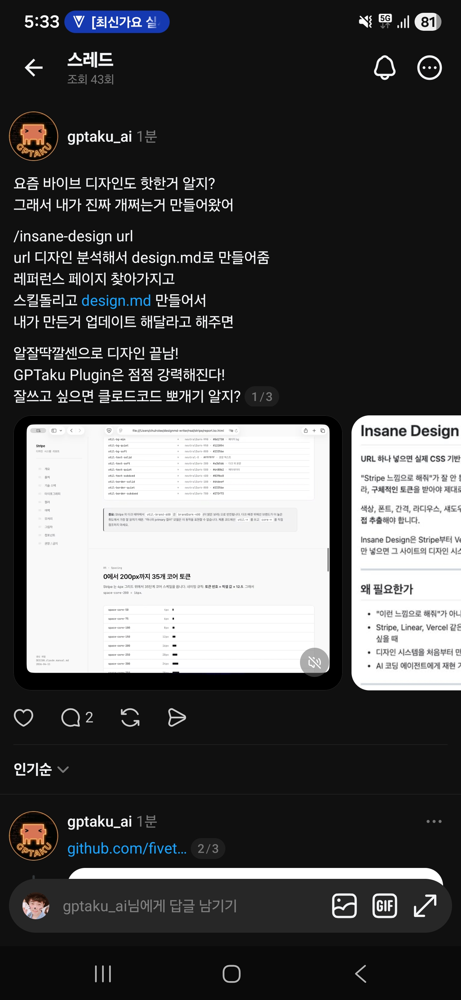

## 한눈에 보기

- "Stripe 느낌으로 해 줘" 같은 말은 AI가 제대로 따라 하지 못하니, **느낌 대신 실제 값(디자인 토큰)**을 건네주자는 도구입니다. 사이트의 CSS를 직접 내려받아 분석하고 `design.md`와 HTML 리포트를 만듭니다.
- 만든 사람은 GitHub 사용자 fivetaku(Threads 계정 gptaku_ai)이고, 같은 사람이 운영하는 플러그인 묶음 gptaku_plugins에 들어 있습니다.
- 공개 시기는 저장소 생성일인 2026-04-12를 기준으로 적었습니다. 캡처의 소개 글도 같은 날 올라온 것입니다. GitHub 릴리스 목록에서 가장 이른 것은 v0.5.1(2026-06-19), 최신은 v0.5.6(2026-10-13)입니다. 별 134개, 포크 19개 (2026-11-11 조회).


## 핵심 내용

### 동작 순서 (README)

1. 주소를 받으면 HTML과 CSS 파일을 실제로 내려받습니다.
2. CSS 변수(custom property)를 읽어 색 단계, 글자 크기 체계, 간격, 둥글기, 그림자, 글꼴 목록을 뽑습니다.
3. 화면을 캡처해 대표 색, 밝은·어두운 테마, 글꼴이 맞는지 눈으로 대조합니다. Playwright MCP가 있으면 그것을 쓰고, 없으면 curl 방식으로 대신합니다.
4. `design.md`(에이전트용)와 `report.ko.html`(사람이 보는 리포트)을 `사이트이름/` 폴더에 만듭니다.

README는 "LLM이 추측한 값이 아니라 스타일시트에서 나온 값"이라는 점을 가장 앞세웁니다.

### 명령

| 명령 | 하는 일 |
|---|---|
| `/insane-design [URL]` | 사이트 분석 → `design.md`와 HTML 리포트 생성 |
| `/insane-design [이름]` | 미리 분석된 디자인을 내 프로젝트에 적용 |
| `/insane-design:analysis [URL]` | 분석만 |
| `/insane-design:apply [이름]` | 적용만 |
| `/insane-design:build [design.md]` | `design.md`로 새 페이지·컴포넌트 뼈대 만들기 |
| `/insane-design:verify [job_id]` | 비동기 검증 결과 확인(금지 규칙 위반, 화면 비교) |

"이 사이트 디자인 분석해 줘", "Stripe 스타일 적용해 줘"처럼 말로 해도 된다고 합니다.

### design.md에 들어가는 것

빠른 시작(세 단계 CSS), 출처(주소·수집일·CSS 크기), 기술 스택, 글꼴과 글자 체계, 색(브랜드·무채색·강조·의미별), 간격·둥글기·그림자 표, 컴포넌트 클래스 패턴, 바로 붙여 넣는 `:root {}` CSS 변수, Tailwind `theme.extend` 설정, 해야 할 것과 하지 말 것.

### 적용 모드

내 프로젝트의 `globals.css`, Tailwind 설정, 일반 CSS를 찾아 토큰을 넣습니다. 기존 `:root {}`가 있으면 그 안에 덧붙이고, 다시 적용하면 `/* insane-design */` 표시가 있는 덩어리만 바꿉니다.

### 미리 분석된 사이트 100곳

Stripe, Apple, Linear, Vercel, Notion, Figma, GitHub, Discord, Slack, Spotify, 토스, 배민, 당근, 카카오, 네이버, Nike, Gucci, Chanel, Tesla, Ferrari, BMW 등. 갤러리 페이지에서 리포트를 볼 수 있습니다.

## 써 보려면

```text
/plugin marketplace add https://github.com/fivetaku/gptaku_plugins.git
/plugin install insane-design
```

설치 뒤 Claude Code를 다시 시작하고 `/insane-design https://stripe.com`처럼 실행합니다.

- 필요한 것: Claude Code, Python 3.11 이상, Pillow(`pip install Pillow`). Playwright MCP는 선택입니다.
- 라이선스는 MIT입니다.

## 눈여겨볼 점

- 캡처의 글은 "레퍼런스 페이지를 찾아 스킬을 돌려 design.md를 만들고, 내가 만든 것을 거기에 맞춰 업데이트해 달라고 하면 디자인이 끝난다"는 사용 흐름을 소개합니다. 이 흐름은 README의 분석 모드와 적용 모드에 해당합니다.
- 캡처 당시 리포트 화면에는 "0에서 200px까지 35개 코어 토큰" 같은 Stripe 분석 예가 보입니다. 지금의 리포트 모양과 같은지는 확인하지 않았습니다.
- 다른 회사 사이트의 디자인 값을 그대로 가져다 쓰는 것이므로, 상표나 브랜드 정체성을 흉내 내는 수준으로 쓰는 것은 따로 판단해야 합니다. 저장소에 `DISCLAIMER.md`가 있으나 이번 조사에서 열어 보지 않았습니다.
- 실제 설치와 결과 품질은 직접 확인하지 않았습니다. 위 내용은 저장소 README와 메타데이터를 읽은 것입니다.
- 비슷한 목적의 자료: 이미 만들어진 DESIGN.md 모음은 [Awesome DESIGN.md](awesome-design-md.md)를 보세요.

## 받은 캡처



캡처 2026-04-12

## 출처

- [fivetaku/insane-design 저장소 README](https://github.com/fivetaku/insane-design) — 동작 순서, 명령, design.md 구성, 설치 방법, 요구 사항
- [GitHub 저장소 API 정보](https://api.github.com/repos/fivetaku/insane-design) — 생성일, 별·포크 수, 릴리스 목록, 라이선스 (2026-11-11 조회)
- [갤러리](https://fivetaku.github.io/insane-design/), [gptaku_plugins](https://github.com/fivetaku/gptaku_plugins) — 주소가 열리는 것만 확인
- Threads gptaku_ai 글(캡처) — 소개 문구와 사용 흐름. 원문 주소는 캡처에 보이지 않음
