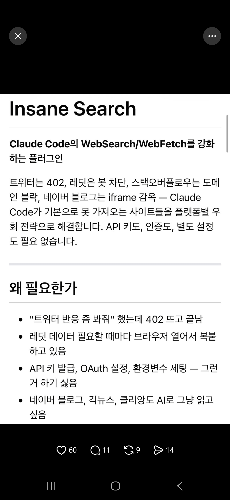
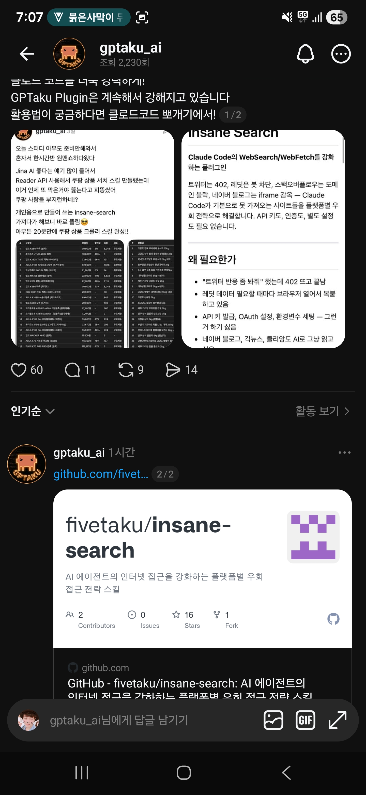

## 한눈에 보기

- Claude Code에서 "레딧 반응 좀 봐 줘"라고 했는데 가져오기가 막혀 끝나는 문제를 풀려는 플러그인입니다. 따로 외울 명령 없이, 평소처럼 부탁하면 가져오기가 막혔을 때 끼어듭니다.
- 만든 사람은 GitHub 사용자 fivetaku(Threads 계정 gptaku_ai)이고, gptaku_plugins 묶음에 들어 있습니다.
- 공개 시기는 저장소 생성일인 2026-04-07을 기준으로 적었습니다. 캡처(2026-04-12) 당시 링크 카드에는 별 16개, 포크 1개로 보였고, 지금은 별 2,687개, 포크 308개, 최신 릴리스 v0.17.6(2026-11-09)입니다 (2026-11-11 조회).


## 핵심 내용

### 단계를 올려 가며 시도 (README의 Phase 0→3)

앞 단계가 실패하거나 차단 신호가 보일 때만 다음 단계로 갑니다.

| 단계 | 하는 일 |
|---|---|
| 0 | 플랫폼별 공개 API, 피드 같은 특수한 공개 경로 |
| 1 | 가벼운 시도: 공개 API 리더, 신디케이션 게이트웨이, 모바일·`.json`·`/rss` 주소 변형 |
| 2 | TLS 흉내(curl_cffi: safari → chrome → firefox)와 브라우저처럼 보이는 요청 구성 |
| 3 | JS로 그려지는 페이지를 위한 실제 헤드리스 브라우저 |
| 종료 | 로그인이나 유료 벽이 감지되면 "authentication required"라고 알리고 멈춤 |

모든 응답에서 OGP와 JSON-LD를 함께 읽어, 페이지가 일부만 와도 제목·요약·가격을 건집니다.

### 되는 곳 (README)

X, Reddit, YouTube, Hacker News, 네이버, 쿠팡, LinkedIn, Medium, Substack, arXiv, GitHub, Stack Overflow, Bluesky, Mastodon, 그리고 공개 페이지·피드·`/rss`가 있는 사이트. 전체 목록과 방식은 저장소의 `PLATFORMS.md`에 있다고 합니다(이번에 열어 보지 않음).

- YouTube 등 미디어 페이지는 `yt-dlp`로 정보와 자막을 가져옵니다.
- X는 무료 검색 경로(Brave·Yahoo)로 찾고 결과를 검증합니다. xAI 자격 정보가 이미 있으면 `x_search`를 함께 쓰고, `INSANE_SEARCH_XAI=off`로 끌 수 있습니다.
- 필요한 도구(`curl_cffi`, `yt-dlp` 등)는 처음 쓸 때 자동으로 설치합니다.

### 선을 긋는 곳

README는 이 도구를 "인증을 뚫는 수단이 아니라 공개 콘텐츠 리더"라고 못 박습니다. 로그인하지 않고, 자격 정보를 저장하거나 보내지 않으며, 사이트 약관·`robots.txt`·요청 한도·법을 지키는 책임은 사용자에게 있다고 적혀 있습니다(`DISCLAIMER.md`).

## 써 보려면

```text
/plugin marketplace add https://github.com/fivetaku/gptaku_plugins.git
/plugin install insane-search@gptaku-plugins
/reload-plugins
```

- API 키, 가입, 프록시 설정이 필요 없다고 합니다.
- 라이선스는 MIT입니다.

## 눈여겨볼 점

- **캡처와 지금의 설명이 다릅니다.** 캡처(2026-04-12)의 README는 "Claude Code의 WebSearch/WebFetch를 강화하는 플러그인", "트위터는 402, 레딧은 봇 차단, 스택오버플로우는 도메인 블락, 네이버 블로그는 iframe 감옥", "플랫폼별 우회 전략"이라고 소개했습니다. 지금 README는 "공개 페이지 리더"와 Phase 0→3 방식, 그리고 로그인·유료 벽에서 멈춘다는 경계를 앞세웁니다.
- 캡처에는 만든 사람이 Jina Reader API로는 막히던 쿠팡 상품 검색을 insane-search로 뚫어 20분 만에 크롤러 스킬을 만들었다는 글이 함께 보입니다. 이 주장은 확인하지 못했습니다.
- TLS 흉내와 헤드리스 브라우저로 봇 차단을 넘는 방식이므로, 사이트 약관에 어긋날 수 있습니다. 회사 업무나 사내망에서 쓰기 전에 약관과 보안 규정을 먼저 확인해야 합니다.
- 처음 쓸 때 패키지를 자동으로 설치하므로, 외부 설치가 막힌 환경에서는 그대로 동작하지 않을 수 있습니다(직접 시험하지 않음).
- README 맨 위 "New in" 안내는 v0.16.3 기준인데 릴리스 목록의 최신은 v0.17.6입니다. 그 사이 바뀐 내용은 확인하지 않았습니다.
- 실제 설치와 성공률은 직접 확인하지 않았습니다.

## 받은 캡처



캡처 2026-04-12



캡처 2026-04-12

## 출처

- [fivetaku/insane-search 저장소 README](https://github.com/fivetaku/insane-search) — 단계별 방식, 지원 사이트, 경계, 설치 방법
- [GitHub 저장소 API 정보](https://api.github.com/repos/fivetaku/insane-search) — 생성일, 별·포크 수, 릴리스 목록, 라이선스 (2026-11-11 조회)
- [소개 페이지](https://fivetaku.github.io/gptaku_plugins/insane-search/) — 주소가 열리는 것만 확인
- Threads gptaku_ai 글(캡처) — 당시 README 문구, 쿠팡 사례, 당시 별·포크 수. 원문 주소는 `github.com/fivet...`까지만 보임
