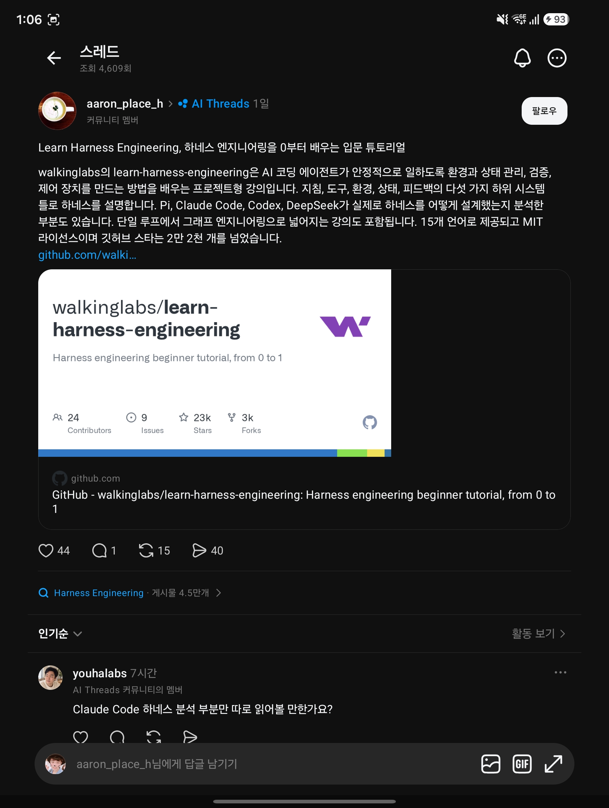

## 한눈에 보기

- "모델은 똑똑하지만, 믿고 맡길 수 있게 만드는 것은 하네스다"를 주제로 한 **프로젝트형 공개 강의**입니다. 하네스는 에이전트를 둘러싼 지침, 도구, 환경, 상태, 피드백 장치를 가리킵니다.
- 만든 곳은 GitHub 조직 walkinglabs입니다. OpenAI와 Anthropic이 공개한 하네스 관련 글들을 핵심 참고 자료로 삼았다고 밝힙니다.
- 공개 시기는 저장소 생성일 2026-03-29를 기준으로 적었습니다. 별 24,245개, 포크 2,781개, 마지막 푸시 2026-10-22(2026-11-11 조회). 캡처한 글은 "스타 2만 2천 개를 넘었다"고 했고, 글에 붙은 저장소 카드에는 23k, 기여자 24명으로 보입니다.


## 핵심 내용

### 왜 하네스인가

README가 드는 근거는 Anthropic의 실험입니다. 같은 모델(Opus 4.5)에 같은 요청("2D 레트로 게임 편집기를 만들어라")을 주었을 때, 하네스 없이는 20분·9달러를 쓰고 동작하지 않는 결과가 나왔고, 계획자·생성자·평가자로 이루어진 하네스에서는 6시간·200달러를 써서 실제로 해 볼 수 있는 게임이 나왔다고 소개합니다. (이 수치는 README가 인용한 것이고, Anthropic 원문은 이번에 대조하지 않았습니다.)

### 강의 14개

| 강의 | 질문 | 핵심 |
|---|---|---|
| L01 | 강한 모델이 왜 실제 작업에서 실패하나 | 벤치마크와 실제 개발 사이의 간격 |
| L02 | 하네스가 정확히 무엇인가 | 다섯 가지 하위 시스템 |
| L03 | 왜 저장소가 유일한 기준이어야 하나 | 에이전트가 볼 수 없으면 없는 것 |
| L04 | 왜 거대한 지침 파일 하나는 실패하나 | 백과사전이 아니라 지도를 준다(점진적 공개) |
| L05 | 긴 작업은 왜 흐름이 끊기나 | 진행 상황을 디스크에 남긴다 |
| L06 | 초기화에 왜 별도 단계가 필요한가 | 일 시작 전에 환경이 멀쩡한지 확인 |
| L07 | 에이전트는 왜 넘치게 하고 덜 끝내나 | 한 번에 기능 하나, 완료 기준 명시 |
| L08 | 기능 목록이 왜 기본 요소인가 | 기계가 읽는 범위 경계 |
| L09 | 왜 너무 일찍 끝났다고 하나 | 자신감은 정확함이 아니다 |
| L10 | 끝에서 끝까지 테스트가 왜 결과를 바꾸나 | 전체 흐름을 돌려야 진짜 검증 |
| L11 | 관측이 왜 하네스 안에 있어야 하나 | 한 일을 볼 수 없으면 고칠 수 없다 |
| L12 | 세션은 왜 깨끗한 상태로 끝나야 하나 | 다음 세션의 성공이 여기에 달림 |
| L13 | 왜 에이전트에게 프롬프트를 그만 쳐야 하나 | 루프 엔지니어링: 목표 루프, 타이머 루프, 만드는 쪽과 검사하는 쪽 분리 |
| L14 | 단일 루프는 왜 그래프로 커지나 | 그래프 엔지니어링: 노드, 엣지, 공유 상태, 라우팅 |

L13(루프)은 2026년 7월, L14(그래프)는 2026년 8월 갱신으로 추가됐다고 README에 적혀 있습니다.

### 실습 8개

같은 Electron 앱을 대상으로 단계를 밟습니다. P01 프롬프트만 준 경우와 규칙 먼저 준 경우 비교 → P02 에이전트가 읽기 좋은 작업 공간 → P03 여러 세션 이어 가기 → P04 범위 제어와 실행 피드백 → P05 스스로 검증 → P06 하네스 전체 만들기(종합) → P07 첫 자동 루프 → P08 작업 흐름을 그래프로 그리기.

### 실제 하네스 분석 (2026년 8월 추가)

강의의 틀로 네 제품을 뜯어본 글입니다.

| 대상 | README가 요약한 내용 |
|---|---|
| Pi | 최소 핵심, 프로그램으로 넓히는 확장, 컨텍스트 엔지니어링 |
| Claude Code | 4단 메모리, 5단계 압축, 훅, 하위 에이전트 격리 |
| Codex | 저장소가 기준, 목차 역할의 AGENTS.md, worktree 격리 |
| DeepSeek | "모든 것이 플러그인", 기능 이음매, 이벤트 파이프라인 |

### 바로 써먹는 구성

강의를 다 읽지 않아도 프로젝트 루트에 다음 파일을 두는 것부터 시작하라고 권합니다.

```text
AGENTS.md            에이전트의 작업 설명서 (Claude Code면 CLAUDE.md)
init.sh              설치 + 확인 + 실행
feature_list.json    어떤 기능이 있고 무엇이 끝났는지
claude-progress.md   세션 진행 기록
```

- `skills/harness-creator/` 스킬이 이 구성을 내 프로젝트에 깔아 줍니다.
- `tools/audit-harness.sh`는 기존 저장소가 다섯 하위 시스템을 갖췄는지 점검하는 셸 스크립트입니다(Node.js 불필요).

## 써 보려면

- 강의 사이트에서 바로 읽습니다. 언어는 English, 简体中文, 繁體中文, 日本語, **한국어**, Español, Français, Русский, Deutsch, العربية, Tiếng Việt, Oʻzbekcha, Türkçe, Portuguese (BR), Українська의 15개입니다.
- 저장소를 받아 `npm run pdf:build`를 실행하면 PDF 교재가 `artifacts/pdfs/`에 만들어집니다.
- 라이선스는 MIT입니다.

## 눈여겨볼 점

- "다섯 가지 하위 시스템"의 이름이 README 안에서 두 가지로 나옵니다. L02 표에는 지침·상태·검증·범위·생명주기, 8월 갱신 소개와 캡처한 글에는 지침·도구·환경·상태·피드백입니다. 어느 쪽이 최신 정리인지는 강의 본문을 봐야 알 수 있습니다. 확인 못 함.
- 캡처의 댓글에 "Claude Code 하네스 분석 부분만 따로 읽어 볼 만한가"라는 질문이 있습니다. 해당 글은 `docs/en/harness-designs/claude-code/`에 따로 있어 그것만 읽을 수 있습니다. 이번 조사에서 그 본문과 한국어 번역 품질은 읽어 보지 않았습니다.
- 공식 제품 문서가 아니라 외부에서 분석한 글이므로, Claude Code나 Codex 내부 구조에 대한 설명은 각 회사의 공식 문서와 다를 수 있습니다.
- 저장소 주제 태그에 `dsh`, `dsh-plugin`이 달려 있습니다. DeepSeek Harness와 연결된 부분이 있어 보이나 내용은 확인하지 않았습니다. 관련 문서: [deepseek-bot](deepseek-bot.md).

## 받은 캡처



캡처 2026-11-03

## 출처

- [walkinglabs/learn-harness-engineering 저장소 README](https://github.com/walkinglabs/learn-harness-engineering) — 강의·실습 목차, 갱신 내역, 하네스 분석 요약, 빠른 시작 구성, 지원 언어, 스킬과 도구
- [GitHub 저장소 API 정보](https://api.github.com/repos/walkinglabs/learn-harness-engineering) — 별·포크 수, 생성일, 마지막 푸시, 라이선스 (2026-11-11 조회)
- [강의 사이트](https://walkinglabs.github.io/learn-harness-engineering/) — 주소가 열리는 것만 확인
- Threads 글(aaron_place_h, AI Threads 커뮤니티) 캡처 — 출발점. 글 속 링크는 `github.com/walki…`까지만 보임
