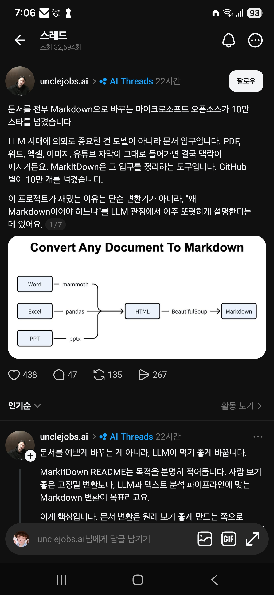

## 한눈에 보기

- 마이크로소프트가 공개한 Python 도구로, 여러 형식의 파일을 Markdown으로 바꿉니다. 문서를 LLM에 넣기 전 "입구"를 정리하는 용도입니다.
- 공개 시기는 저장소 생성일이자 PyPI 첫 배포(0.0.1a1)일인 2024-11-13을 기준으로 적었습니다. 최신 버전은 0.1.9(2026-10-21)입니다.
- 캡처(2026-04-15)의 글은 "GitHub 별이 10만 개를 넘겼다"고 했고, 지금은 별 194,890개, 포크 14,695개입니다 (2026-11-11 조회).

## 핵심 내용

### 목적: 사람용이 아니라 LLM용

README는 이렇게 밝힙니다. 제목·목록·표·링크 같은 문서 구조를 Markdown으로 살리는 데 초점을 두며, 결과가 사람이 보기에도 괜찮은 편이지만 텍스트 분석 도구가 읽으라고 만든 것이라, 사람이 볼 고정밀 변환에는 최선이 아닐 수 있다고 합니다.

왜 Markdown인가에 대한 README의 설명:

- 일반 글에 아주 가깝고 표시가 적으면서도 문서 구조를 나타낼 수 있습니다.
- 주요 LLM이 Markdown으로 된 글을 많이 학습해 잘 이해하고, 시키지 않아도 Markdown으로 답하곤 합니다.
- 토큰을 적게 씁니다.

### 바꿀 수 있는 것

PDF, PowerPoint, Word, Excel, 이미지(EXIF 정보와 설명 글), 오디오(EXIF 정보와 받아쓰기), HTML, 글 기반 형식(CSV, JSON, XML), ZIP(안의 파일을 차례로), YouTube 주소, EPub 등.

이미지 설명과 음성 받아쓰기는 웹에 있는 서비스에 의존한다고 README에 적혀 있습니다.

### 더 붙일 수 있는 것

| 기능 | 내용 |
|---|---|
| LLM 이미지 설명 | `llm_client`, `llm_model`을 주면 pptx와 이미지 파일의 그림을 설명 글로 바꿈 |
| `markitdown-ocr` 플러그인 | PDF·DOCX·PPTX·XLSX 안의 그림에서 LLM 비전으로 글자를 뽑음 |
| Azure Document Intelligence | 클라우드 레이아웃 분석(유료 호출) |
| Azure Content Understanding | 문서·이미지·오디오·비디오를 한 API로, 항목 추출까지(유료 호출) |
| 서드파티 플러그인 | 기본은 꺼져 있고 `--use-plugins`로 켬 |
| `markitdown-mcp` | MCP 서버 패키지(저장소에 포함) |

## 써 보려면

Python 3.10~3.14가 필요합니다.

```bash
pip install 'markitdown[all]'
markitdown path-to-file.pdf -o document.md
```

필요한 형식만 골라 설치할 수도 있습니다(`pip install 'markitdown[pdf, docx, pptx]'`).

```python
from markitdown import MarkItDown

md = MarkItDown(enable_plugins=False)
result = md.convert("test.xlsx")
print(result.markdown)
```

- Docker로도 실행할 수 있습니다.
- 라이선스는 MIT입니다.

## 눈여겨볼 점

- **보안 주의(README 맨 위 경고).** MarkItDown은 실행한 프로세스의 권한으로 파일과 네트워크에 접근합니다. 믿을 수 없는 입력을 그대로 넘기지 말고, `convert()` 대신 용도에 맞는 좁은 함수(`convert_local()`, `convert_stream()` 등)를 쓰라고 권합니다.
- 내장 변환기는 오프라인으로 돌지만, 이미지 설명·음성 받아쓰기·Azure 연동은 외부 서비스로 내용을 보냅니다. 사내 문서를 다룰 때는 필요한 선택 설치만 하는 것이 안전합니다.
- 캡처의 그림은 "Word는 mammoth, Excel은 pandas, PPT는 pptx로 HTML을 만든 뒤 BeautifulSoup으로 Markdown으로 바꾼다"는 흐름을 보여 줍니다. 이 내부 구조는 README에 나오지 않아 이번 조사에서 확인하지 못했습니다.
- 캡처의 댓글에는 "국내산 opendataloader-pdf가 훨씬 정교하다, IBM과 MS도 비슷한 것을 냈지만 MS 것이 제일 못하다"는 의견이 있습니다. 한 사람의 의견이고 비교 근거는 확인하지 못했습니다. [opendataloader-pdf 저장소](https://github.com/opendataloader-project/opendataloader-pdf)는 실제로 있으며 "AI용 데이터를 위한 PDF 파서"라고 소개하고, Apache-2.0 라이선스에 별 30,277개입니다 (2026-11-11 조회). 국내에서 만든 것인지는 확인하지 않았습니다.
- 한글 문서와 이미지 추출 품질을 묻는 댓글이 있었으나 답은 캡처에 없습니다. 한글(HWP) 파일은 README의 지원 목록에 없습니다.
- 직접 설치해 변환 품질을 시험하지는 않았습니다.

## 받은 캡처



캡처 2026-04-15


캡처 2026-04-15

## 출처

- [microsoft/markitdown 저장소 README](https://github.com/microsoft/markitdown) — 목적, 지원 형식, 왜 Markdown인가, 설치·사용법, 플러그인, Azure 연동, 보안 주의
- [GitHub 저장소 API 정보](https://api.github.com/repos/microsoft/markitdown) — 생성일, 별·포크 수, 릴리스 목록, 라이선스 (2026-11-11 조회)
- [PyPI markitdown](https://pypi.org/project/markitdown/) — 첫 배포일(0.0.1a1, 2024-11-13), 최신 버전(0.1.9, 2026-10-21), Python 요구 버전
- [opendataloader-project/opendataloader-pdf](https://github.com/opendataloader-project/opendataloader-pdf) — 저장소 소개 글, 라이선스, 별 수 (2026-11-11 조회)
- Threads unclejobs.ai 글과 댓글(캡처) — "10만 스타" 문구, 구조 그림, 댓글 의견. 원문 주소는 캡처에 보이지 않음
