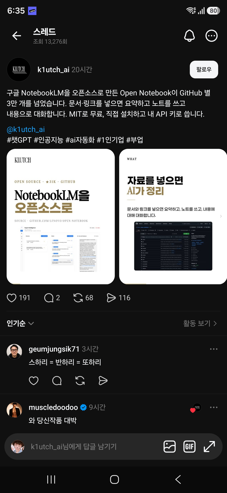

## 한눈에 보기

- 구글 **NotebookLM**을 대신할 수 있는 오픈소스 프로그램입니다. PDF, 영상, 음성, 웹 페이지, 오피스 문서를 넣으면 요약하고, 노트를 만들고, 넣은 자료를 근거로 대화합니다.
- 만든 사람은 GitHub 사용자 lfnovo입니다. 서비스에 가입하는 방식이 아니라 내 PC나 서버에 직접 설치하고, AI 모델은 내 API 키나 로컬 모델(Ollama 등)로 연결합니다.
- 공개 시기는 저장소 생성일과 첫 릴리스(`v0.0.1-alpha`)가 모두 2024-10-21이어서 그날로 적었습니다. 최신 릴리스는 `v1.15.1`(2026-11-04)입니다. GitHub 별 41,851개, 포크 4,811개 (2026-11-11 조회).


## 핵심 내용

### 주요 기능 (README 기준)

- **여러 종류의 자료**: PDF, 영상, 음성, 웹 페이지, 오피스 문서 등을 노트북별로 나눠 관리합니다.
- **모델 선택**: OpenAI, Anthropic, Google, Mistral, Ollama 등 20여 개 제공자와 OpenAI 호환 서버(LM Studio, vLLM)를 지원합니다. 제공자 연결은 같은 사람이 만든 Esperanto 라이브러리가 맡습니다.
- **검색**: 전체 글 검색과 벡터 검색을 함께 씁니다.
- **자료 기반 대화와 인용**: 답변에 어떤 자료·노트를 썼는지 출처를 붙입니다. 어떤 자료를 모델에 넘길지 사용자가 고를 수 있습니다.
- **팟캐스트 생성**: 화자 1~4명을 프로필로 정해 음성 팟캐스트를 만듭니다.
- **변환(Transformations)**: 요약, 핵심 추출 같은 처리를 기본 제공하고 직접 만들 수도 있습니다.
- **REST API**: 모든 기능을 API로 부를 수 있습니다.
- **화면 언어**: 영어, 중국어, 일본어, 프랑스어, 독일어 등. README의 화면 언어 목록에 한국어는 없습니다(README 번역본은 한국어 링크가 있음).

만든 기술: Python, Next.js, React, SurrealDB, LangChain.

### NotebookLM과 비교 (README의 비교표 요약)

| 항목 | Open Notebook | Google NotebookLM |
|---|---|---|
| 데이터 위치 | 직접 설치, 내 데이터 | 구글 클라우드 |
| AI 모델 | 20여 개 제공자, 로컬 모델 가능 | 구글 모델만 |
| 팟캐스트 화자 | 1~4명, 프로필 지정 | 2명 |
| API | REST API 제공 | 없음 |
| 비용 | AI 사용료만 | 무료 구간 + 월 구독 |

이 표는 Open Notebook 쪽이 쓴 것이므로 NotebookLM 쪽 내용은 따로 확인하지 않았습니다.

### 제공자별 지원 범위

모델 종류는 언어 모델, 임베딩, 음성 인식, 음성 합성 네 가지입니다. 제공자마다 되는 것이 다릅니다. 예를 들어 Anthropic과 Groq는 임베딩 모델이 없어서 임베딩을 제공하는 다른 제공자와 함께 써야 합니다. 언어 모델 하나와 임베딩 모델 하나는 꼭 등록해야 합니다.

## 써 보려면

필요한 것: Docker Desktop(또는 Docker Engine + Compose), 그리고 AI 제공자의 API 키나 Ollama 같은 로컬 모델 서버.

```bash
mkdir open-notebook && cd open-notebook
curl -o docker-compose.yml https://raw.githubusercontent.com/lfnovo/open-notebook/main/docker-compose.yml
# docker-compose.yml에서 OPEN_NOTEBOOK_ENCRYPTION_KEY 값을 직접 만든 긴 무작위 문자열로 바꾼 뒤
docker compose up -d
```

- 30초쯤 기다린 뒤 `http://localhost:8502`를 엽니다. 서비스는 `surrealdb`(데이터베이스)와 `open_notebook`(화면, API, 백그라운드 작업) 두 개가 뜹니다.
- API 키는 설정 파일이 아니라 화면의 Models 메뉴에서 넣습니다. 암호화 키는 저장한 API 키를 암호화하는 데 쓰이므로 잃어버리면 안 됩니다.
- API 비용 없이 쓰려면 Ollama로 로컬 모델을 붙이는 안내(`docs/0-START-HERE/quick-start-local.md`)가 있습니다.
- 라이선스는 MIT입니다.

## 눈여겨볼 점

- **기본 설정에는 비밀번호가 없습니다.** 화면(8502)과 API(5055) 포트가 모든 네트워크 인터페이스에 열리므로, 다른 기기가 접근할 수 있는 PC나 서버라면 포트를 `127.0.0.1`로 묶거나 `OPEN_NOTEBOOK_PASSWORD`를 넣으라고 README가 안내합니다. 사내망에서 띄울 때 꼭 확인할 부분입니다.
- "100% 로컬"은 로컬 모델을 붙였을 때의 이야기입니다. 외부 제공자의 API 키를 쓰면 넣은 자료가 그 제공자로 전송됩니다.
- 캡처 속 글은 "GitHub 별 3만 개를 넘었다"(이미지에는 31K)고 했고, 2026-11-11 조회로는 41,851개입니다.
- 실제 설치와 요약·팟캐스트 품질은 직접 확인하지 않았습니다. 위 내용은 저장소 README와 메타데이터를 읽은 것입니다.

## 받은 캡처



캡처 2026-06-19

## 출처

- [lfnovo/open-notebook 저장소 README](https://github.com/lfnovo/open-notebook) — 기능, 비교표, 설치 방법, 지원 제공자, 보안 안내
- [GitHub 저장소 API 정보](https://api.github.com/repos/lfnovo/open-notebook) — 별·포크 수, 생성일, 라이선스, 첫 릴리스와 최신 릴리스 날짜 (2026-11-11 조회)
- [open-notebook.ai](https://www.open-notebook.ai) — 주소가 열리는 것만 확인
- Threads 글(k1utch_ai) — 받은 캡처. 원문 주소는 캡처에 보이지 않음
