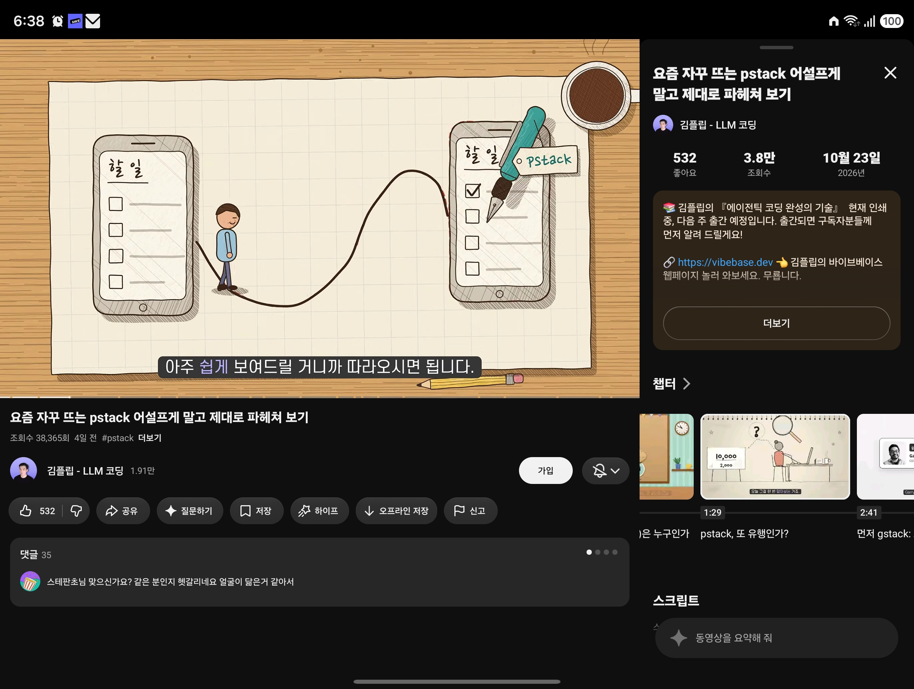
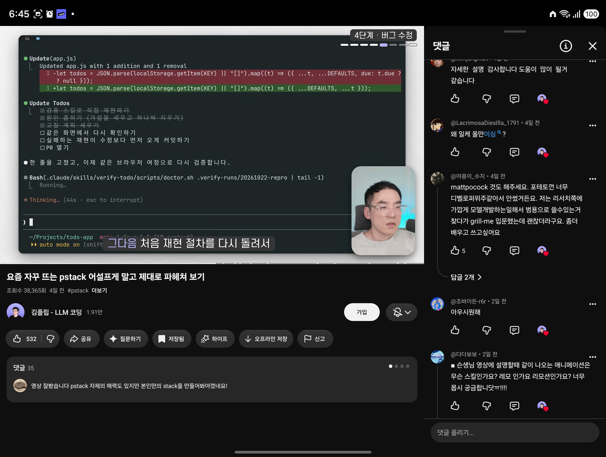

## 한눈에 보기

- **pstack**은 Cursor 공식 플러그인 저장소(`cursor/plugins`) 안에 있는 스킬 묶음입니다. 만든 사람은 poteto(플러그인 정보의 이름은 Lauren Tan)이고, README에서 Meta·Netflix·Cursor에서 일했고 React 코어 팀에서 React Compiler를 만든다고 소개합니다.
- 목표는 코드 양을 늘리는 것이 아니라 반대입니다. "빨리 가려면 먼저 깊이 가라", "덜 쓰되 품질 높은 코드"가 구호입니다. 에이전트 하나를 믿을 수 있어야 여러 개를 동시에 돌릴 수 있다는 생각입니다.
- 공개 시기는 `cursor/plugins`에 pstack 폴더가 처음 들어간 커밋("Add pstack plugin") 날짜인 2026-05-23을 기준으로 적었습니다. 2026-11-11 조회 기준 플러그인 버전은 0.15.36, pstack 폴더를 건드린 커밋은 169개입니다. `cursor/plugins` 저장소 전체의 별은 16,004개인데, 이는 pstack만의 수치가 아닙니다.

## 핵심 내용

### `/poteto-mode` 하나로 시작

작업을 시작할 때 `/poteto-mode`를 붙이면 다음을 합니다.

1. 요청을 읽고 **플레이북** 하나에 맞춘 뒤, 그 단계들을 그대로 옮긴 할 일 목록을 엽니다.
2. 단계가 필요로 할 때 다른 스킬을 부릅니다.
3. 답은 군더더기를 뺀 글로 씁니다.

README의 예:

```text
/poteto-mode this pr has a subtle bug where the scroll drifts every 750ms even when idle. repro
first, then fix and verify.
```

### 플레이북 23개 (일부)

| 플레이북 | 쓰는 때 |
|---|---|
| investigation | 읽기만 하는 질문. 어떻게 동작하나, 왜 이렇게 만들었나 |
| bug fix | 결함을 재현하고, 근본 원인을 찾고, 실행 증거와 함께 고침 |
| perf | 측정된 느림을 기준값과 비교해 개선 |
| hillclimb | 지표 하나를 목표까지, 가설 → 전후 측정 → 채택된 개선마다 커밋 하나 |
| feature | 이름 붙인 데이터 모양에서 출발해 새 동작을 만듦 |
| refactoring | 동작은 그대로 두고 구조만 바꿈 |
| prototype | 버릴 스케치로 설계 결정을 싸게 내림 |
| visual parity | 두 구현의 화면을 픽셀 단위로 맞춤 |
| eval | 스킬·프롬프트 변경이 에이전트 행동에 주는 영향을 가리고 시험 |
| babysit, shipping | PR을 병합 가능 상태로 끌고 가서 검증 후 넣음 |
| autonomous run, orchestrate | 멈추지 않고 긴 작업을 끝냄, 여러 날짜리 일을 조정자 하나가 맡음 |
| opening a pr | 작은 커밋들로 PR을 엶. 다른 모든 플레이북의 마지막 단계 |

그 밖에 runtime forensics, trace forensics, authoring a skill, autopilot-full, autopilot-stack, session pickup, pause safely, multi-phase plan, worktree cleanup이 있습니다.

### 따로 부를 수 있는 스킬 (일부)

| 스킬 | 하는 일 |
|---|---|
| `/how`, `/why` | 하위 시스템이 어떻게 동작하는지, 왜 그렇게 만들어졌는지 조사 |
| `/architect` | 함수 경계를 넘는 코드를 쓰기 전에 호출 모양·타입·모듈 구조를 먼저 정함 |
| `/arena` | 같은 일을 여러 번 병렬로 시도하게 하고 좋은 부분을 고름 |
| `/swarm` | 서로 다른 조각에 작업자를 나눠 보내고 보고 하나로 모음 |
| `/interrogate` | 다른 모델들에게 변경분을 깨 보게 하고, 실행으로 증명된 지적만 남김 |
| `/tdd` | 실패하는 테스트를 먼저 쓰고 고침 |
| `/blast-radius` | 작아 보이는 변경이 무엇을 깨뜨릴 수 있는지 확인 |
| `/reflect`, `/correct` | 끝난 작업의 요령을 스킬로 남김, 반복되는 실수를 구조(타입·린트·CI)로 막음 |
| `/automate-me` | 내 작업 기록을 읽어 나만의 `<이름>-mode` 스킬 초안을 만듦 |
| `/setup-pstack` | 역할별로 쓸 모델을 고름 |

### 원칙 24개

원칙 하나가 짧은 스킬 하나입니다. 묶음별 예는 다음과 같습니다.

- **core**: 지우는 쪽과 가장 작은 변경을 택한다(laziness-protocol), 자료 구조를 먼저 바로잡는다(foundational-thinking), 더하기 전에 뺀다, 경쟁 시안 2~3개를 만들어 비교한다.
- **architecture**: 가드는 시스템 경계에 모은다, 잘못된 상태를 타입으로 표현할 수 없게 한다, 연산을 멱등하게 만든다.
- **verification**: 컴파일된다가 아니라 실제 결과물로 확인한다(prove-it-works), 증상이 아니라 처음 잘못된 곳을 고친다(fix-root-causes), 측정한 숫자를 믿기 전에 무엇이 그 숫자를 제한하는지 설명한다.
- **delegation**: 큰 덩어리는 하위 에이전트에 보내고 주 대화에는 요약만 둔다, 사람을 기다리며 멈추지 않는다(되돌릴 수 없는 행동만 확인받음).
- **meta**: 교훈을 글이 아니라 린트·검사·스크립트로 남긴다.

### 계획 스킬이 없는 이유

README에 따르면 만든 사람은 계획을 믿지 않고 "가장 좋은 명세는 코드"라고 생각합니다. Cursor의 plan 모드와 함께 쓸 수는 있습니다.

## 써 보려면

Cursor:

```text
/add-plugin pstack
```

Claude Code:

```text
/plugin marketplace add cursor/plugins
/plugin install pstack@cursor-plugins
```

- 설치 후 `/setup-pstack`으로 모델을 고르고, 엄밀함이 필요한 일에 `/poteto-mode`를 씁니다. 모르겠으면 `/poteto-help`에 묻습니다.
- Claude Code에서는 명령에 접두어가 붙어 `/pstack:poteto-mode`가 됩니다. bugbot·automations처럼 Cursor에만 있는 기능이 필요한 단계는 한 줄 안내와 함께 건너뜁니다. 외부 마켓플레이스는 자동 업데이트가 꺼져 있어 직접 켜거나 `claude plugin update pstack@cursor-plugins`로 올립니다.
- 기본 모델 배분은 코드 작업을 grok에, 가장 어려운 변경·글·판단을 opus 5.5에 맡기는 것이고 `/setup-pstack`에서 바꿀 수 있습니다.
- 라이선스는 MIT입니다(플러그인 정보와 README 기준. `cursor/plugins` 저장소 전체에는 GitHub가 인식한 라이선스가 없습니다).

### 다른 에이전트용 파생 저장소

| 저장소 | 성격 | 별 (2026-11-11 조회) |
|---|---|---|
| [michael-denyer/pstack-claude](https://github.com/michael-denyer/pstack-claude) | Claude Code, Codex, Pi, Copilot 등으로 옮긴 포트. Cursor 용어를 설치 전에 미리 바꿔 둠 | 4,226 |
| [backnotprop/pstack](https://github.com/backnotprop/pstack) | 원본을 그대로 따라가는 미러. `npx skills add backnotprop/pstack`으로 설치 | 3,963 |

둘 다 2026-05 말에 만들어졌고 MIT입니다. 공식 빌드는 아닙니다.

## 눈여겨볼 점

- `poteto-mode`는 만든 사람의 방식이라고 스스로 말합니다. 그대로 쓰기보다 `/automate-me`로 자기 방식의 모드를 만들라고 권합니다. 캡처의 영상 댓글에도 "본인만의 stack을 만들어야겠다"는 반응이 보입니다.
- `/deslop`, `control-cli`, `control-ui`는 pstack에 들어 있지 않고 `cursor-team-kit` 플러그인에 있습니다.
- 여러 모델을 섞어 쓰는 스킬(`/arena`, `/interrogate` 등)이 많아, 모델을 하나만 쓸 수 있는 환경에서 얼마나 효과가 있는지는 확인 못 함. 토큰 사용량도 확인 못 함.
- 캡처는 김플립 채널의 해설 영상(2026-10-23 게시, 캡처 시점 조회수 약 3.8만)입니다. 영상 내용은 보지 않았고, 화면에 보이는 것만 확인했습니다: 할 일 앱의 버그를 고치는 "4단계 · 버그 수정" 시연에서 에이전트가 재현 → 원인 좁히기 → 수정 계획 → 같은 화면에서 다시 확인 → 실패하는 재현을 수정보다 먼저 커밋 → PR 열기 순서의 할 일 목록을 따르는 장면입니다. 이는 README의 bug fix 플레이북 설명("재현하고, 근본 원인을 찾고, 실행 증거와 함께 고침")과 맞습니다.
- 영상 챕터에 "먼저 gstack"으로 시작하는 제목이 보입니다. gstack이 무엇이고 pstack과 어떤 관계인지는 이번에 조사하지 않았습니다.
- 캡처 댓글에 언급된 mattpocock의 스킬과 `grill-me`는 조사하지 않았습니다.
- 실제 설치와 효과는 직접 확인하지 않았습니다.

## 받은 캡처



캡처 2026-10-28



캡처 2026-10-28

## 출처

- [cursor/plugins의 pstack README](https://github.com/cursor/plugins/tree/main/pstack) — 소개, 설치, 플레이북 23개, 스킬 목록, 원칙 24개, 빠진 것, 라이선스
- pstack 폴더의 `plugin.json` — 버전 0.15.36, 만든 사람 이름, 라이선스 (2026-11-11 조회)
- GitHub 커밋 API(`cursor/plugins`, `path=pstack`) — 첫 커밋 2026-05-23 "Add pstack plugin", 커밋 수 (2026-11-11 조회)
- [michael-denyer/pstack-claude](https://github.com/michael-denyer/pstack-claude), [backnotprop/pstack](https://github.com/backnotprop/pstack) — README 앞부분과 저장소 정보로 원본과의 관계, 별 수 확인 (2026-11-11 조회)
- YouTube 영상 "요즘 자꾸 뜨는 pstack 어설프게 말고 제대로 파헤쳐 보기"(김플립 - LLM 코딩, 2026-10-23 게시, 캡처 2026-10-28) — 처음 알게 된 곳. 영상 주소는 캡처에 보이지 않음
