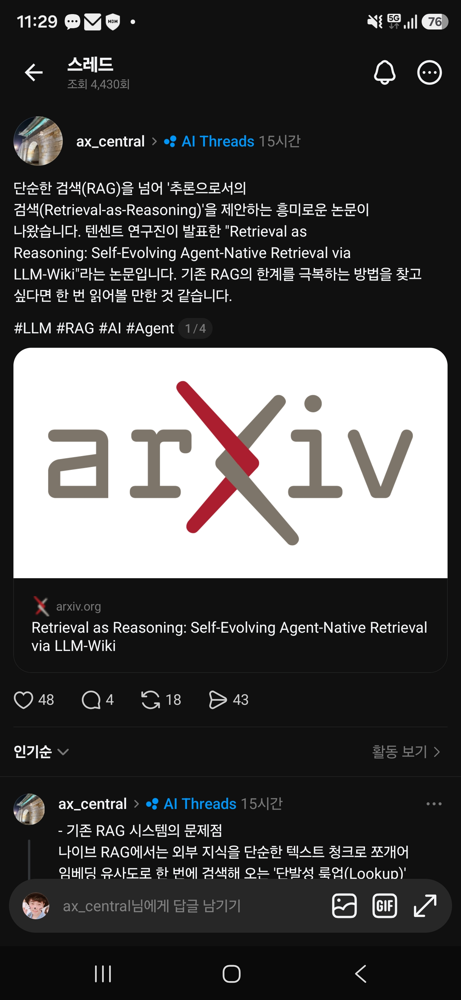
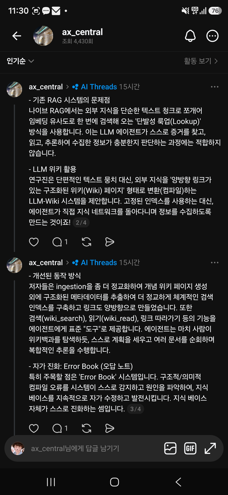

## 한눈에 보기

- 논문 제목은 "Retrieval as Reasoning: Self-Evolving Agent-Native Retrieval via LLM-Wiki"(arXiv:2605.25480, cs.CL)입니다. 글쓴이는 Haoliang Ming, Feifei Li, Xiaoqing Wu, Wenhui Que이고, 검색 결과에는 텐센트 위챗 소속으로 나옵니다(arXiv 초록 페이지에는 소속이 표시되지 않음).
- 공개 시기는 arXiv 첫 제출일(v1) 2026-05-25로 적었습니다. 현재 판은 v2(2026-05-26)입니다. 15쪽, 그림 3개, 표 10개.
- 공개 저장소 없음. 논문 페이지에서 코드 저장소 링크를 찾지 못했습니다.

## 핵심 내용

### 문제의식: "한 번 찾아오기"와 "추론하며 찾기"

보통의 RAG는 문서를 글 조각으로 쪼개고 임베딩 유사도로 한 번에 몇 개를 골라 옵니다. 논문은 이것을 "조회로서의 검색(retrieval-as-lookup)"이라 부릅니다. 에이전트는 찾고, 읽고, 링크를 따라가고, 근거가 충분한지 판단하는 과정을 되풀이해야 하는데 이 방식은 거기에 맞지 않는다는 주장입니다.

### LLM-Wiki의 구조

- 원문을 LLM이 **위키 페이지로 "컴파일"** 합니다. 원문 한 단락마다 관련된 기존 페이지를 고르고(최대 5개), 페이지·링크·색인을 갱신합니다.
- 폴더 구조: `wiki/` 아래에 전체 `index.md`와 폴더별 `_index.md`가 있고, 주제별 폴더에 지식 페이지가 들어갑니다. 따로 `sources/`에 원문 요약과 전문을 두어 출처를 추적합니다.
- 페이지 형식: YAML 머리말(종류, 만든·고친 시각, 별칭, 태그), 한 줄 요약, 핵심 사실, 관련 페이지, 관련 출처. 페이지끼리는 **양방향 링크**로 이어집니다.
- 규모 예: 2WikiMultiHopQA용 위키는 지식 페이지 5,825개(폴더 6개), 출처 페이지 6,840개.

### 에이전트에게 주는 도구

| 도구 | 하는 일 |
|---|---|
| `wiki_search(query)` | 페이지 이름, 별칭, 태그, 설명을 본문보다 먼저 찾아 후보 페이지를 돌려줍니다. |
| `wiki_read(paths)` | 색인 파일이나 페이지 전체를 여러 개 한꺼번에 읽습니다. 페이지 안의 링크도 함께 보입니다. |

에이전트는 이 도구들을 표준 도구 호출로 쓰며, 링크를 따라 여러 페이지를 돌아다닙니다. 도구 호출은 질문당 최대 15번이고, 검색이 세 번 연속 비면 멈춥니다.

### Error Book (오답 노트)

LLM이 만든 위키에는 오류가 생깁니다. 논문은 오류를 일곱 가지로 나눕니다. 구조 오류는 끊어진 링크, 덜 채워진 페이지, 잘못된 참조, 보지 않고 덮어쓰기, 색인 불일치이고, 내용 오류는 근거 없는 사실, 페이지 간 모순입니다. 발견된 오류 가운데 끊어진 링크가 29.1~63.8%로 가장 많았습니다.

오류는 다섯 단계로 다룹니다.

1. 발견: 검사 코드와 LLM 확인으로 오류를 찾습니다.
2. 원인 찾기: 오류마다 뿌리 원인을 추적합니다.
3. 규칙 만들기: 원인을 자연어 규칙으로 적습니다.
4. 주입: 열려 있는 규칙을 컴파일 프롬프트에 넣어 같은 실수를 막습니다.
5. 확인 후 닫기: 다시 검사해 오류가 안 나오면 항목을 닫습니다.

기록은 `error_book.yaml`에 쌓입니다. 고치기는 두 층으로, 코드 자동 수정은 묶음마다, LLM 수정은 주기적으로 돕니다.

### 실험 결과 (논문 표 1, F1 / EM)

| 방법 | HotpotQA | MuSiQue | 2WikiMHQA |
|---|---|---|---|
| RAG (임베딩) | 0.764 / 0.642 | 0.611 / 0.500 | 0.815 / 0.724 |
| GraphRAG | 0.771 / 0.650 | 0.582 / 0.482 | 0.720 / 0.648 |
| HippoRAG 2 | 0.805 / 0.668 | 0.624 / 0.514 | 0.831 / 0.706 |
| LightRAG | 0.819 / 0.682 | 0.659 / 0.550 | 0.847 / 0.764 |
| **LLM-Wiki** | **0.839 / 0.710** | **0.739 / 0.634** | **0.911 / 0.854** |

- 가장 강한 비교 대상(LightRAG)보다 F1이 2.0~8.1점 높다고 합니다. 비교 대상은 모두 일곱 가지입니다(검색 없음, BM25, 임베딩, RAPTOR, GraphRAG, LightRAG, HippoRAG 2).
- **AuthTrace**: 논문이 새로 만든 진단용 벤치마크입니다. 현대 중국 산문 작가 다섯 명의 글 860편에 대한 질문 2,099개로, 답에 필요한 문서 수에 따라 나눕니다. 전체 정확도는 LLM-Wiki 70.4, HippoRAG 2 68.3입니다. 문서 4개 이상이 필요한 질문에서는 55.4 대 46.5로 차이가 크지만, **문서 하나로 답하는 질문에서는 HippoRAG 2가 78.3으로 LLM-Wiki(76.0)보다 높습니다.**
- 요소 빼기 실험(F1 하락폭): 단계적 탐색을 빼면 11.7~13.8점, 위키 구조를 빼면 6.1~7.0점, Error Book을 빼면 3.4~4.0점 떨어집니다.
- 질문당 걸린 시간은 14.9~27.1초로 임베딩 RAG(15.6~26.9초)와 비슷하고 LightRAG(39.7~51.3초)보다 짧았습니다.
- 쓴 모델: 답변과 위키 컴파일에 GLM-5.1, 임베딩에 Qwen3-Embedding-8B, AuthTrace 채점에 GPT-4o-mini.

## 써 보려면

공개된 코드가 없어 바로 설치해 쓸 수는 없습니다. 다만 구성이 단순해서(마크다운 위키 + 검색·읽기 도구 두 개 + 오류 기록 파일) 생각을 빌려 오기는 쉽습니다. 이 보관함의 `INDEX.md`와 `docs/` 구조도 "AI가 색인을 먼저 읽고 문서를 찾아 들어가는" 같은 계열의 방식입니다.

## 눈여겨볼 점

- **위키를 만드는 비용이 큽니다.** 원문 단락마다 LLM을 여러 번 부릅니다. 논문은 이후 질문들에 나눠 부담된다고만 하고 금액은 밝히지 않았습니다.
- **규모 한계**: 페이지가 수만 개가 되면 폴더 색인이 다루기 어려워지고 페이지 고르기가 나빠질 수 있다고 논문이 스스로 밝혔습니다. 웹 규모나 자주 바뀌는 자료에는 추가 설계가 필요하다고 합니다.
- 실험은 각 데이터셋의 앞 500문항과 그 문항에 딸린 단락만 모은 작은 말뭉치에서 했습니다. 위키백과 전체에서 찾는 설정이 아닙니다.
- 캡처 속 글의 설명(양방향 링크 위키, `wiki_search`·`wiki_read` 도구, Error Book)은 논문 내용과 맞습니다. 캡처에는 4개 중 3번째 글까지만 보입니다.
- 수치는 arXiv HTML 판을 자동 요약 도구로 읽은 것이어서, 인용할 때는 원문 표를 다시 확인하는 것이 좋습니다. 그림 3은 열어 보지 못했습니다.

## 받은 캡처

캡처 2026-08-07

캡처 2026-08-07

## 출처

- [arXiv:2605.25480 초록 페이지](https://arxiv.org/abs/2605.25480) — 제목, 글쓴이, 제출일과 판 이력, 분량, 초록
- [arXiv HTML 판](https://arxiv.org/html/2605.25480) — 구조, 도구, Error Book, 실험 표, 한계 (2026-11-11 조회)
- Threads 글(ax_central) — 받은 캡처. 원문 주소는 캡처에 보이지 않음
