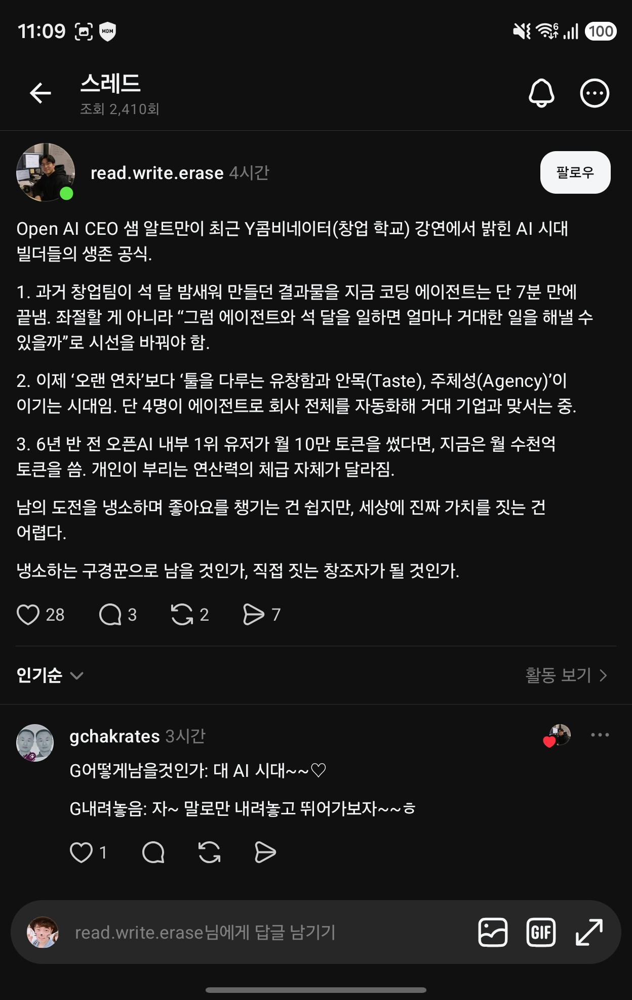

## 한눈에 보기

- OpenAI CEO 샘 알트만이 Y Combinator 행사에서 한 대담입니다. YC 팟캐스트에 "Sam Altman: Never a Better Time to Do a Startup"이라는 제목으로 올라왔습니다.
- 날짜는 팟캐스트 공개일 2026-07-28을 기준으로 적었습니다. 알트만이 끝에 "startup school 2026"을 언급합니다. 행사가 7월 25~26일 샌프란시스코에서 열렸다는 것은 2차 자료 한 곳에서만 보았습니다.
- 아래 내용은 **제3자 사이트의 녹취록**을 읽어 확인한 것입니다. 영상을 직접 보지는 않았고, 녹취록에는 숫자가 흐트러진 곳이 있습니다. YC 공식 글은 찾지 못했습니다.

## 핵심 내용

캡처한 Threads 글의 세 가지 요약을 녹취록과 대조했습니다.

| 캡처의 요약 | 녹취록에서 확인한 것 |
|---|---|
| 창업팀이 석 달 밤새워 만들던 것을 코딩 에이전트가 7분에 끝낸다. 좌절할 게 아니라 "에이전트와 석 달을 일하면 얼마나 큰 일을 할 수 있을까"로 봐야 한다 | 2005년 무렵 YC 회사들이 약 석 달 걸려 만들던 것을 지금은 코딩 에이전트가 "7분쯤"에 할 수 있다고 말합니다. "Codex 프롬프트 하나가 스타트업 하나"라고 슬퍼할 것이 아니라 가장 야심 찬 회사를 시작할 수 있다고 생각하라는 취지입니다. 녹취록의 다른 곳에는 "17초", "17분"으로도 적혀 있어 정확한 숫자는 불분명합니다 |
| 오랜 연차보다 툴을 다루는 유창함, 안목(taste), 주체성(agency)이 이기는 시대. 4명이 에이전트로 회사 전체를 자동화해 거대 기업과 맞서는 중 | 안목, 주체성, 사업 기본기에 대한 이해가 여전히 중요하다고 하고, 이 변화가 "오랜 경력"보다 "도구에 유창한 사람"에게 유리하게 작용할 것이라고 말합니다. "4명"은 AI와 함께 자란 사람들이 "에이전트로 된 스타트업 전체를 자동화하고, 우리 넷과 이 연산 자원"이라고 말하는 **가정의 장면**으로 나옵니다. 특정 회사 사례는 녹취록에 없습니다 |
| 6년 반 전 OpenAI 내부 1위 사용자가 월 10만 토큰을 썼는데 지금은 월 수천억 토큰 | 약 6년 반 전 최상위 사용자가 월 약 10만 토큰을 썼고 당시에는 터무니없어 보였다고 합니다. 지금 OpenAI 최상위 사용자는 "수천억" 단위라고 합니다. 토큰은 "가장 멍청한 지표지만 가진 게 이것"이라고 덧붙이고, 6년 반 뒤에는 최상위 사용자가 월 천조(quadrillion) 토큰에 이를 수 있다고 내다봅니다 |

### 그 밖에 녹취록에 있는 것

- 창업자를 향해 Twitter에서 비난을 던지는 일은 "영혼을 오염시킨다"며, 에너지를 전부 만드는 데 쓰라고 말합니다. 캡처한 글의 마지막 두 문단("냉소하는 구경꾼으로 남을 것인가, 직접 짓는 창조자가 될 것인가")은 이 대목을 글쓴이가 자기 말로 옮긴 것으로 보입니다.
- 2차 자료 한 곳은 "7분" 비교가 통제된 측정이 아니라 수사적인 표현이라고 짚었습니다.

## 눈여겨볼 점

- "7분", "수천억 토큰"은 알트만이 무대에서 한 말이고 측정 결과나 공식 통계가 아닙니다.
- 캡처한 글은 "Y콤비네이터 강연"이라고만 했고 행사 이름과 날짜는 없습니다. 내용이 일치해 이 대담으로 판단했습니다.
- 캡처한 글의 "단 4명이 회사 전체를 자동화해 거대 기업과 맞서는 중"은 녹취록보다 단정적인 표현입니다.
- 링크의 YouTube 주소는 요약 사이트들이 이 대담의 영상으로 가리킨 주소이고, 주소가 열리는 것만 확인했습니다.

## 받은 캡처

캡처 2026-11-03

## 출처

- [Sam Altman: "Never a Better Time to Do a Startup" 녹취 (podscripts)](https://podscripts.co/podcasts/y-combinator-startup-podcast/sam-altman-never-a-better-time-to-do-a-startup) — 팟캐스트 날짜, 7분·안목·4명·토큰·비난에 대한 발언
- [Podscan 에피소드 페이지](https://podscan.fm/e/ep_yq2ajqvlne4lxmzw) — 에피소드 날짜 2026-07-28 (검색 결과 요약으로만 확인)
- [João Queiros 블로그 정리](https://www.ai.joaoqueiros.com/blog/sam-altman-startup-school-2026-ai-founder-playbook) — 행사 일정, "수사적 비교"라는 지적 (검색 결과 요약으로만 확인)
- Threads 글(read.write.erase) 캡처 — 출발점. 원문 주소는 캡처에 보이지 않음
