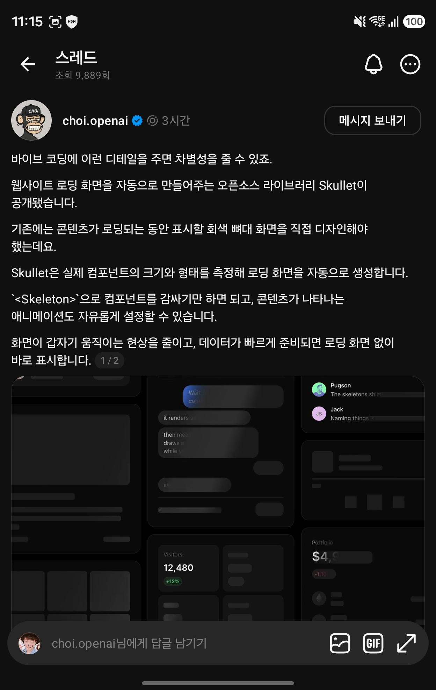

## 한눈에 보기

- 웹 화면에서 데이터가 로딩되는 동안 보여 주는 **스켈레톤(회색 뼈대) 화면을 자동으로 만들어 주는** 라이브러리입니다. React, Vue, Svelte, 순수 JavaScript, 웹 컴포넌트에서 씁니다.
- 만든 사람은 GitHub 사용자 lochie입니다(README에 Twitter 계정 lochieaxon). 같은 사람의 torph, easing.dev, web haptics가 README에 함께 소개됩니다.
- 공개 시기는 저장소 생성일 2026-10-19를 기준으로 적었습니다. npm 첫 등록은 2026-10-26, 최신 버전은 0.0.3(2026-10-31)입니다. 별 904개, 포크 20개(2026-11-11 조회).

## 핵심 내용

### 동작 방식

데이터가 왔을 때 그릴 내용을 `<Skeleton>`으로 감쌉니다. 로딩 중에는 그 내용을 **보이지 않게 배치해 크기를 재고**, 그 위에 뼈대를 그립니다. 글자 한 줄마다 막대, 이미지·컨트롤·버튼마다 블록이 생깁니다. 뼈대가 실제 내용과 정확히 같은 자리를 차지하므로 데이터가 도착해도 화면이 밀리지 않습니다.

```tsx
import { Skeleton } from "skullet/react";

<Skeleton data={user} sample={SAMPLE_USER}>
  {(user) => <Card user={user} />}
</Skeleton>;
```

`data`가 비어 있는 동안 로딩 상태이고, `sample`(견본 데이터)로 첫 뼈대를 그립니다. `loading` 값으로 직접 켜고 끌 수도 있습니다.

### 뼈대 모양을 어디서 가져오나 (우선순위)

1. 화면에 이미 있는 데이터(`loading`을 강제로 켠 경우)
2. 같은 `id`로 마지막에 보여 준 데이터
3. 이전 방문 때 기억해 둔 모양
4. 넘겨준 `sample`
5. 데이터 없이 그린 자식 요소
6. 일반적인 몇 줄(개발 모드에서 경고)

기억해 둔 모양은 배치만 남기고 내용은 남기지 않습니다(글자는 채움 글자로 바꾸고, 미디어 주소와 입력값은 버림). 로그아웃 때 `forgetShapes()`로 지울 수 있습니다.

### 내용이 나타나는 방식 (`reveal`)

| 값 | 동작 |
|---|---|
| `together` | 뼈대와 내용을 통째로 교차 전환 |
| `sequence` | 위에서 아래로 조각마다 제자리에서 등장 |
| `sweep` | 반짝임과 같은 기울기의 대각선을 따라 등장 |
| `smart` (기본) | 상황마다 고름. **150ms 안에 끝난 로딩은 뼈대를 아예 보여 주지 않음**, 다시 불러올 때는 빠른 교차 전환, 작은 것은 통째로, 그 밖에는 순서대로 |

직접 `RevealSpec`을 넘겨 순서·등장 효과·타이밍을 정할 수도 있습니다.

### 그 밖의 기능

- **꾸미기**: 밝은/어두운 색, 애니메이션(`shimmer`, `group-shimmer`, `pulse`, `none`), 속도, 모서리 둥글기. 모두 `--skullet-*` CSS 변수라서 CSS만으로도 바꿀 수 있습니다. 화면 전체의 뼈대가 한 흐름으로 반짝입니다.
- **글자 막대 높이**: 글꼴을 재서 `ascender`·`cap-height`·`x-height`부터 `baseline`·`descender`까지 중에서 고릅니다.
- **Suspense**: React·Vue용 `SkeletonSuspense`.
- **서버 렌더링**: 작은 인라인 스크립트가 첫 화면 그리기 전에 뼈대를 재서, 내용이 잠깐 비치거나 하이드레이션 때 바뀌는 일이 없다고 합니다. CSP용 `nonce`를 줄 수 있습니다.
- **접근성**: 로딩 중 `aria-busy`, 뼈대는 스크린 리더에서 숨김, `prefers-reduced-motion`이면 움직임 정지.
- **디버그**: `debug` 또는 주소에 `?skullet-debug`를 붙이면 뼈대가 어디서 왔는지, 내용이 도착했을 때 무엇이 밀렸는지 표시합니다.

## 써 보려면

```shell
pnpm i skullet
```

- 가져오는 경로: `skullet/react`, `skullet/vue`, `skullet/svelte`, 순수 JS는 `skullet`(`Reveal`), 웹 컴포넌트는 `skullet/element`(`<skullet-reveal>`).
- React 19에서는 스타일이 자동으로 들어가고, 그 밖에는 `import "skullet/styles.css"`를 한 번 넣습니다.
- 라이선스는 MIT입니다.

## 눈여겨볼 점

- 버전이 0.0.3으로 아주 초기입니다. API가 바뀔 수 있습니다.
- 이미지에는 크기(`width`·`height` 또는 `aspect-ratio`)를 줘야 합니다. 로딩된 뒤에야 크기가 정해지는 이미지는 그때 화면을 밉니다.
- 데이터로 그리는 내용에 `sample`이 없으면 뼈대가 부정확해집니다. 개발 모드에서 붙여 넣을 견본을 로그로 만들어 줍니다.
- jsdom·happy-dom 테스트에서는 배치가 없어 모든 전환이 즉시 끝납니다. 로딩 중 견본 글자가 `aria-hidden` 뼈대 안에 있으므로 글자가 아니라 role로 찾으라고 안내합니다.
- 캡처한 글의 설명(실제 컴포넌트 크기를 재서 자동 생성, `<Skeleton>`으로 감싸기, 등장 애니메이션 설정, 빠른 데이터는 뼈대 없이 표시)은 패키지 문서와 일치합니다.
- 직접 설치해 써 보지는 않았습니다. 다른 사람이 만든 Flutter·Phoenix LiveView 이식판이 검색에 보였습니다(이름만 확인).

## 받은 캡처



캡처 2026-11-03

## 출처

- [lochie/skullet 저장소 README](https://github.com/lochie/skullet) — 한 줄 설명, 설치, 기본 사용법
- [packages/skullet/README.md](https://github.com/lochie/skullet/blob/main/packages/skullet/README.md) — 프레임워크별 사용법, 속성 표, 테마, reveal 방식, 모양 우선순위, 서버 렌더링
- [skullet.lochie.me](https://skullet.lochie.me) — 공식 사이트, 버전 v0.0.3 표기
- [GitHub 저장소 API 정보](https://api.github.com/repos/lochie/skullet) — 별·포크 수, 생성일, 라이선스 (2026-11-11 조회)
- [npm 레지스트리 정보](https://registry.npmjs.org/skullet) — 첫 등록일, 최신 버전과 날짜 (2026-11-11 조회)
- Threads 글(choi.openai) 캡처 — 출발점. 원문 주소는 캡처에 보이지 않음
