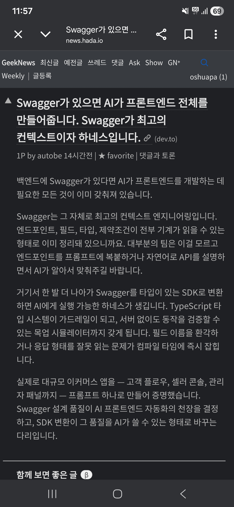

## 한눈에 보기

- Nestia와 typia를 만든 남정호(GitHub samchon)가 dev.to에 쓴 글입니다. 제목은 "[Nestia] Do you have Swagger? AI can build your entire frontend. Swagger is the best context and harness."이고, 캡처는 이 글을 소개한 GeekNews(news.hada.io) 게시물입니다.
- 주장은 한 줄입니다. **Swagger → SDK → 프런트엔드 한 번에.** Swagger를 문서로만 보지 말고, AI가 실행하고 스스로 제약받고 시험할 수 있는 SDK로 바꾸라는 것입니다.
- 공개 시기는 dev.to 글 게시일인 2026-04-15(04-16 수정)를 기준으로 적었습니다. 글쓴이가 자기 도구를 소개하는 글이고, 독립된 검증은 없습니다.


## 핵심 내용

### SDK가 AI에게 주는 세 가지

| | Swagger를 그대로 줄 때 | SDK로 바꿔 줄 때 (글의 주장) |
|---|---|---|
| 맥락 | 엔드포인트를 프롬프트에 붙이거나 말로 설명 | 백엔드의 DTO 타입과 JSDoc 주석이 SDK에 그대로 실려, 필드·제약·업무 규칙을 따로 설명할 필요가 없음 |
| 제약 | 틀린 필드 이름이 실행 중 400/422로 드러남 | TypeScript 컴파일러가 틀린 필드 이름과 응답 모양을 컴파일할 때 바로 잡음 |
| 검증 | 서버를 띄워야 시험 가능 | SDK에 든 목업 시뮬레이터로 서버 없이 시험. `typia.assert()`로 입력을 검사하고 `typia.random()`으로 모양이 맞는 가짜 응답을 돌려줌 |

### 작업 흐름

1. 주석과 타입이 잘 달린 백엔드에서 시작합니다.
2. SDK를 만듭니다. NestJS면 Nestia로 백엔드 코드에서 바로 만들고, 다른 언어·프레임워크면 `swagger.json`을 Nestia Editor에 올려 만듭니다.
3. SDK와 `CLAUDE.md` 프롬프트 하나를 AI에게 줍니다.
4. AI가 SDK를 읽고 → 코드를 쓰고 → 목업 시뮬레이터로 확인하고 → 컴파일 검사를 하는 고리를 돕니다.
5. Playwright로 그려진 화면을 AI가 직접 보고 UI를 고칩니다.

### 데모

쇼핑몰 백엔드의 Swagger를 SDK로 바꾼 뒤 Claude에게 SDK와 `CLAUDE.md` 하나를 주어, 고객 화면·판매자 콘솔·관리자 패널을 한 번에 만들었다고 합니다. 글에는 홈, 상품 상세, 주문, 지갑, 판매자 콘솔, 관리자 콘솔 등 화면 8장이 실려 있습니다.

### Swagger 품질이 천장

모호한 필드 이름, 빠진 설명, 타입 없는 `object`는 SDK에도 그대로 넘어가고, AI는 그 빈칸을 추측으로 채웁니다. 데모 백엔드는 모든 필드에 업무 의미를 JSDoc으로 적었습니다(예: 주문은 "아직 확정되지 않은 주문 신청"이고 결제해야 완료된다는 설명). 글은 백엔드 설계 품질이 프런트엔드 자동화의 입력이 되었다고 결론짓습니다.

## 써 보려면

데모를 직접 돌려 보는 방법(원문):

```bash
git clone https://github.com/samchon/shopping
cd shopping
pnpm install
pnpm start
```

GitHub Codespaces로 열 수도 있다고 합니다. 내 프로젝트에 적용하려면 `swagger.json`을 Nestia Editor에 올려 SDK를 받고, 데모의 `packages/frontend/CLAUDE.md`를 참고해 프롬프트를 씁니다.

- samchon/nestia: MIT, 별 2,182개. samchon/typia: MIT, 별 5,965개. samchon/shopping: MIT, 별 4개, 2026-04-14 생성 (모두 2026-11-11 조회).

## 눈여겨볼 점

- 글쓴이도 "일부 시각적 선택은 여전히 AI가 만든 티가 난다"고 인정합니다. "한 번에"라는 주장은 흐름과 업무 로직이 동작한다는 뜻이고, 다듬어진 UI를 뜻하지 않습니다.
- 목업 시뮬레이터는 모양이 맞는 무작위 값을 돌려주므로, 입력 형식과 응답 모양은 확인해도 실제 업무 동작은 확인하지 못합니다.
- 시간 절감, 코드 양, 오류 수 같은 수치는 글에 없습니다. 중간에 사람이 고친 부분이 있었는지도 글에 나오지 않습니다.
- SDK 생성기가 TypeScript용이므로, 이 방식은 TypeScript 프런트엔드를 전제로 합니다.
- 글이 다음 단계로 소개한 AutoBe 저장소(`github.com/wrtnlabs/autobe`)는 오늘 GitHub API로 조회했을 때 찾을 수 없다고 나왔습니다 (2026-11-11 조회). 옮겨졌는지 여부는 확인하지 못했습니다.
- 캡처의 GeekNews 게시물 주소는 찾지 못했습니다(사이트가 자동 접속을 막음). 캡처의 요약문은 dev.to 원문 내용과 일치합니다.
- 데모를 직접 실행해 보지는 않았습니다.

## 받은 캡처



캡처 2026-04-17

## 출처

- [dev.to 원문](https://dev.to/samchon/nestia-well-designed-backend-fully-automated-frontend-development-45d9) — 주장, 작업 흐름, 비교표, 데모, 한계
- [dev.to 글 API](https://dev.to/api/articles/samchon/nestia-well-designed-backend-fully-automated-frontend-development-45d9) — 게시일(2026-04-15), 수정일(2026-04-16)
- [samchon/shopping](https://github.com/samchon/shopping), [samchon/nestia](https://github.com/samchon/nestia), [samchon/typia](https://github.com/samchon/typia) — 저장소 정보, 별 수, 라이선스 (2026-11-11 조회)
- [Nestia Editor 문서](https://nestia.io/docs/swagger/editor) — 주소가 열리는 것만 확인
- GeekNews 게시물(캡처) — 한국어 요약. 게시물 주소는 캡처에 보이지 않음
