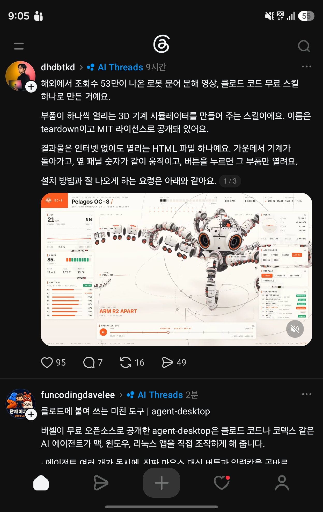

## 한눈에 보기

- Claude Code에 설치하는 스킬입니다. 기계 이름을 말하면 **오프라인 HTML 한 장**을 만듭니다. 가운데에서 기계가 돌아가고, 둘레 패널에 실제 수치가 같이 움직이고, 버튼을 누르면 일하는 부품이 열리고, 아무도 건드리지 않으면 화면이 스스로 둘러봅니다.
- 만든 곳은 GitHub 계정 elvarofficial입니다.
- 공개 시기는 저장소 생성일인 2026-10-30을 기준으로 적었습니다. 2026-11-11 조회 기준 별 3,063개, 포크 461개, 커밋 2개, 마지막 커밋 2026-10-31입니다. 릴리스는 없습니다.


## 핵심 내용

### 결과물

- three.js와 글꼴까지 안에 넣은 HTML 파일 하나입니다. 인터넷 없이 열립니다.
- 예시 기계 세 가지가 들어 있습니다: V8 엔진, 세스나 비행기, 스트란트비스트(바람으로 걷는 구조물). README 그림에는 로봇 벌, 로봇 전갈, 로봇 문어도 나옵니다.
- 영상도 만듭니다. 화면을 프레임 단위로 찍어 60fps mp4로 만들거나, 검토용 정지 화면 묶음으로 뽑습니다.
- 효과음은 영상 시간표에 맞춰 절차적으로 만들고 −14 LUFS로 맞춥니다.

### 저장소 구성 (README 표)

| 파일 | 역할 |
|---|---|
| `SKILL.md` | Claude가 읽는 문서. 기계를 짓는 법, 보기 좋게 만드는 규칙, 검토 반복 절차 |
| `sims/kit/` | 실행 코드, 무대, 셰이더 예열 |
| `sims/v8-*`, `sims/cessna-*`, `sims/strandbeest-*` | 완성된 기계 세 가지. `-shared`는 기계 자체, `-live`는 직접 조작하는 화면, `-film`은 녹화된 둘러보기 |
| `sims/build.mjs` | 기계를 HTML 한 파일로 묶음 |
| `sims/capture.mjs` | 영상 또는 검토용 정지 화면 생성 |
| `sfx/`, `run_sfx.py` | 효과음 |

### 요청 예시 (README)

- "분해할 수 있는 4행정 오토바이 엔진 시뮬레이터를 만들어 줘."
- "기계식 시계는 어떻게 시간을 맞춰? 시뮬레이터로 보여 줘."
- "유압 굴착기 팔의 분해도를 만들고 20초짜리 영상으로 녹화해 줘."

## 써 보려면

```bash
npx skills add elvarofficial/teardown -g -a claude-code
```

설치된 폴더에서 한 번:

```bash
npm install && npx playwright install chromium
```

- 필요한 것: Node.js 20 이상. 영상에는 `ffmpeg`, 소리에는 Python 3이 필요합니다.
- 예시를 먼저 열어 보려면 `node sims/build.mjs v8-live`를 실행합니다(결과는 `teardown-out/dist/v8-live.html`). `cessna-live`, `strandbeest-live`도 같습니다.
- 라이선스는 MIT입니다.

## 눈여겨볼 점

- 실행 코드, 프레임 캡처, 소리 엔진, 검토 규칙은 [whaleyxbt/claude-motion](https://github.com/whaleyxbt/claude-motion)(MIT)에서 왔다고 README가 밝힙니다. 녹음 샘플은 Freesound의 CC0 자료입니다.
- 캡처 속 글의 "해외에서 조회수 53만이 나온 로봇 문어 분해 영상"은 확인 못 함. 글에 있던 "설치 방법과 잘 나오게 하는 요령"(2/3, 3/3쪽)은 캡처에 없습니다.
- 캡처의 "MIT 라이선스", "인터넷 없이 열리는 HTML 파일 하나", "버튼을 누르면 그 부품만 열린다"는 README와 맞습니다.
- 나온 지 얼마 안 됐고 커밋이 2개뿐입니다. Playwright용 Chromium을 내려받아야 하므로 사내망에서는 설치가 막힐 수 있습니다.
- 실제 설치와 결과 품질은 직접 확인하지 않았습니다.

## 받은 캡처



캡처 2026-11-01. 같은 캡처 아래쪽 글은 [agent-desktop](agent-desktop.md) 문서로 따로 정리했습니다.

## 출처

- [elvarofficial/teardown README](https://github.com/elvarofficial/teardown) — 기능, 설치, 구성, 출처 표기, 라이선스
- [GitHub 저장소 API 정보](https://api.github.com/repos/elvarofficial/teardown) — 생성일, 별·포크 수, 커밋 수, 마지막 커밋 (2026-11-11 조회)
- Threads 글(dhdbtkd, 캡처 2026-11-01) — 처음 알게 된 곳. 원문 주소는 캡처에 보이지 않음
