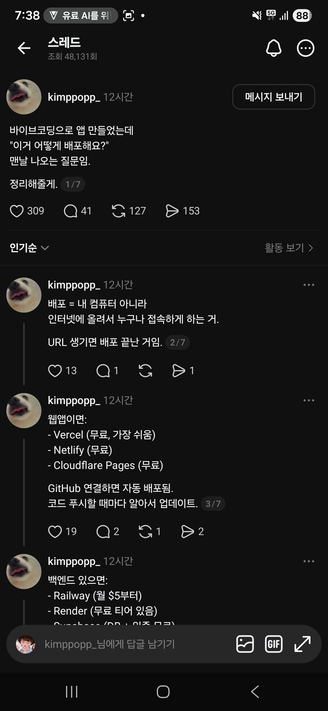

## 한눈에 보기

- Threads 사용자 kimppopp_가 쓴 7개짜리 연결 글 가운데 앞의 네 개가 캡처에 담겼습니다. 5~7번째 글은 캡처에 없습니다.
- **캡처 내용을 정리한 문서입니다.** 요금은 Vercel과 Railway만 공식 요금 페이지에서 확인했고, 나머지는 1차 자료를 확인하지 못했습니다.
- 특정 기술의 발표가 아니라 요령을 모은 글이라 공개 시기는 적지 않았습니다(글은 캡처 시점 기준 12시간 전에 올라옴).

## 핵심 내용

### 배포란 (캡처 2/7)

내 컴퓨터가 아니라 인터넷에 올려 누구나 접속하게 하는 것. 주소(URL)가 생기면 배포가 끝난 것입니다.

### 웹앱이면 (캡처 3/7)

| 서비스 | 캡처의 설명 |
|---|---|
| Vercel | 무료, 가장 쉬움 |
| Netlify | 무료 |
| Cloudflare Pages | 무료 |

GitHub에 연결하면 자동으로 배포되고, 코드를 푸시할 때마다 알아서 갱신됩니다.

### 백엔드가 있으면 (캡처 4/7, 일부만 보임)

| 서비스 | 캡처의 설명 |
|---|---|
| Railway | 월 $5부터 |
| Render | 무료 티어 있음 |
| Supabase | 화면 아래에서 잘려 "DB + 인증, 무료"로 보이나 글자가 반쯤 가려져 확실하지 않음 |

## 공식 요금 페이지와 대조 (2026-11-11 조회)

- **Vercel**: Hobby $0, Pro 월 $20, Enterprise 별도. 요금 페이지의 FAQ에 Hobby는 "개인용, 비상업적 사용"을 위한 것이라고 적혀 있습니다. 캡처의 "무료"는 맞지만, 돈을 받는 서비스에는 Hobby를 쓸 수 없다는 조건이 붙습니다.
- **Railway**: 무료 체험(한 번 주는 $5 크레딧, 30일), Free(매달 $1 사용 크레딧), Hobby 월 $5(매달 $5 사용 크레딧 포함, 넘으면 추가 청구), Pro 월 $20. 캡처의 "월 $5부터"는 Hobby 요금과 맞고, 지금은 그 아래에 Free 단계가 보입니다.
- **Render**: 요금 페이지에서 정적 사이트는 무료라는 문구만 읽혔고, 웹 서비스와 데이터베이스의 무료 조건은 확인하지 못했습니다.
- **Netlify, Cloudflare Pages, Supabase**: 요금 페이지를 확인하지 않았습니다.

## 눈여겨볼 점

- 요금제는 자주 바뀝니다. 캡처(2026-04-16)의 설명과 오늘 조회한 내용은 시점이 다르니, 쓰기 전에 요금 페이지를 다시 확인해야 합니다.
- 캡처의 글은 처음 배포하는 사람을 위한 큰 그림이고, 환경 변수, 도메인 연결, 데이터베이스 이전 같은 세부는 다루지 않습니다(보이는 범위 기준).
- 이 서비스들은 모두 외부 클라우드입니다. 회사 코드나 사내 데이터를 다루는 앱은 사내 배포 규정을 따라야 합니다.

## 받은 캡처

캡처 2026-04-16

## 출처

- Threads kimppopp_ 글(캡처) — 배포 뜻, 웹앱용·백엔드용 서비스 목록. 원문 주소는 캡처에 보이지 않음
- [Vercel 요금 페이지](https://vercel.com/pricing) — 요금제 이름과 가격, Hobby의 비상업적 사용 조건 (2026-11-11 조회)
- [Railway 요금 페이지](https://railway.com/pricing) — 요금제 이름과 가격, 포함 크레딧 (2026-11-11 조회)
- [Render 요금 페이지](https://render.com/pricing) — 정적 사이트 무료 문구만 확인 (2026-11-11 조회)
